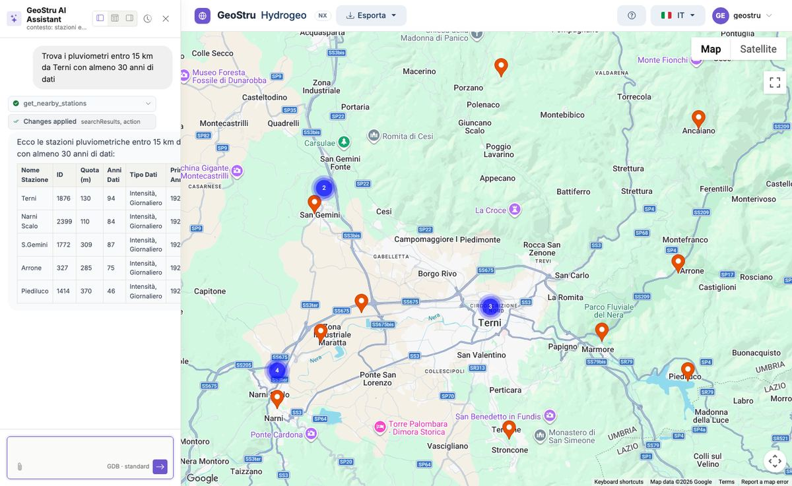
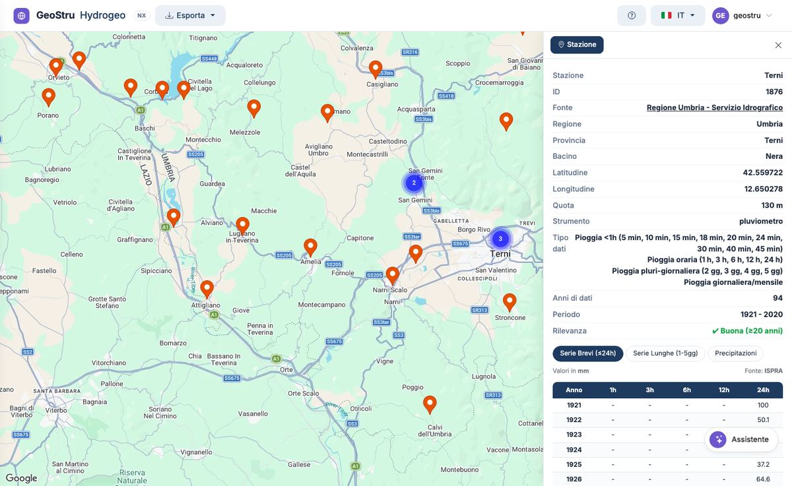
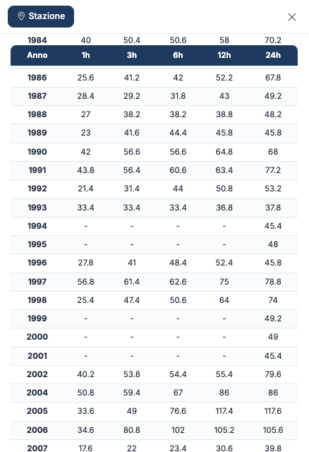

# Guida rapida — la prima tabella in 5 minuti

In cinque minuti trovi una stazione vera, ne leggi la scheda e i massimi annui di pioggia.

## 1. Apri l'app

Vai su [nx.geostru.ai/hydrogeo](https://nx.geostru.ai/hydrogeo/) e accedi con il tuo
account GeoStru NX. Nella barra in alto trovi **Esporta**, il pulsante **?** dell'aiuto, la
lingua e il menu utente; in basso a destra il pulsante **Assistente**.

La mappa si apre **vuota**: le stazioni compaiono quando le cerchi.

## 2. Cerca le stazioni

Apri l'**Assistente** e scrivi che cosa ti serve, per esempio:

```text
Trova i pluviometri entro 15 km da Terni con almeno 30 anni di dati
```

L'assistente interroga il database, mette le stazioni sulla mappa e le elenca in una tabella
con nome, quota, anni di dati e tipo di dati.



Puoi anche partire da una delle **azioni rapide** dell'assistente, come «Trova stazioni in
Calabria». Altri esempi in [Assistente AI](assistente.md).

## 3. Apri la scheda

Fai clic su un segnaposto arancione. Il segnaposto diventa verde e a destra si apre la
**scheda della stazione**: fonte, regione, provincia, bacino, coordinate, quota,
strumento, tipi di dati, anni di dati, periodo e **rilevanza**.



Guarda la **rilevanza**: «Buona (≥20 anni)» indica una serie abbastanza lunga per
un'analisi statistica.

## 4. Sblocca i dati

In fondo alla scheda premi **Sblocca dati**. Lo sblocco usa crediti e include la prima
tabella; i dettagli sono in [Accesso e crediti](crediti.md).

## 5. Leggi i massimi annui

Si apre la tabella **Serie Brevi (≤24h)**: per ogni anno l'altezza di pioggia massima in
1, 3, 6, 12 e 24 ore, in millimetri. Con **Serie Lunghe (1-5gg)** e **Precipitazioni** vedi
le altre due tabelle.



## Prossimi passi

- **Esporta** la stazione: menu **Esporta** → CSV, Excel, PDF Report o PLV GeoStru. Vedi
  [Esportazioni e formati](formati.md).
- **Fai la statistica** in Runoff Lab NX: **Importa → Da Hydrogeo NX…**. Vedi
  [Collegamenti con le altre app NX](integrazioni.md).
- **Parti dal sito del progetto** con Atlante NX: vedi [Il lavoro completo](workflow.md).

---

*Hai trovato un errore in questa pagina? [Segnalacelo](mailto:info@geostru.ai?subject=Help%20Hydrogeo%20NX) o apri una [Pull Request](https://github.com/EngSoft-Geostru/geostru-help-nx/edit/main/hydrogeo/docs/it/quickstart.md).*
