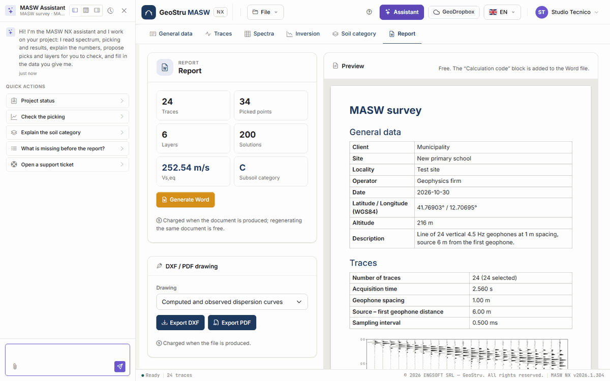

# AI assistant

The **Assistant** button, in the top bar, opens a chat next to the project. The assistant
reads the project, the spectrum and the results, and can write into the project for you: you
ask, it acts, the page updates.

Each message you send uses NX credits, charged only if the reply arrives. See
[Credits](relazione.md#credits).

Above each reply, a label says what the assistant did on the project: for example "Reading
the spectrum…" or "Proposing layers…".

## What it can do

**Read and explain**

- reads general data, acquisition, spectrum parameters, picking by mode, layers and number of
  solutions;
- summarises the **spectrum**: apparent curve, regression, Nyquist frequency, longest
  wavelength and indicative investigation depth;
- reads the inversion **solutions** and the **results** (V~s,eq~, H, category, parameters by
  layer) and explains them;
- checks the picking: missing stretches, points off the ridge, doubts about the mode;
- explains the method, the formulas and the limits of the survey.

**Write into the project**

- fills in the **general data**;
- sets the **spectrum parameters** and computes the map (free);
- runs **automatic picking** on the ridges, or writes into the picking the points you dictate
  or that it reads from an attached file;
- writes the **initial model** of the inversion, or **proposes layers** from the picking and
  **estimates the initial V~s~**;
- **chooses the solution** on which category and report are computed;
- sets **foundation depth** and **standard**.

When it writes, the numbers it reports back are read again from the calculation: it does not
work them out in its head.

## What it does not do

- **It does not run the inversion.** The only way to run it, and pay for it, is the **Run
  inversion** button: the assistant prepares the model and tells you when to press it.
- **It does not delete anything**: you remove traces, points and layers yourself.
- **It does not replace the picking or the layers you already have** unless you ask
  explicitly ("redo the automatic picking", "replace the layers").
- **It does not load traces or generate the report, DXF or PDF**: those are your actions.
- **It does not invent data**: only the points you give it or that it reads from one of your
  documents go into the picking.

## How to use it

Type the request in the box at the bottom and send. When it first opens you also find the
**Quick actions**: **Project status**, **Check the picking**, **Explain the soil category**,
**What is missing before the report?**, **Open a support ticket**.

Requests that work well are concrete:

- "Compute the spectrum between 2 and 60 Hz and run automatic picking"
- "Is the picking reasonable? Are there stretches that could be a higher mode?"
- "Propose the layers, eight including the half-space"
- "How deep does the survey reach with this picking?"
- "Choose solution 3 and tell me how Vs,eq changes"
- "Foundation at 2 m, NTC 2018: which category comes out and why?"

If the request is ambiguous, it asks before writing.

### Attaching a file

With the **paper clip** you attach a file, for example a dispersion curve exported from
another program or a test report. If it contains frequency – phase velocity pairs, the
assistant writes them into the picking (mode 0 if the file does not say) and summarises what
it wrote; if it finds client, site, location or date, it fills in the general data. Always
check the written picking on the map.

### While it works

While the assistant writes into the project the page is locked, and a strip says so: *"The
assistant is working on the project: the page becomes editable again as soon as it has
finished"*.

Before sending the message the app saves the tab you have on screen; when the work is done
the page updates with the modified project.

In one reply the assistant can carry out a limited number of operations: if it reaches the
limit it says so, what it did is in the project, and you write to it to continue.

### The panel

At the top of the panel: three buttons to dock it left, bottom or right, the history button
to resume or clear the conversation, and the close button.

## It is an artificial intelligence system

!!! warning "Check what it writes"
    The assistant's replies are generated by an artificial intelligence system and may
    contain errors. What it writes into the project is a **proposal**: picking, layers and
    choices must be checked. The processing is yours, and you sign it.

In particular: automatic picking must be reviewed on the map, mode by mode; proposed layers
are a starting point for the inversion, not a geological interpretation; a curve read from a
file must be compared with the original.

## Support tickets

The **Open a support ticket** quick action opens a support request from the same chat. While
the ticket is open, messages go to support, not to the project assistant, and use no
credits.

---

*Found an error on this page? [Let us know](mailto:info@geostru.ai?subject=Help%20MASW%20NX) or open a [Pull Request](https://github.com/EngSoft-Geostru/geostru-help-nx/edit/main/masw/docs/en/assistente.md).*
