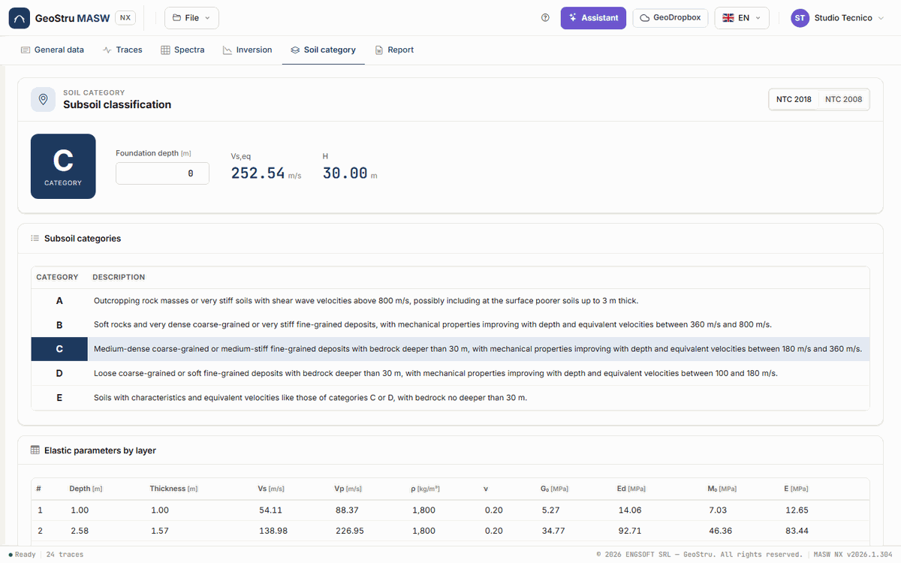
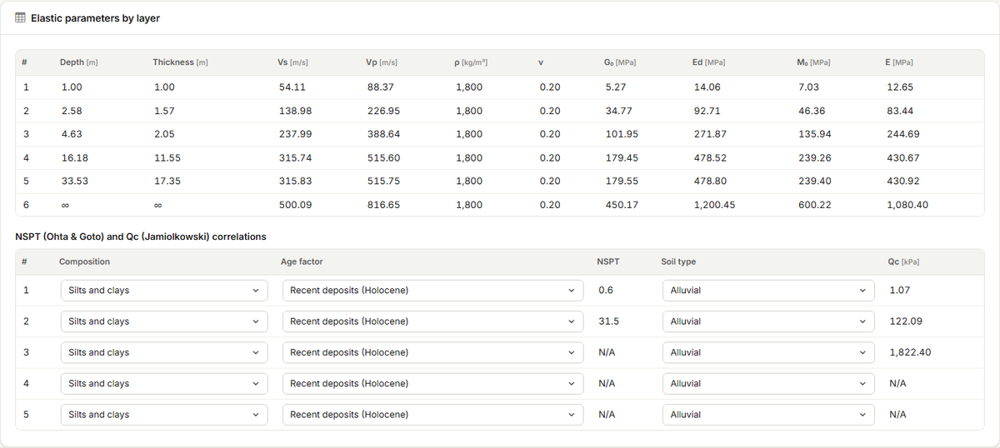
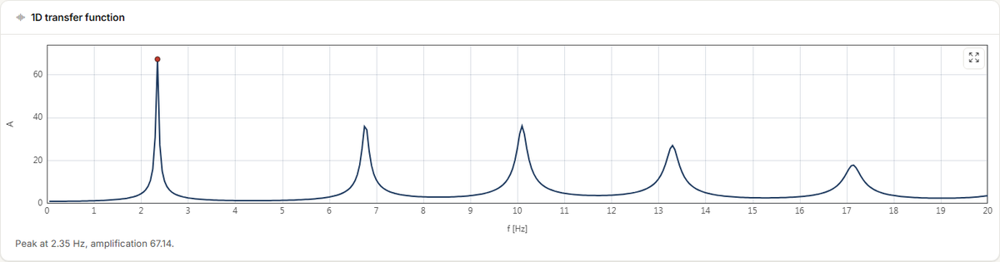

# Soil category and parameters

The **Soil category** tab works on the **selected solution** in the
[Inversion](inversione.md) tab: from it, it derives V~s,eq~, the bedrock depth H, the subsoil
category, the elastic parameters per layer, the NSPT and Qc correlations and the 1D transfer
function. Everything is free and updates as soon as you change a value. Without an inversion
the tab asks you to run one first.

## Standard and foundation depth

The buttons at the top choose the standard (Italian building code):

- **NTC 2018** (§3.2.2) — category from **V~s,eq~** and the bedrock depth **H**;
- **NTC 2008** — category from **V~s,30~**, with the special categories S1 and S2.

**Foundation depth** [m] is the depth below ground level from which H, V~s,eq~ and V~s,30~
are measured: for shallow foundations it is the foundation level, for piled foundations the
pile heads, for retaining walls the top of the structure.

## V~s,eq~ and H (NTC 2018)

V~s,eq~ = H / Σ (h~i~ / V~s,i~)

- **H** is the depth of the **bedrock**, i.e. of the first layer with V~s~ ≥ 800 m/s,
  measured from the foundation.
- If there is no bedrock within 30 m, H = 30 m (this is V~s,30~).
- If the foundation falls **inside** a layer, only the part of that layer below the
  foundation counts.

The category follows table 3.2.II: **A** above 800 m/s (with at most 3 m of poorer soil above
the bedrock), **B** between 360 and 800, **C** between 180 and 360 and **D** between 100 and
180 m/s with bedrock deeper than 30 m, **E** for the C or D cases with bedrock within 30 m.
The **Subsoil categories** table shows the descriptions of the code and highlights the
computed category.

!!! note "Values on the boundary"
    A V~s,eq~ of exactly 100, 360 or 800 m/s falls in no range, as in the desktop version.
    The app does not choose for you: it says the category is not defined and asks you to
    check the model.

## V~s,30~ (NTC 2008)

With **NTC 2008** the app shows **V~s,30~**, the mean velocity of the 30 m below the
foundation, and the category of the 2008 table 3.2.II (A, B, C, D, S1 below 100 m/s). The
**Probable type E soil** check box turns C or D into **E**: V~s~ alone cannot identify a C or
D layer no thicker than 20 m on the bedrock, so the choice is yours.

## Elastic parameters by layer

The **Elastic parameters by layer** table shows, for each layer of the solution: depth of the
bottom, thickness, V~s~, V~p~, density ρ [kg/m³], Poisson's ratio ν and the dynamic moduli in
MPa:

| Symbol | Modulus | Formula |
|---|---|---|
| **G~0~** | shear modulus | ρ·V~s~² |
| **E~d~** | oedometric (constrained) modulus | ρ·V~p~² |
| **M~0~** | bulk modulus | E~d~ − 4/3·G~0~ |
| **E** | Young's modulus | 2·ρ·V~s~²·(1 + ν) |

M~0~ = E~d~ − 4/3·G~0~ is the bulk modulus K, under the name used by the desktop version.

!!! warning "Dynamic moduli"
    These are **small-strain** moduli (10⁻⁶–10⁻⁵), much higher than the operative moduli of a
    settlement calculation. To use them in a static calculation they must be reduced
    according to the strain level.

## NSPT and Qc correlations

The **NSPT (Ohta & Goto) and Qc (Jamiolkowski) correlations** table estimates, for each layer
except the half-space:

- **NSPT** from the inverted **Ohta and Goto** (1978) correlation, at the **mid-depth** of the
  layer. Choose the **Composition** (Silts and clays, Sands, Sands and gravels) and the **Age
  factor** (recent Holocene deposits, or Tertiary Pleistocene deposits);
- **Qc** [kPa] from the inverted **Jamiolkowski** (1985) correlation. Choose the **Soil type**
  (Alluvial, Pleistocene, Pleistocene alluvial).

Estimates beyond the range of the correlations (NSPT above 100, Qc above 5,000 kPa) are shown
as **N/A**. They are indicative values, useful for comparison with in-situ tests, not to
replace them.

## 1D transfer function

The **1D transfer function** chart is the amplification A of SH waves travelling vertically
up from the half-space (treated as bedrock) through the layers of the solution, with 1 %
damping. Under the chart you read the frequency and amplitude of the peak.

It indicates the fundamental frequency of the deposit, to be compared for instance with an
HVSR measurement. The amplitude depends on the contrast with the half-space and on the fixed
damping: it is not a site response analysis.

---

*Found an error on this page? [Let us know](mailto:info@geostru.ai?subject=Help%20MASW%20NX) or open a [Pull Request](https://github.com/EngSoft-Geostru/geostru-help-nx/edit/main/masw/docs/en/categoria.md).*
