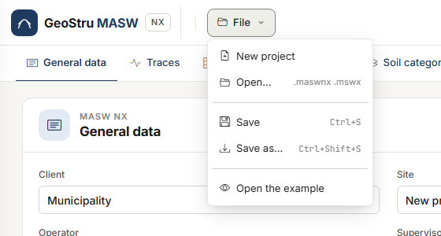
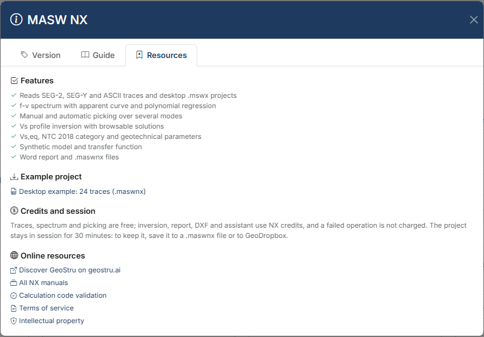

# Files, desktop projects and GeoDropbox

While you work, the project lives **on the server, in your session**. The copy that stays with
you is the **`.maswnx`** file: save it before you leave.

## The File menu

| Item | What it does |
|---|---|
| **New project** | Clears the project in the session. |
| **Open…** | Opens a `.maswnx` file, or an Easy-MASW desktop `.mswx`. |
| **Save** (Ctrl+S) | Overwrites the file opened or saved last; if there is none, it works like **Save as**. |
| **Save as…** (Ctrl+Shift+S) | Saves the project to a new `.maswnx` file. |
| **Open the example** | Loads the desktop example project: 24 traces, picking on three modes, inversion already run. |

New, Open and the example **replace** the project in the session. If there are changes that
are not in a file, a strip under the bar asks what to do: **Save first**, **Continue without
saving** or **Cancel**.

### Save and Save as

In browsers that let a page write a file chosen by the user (Chrome, Edge):

- **Save as…** opens the system dialog and writes the file where you choose;
- from then on the file name appears in the top bar, next to the **File** menu: it is the
  file **Save** writes to;
- **Save** overwrites it without asking. The first time after reopening, the browser may ask
  permission to modify the file;
- **Open…** of a `.maswnx` does the same: the opened file becomes the **Save** file.

After saving a strip confirms *"Project saved to …"*. In other browsers **Save** and **Save
as…** download the file to the downloads folder.

## The .maswnx file

The `.maswnx` file contains the whole project:

- general data and consulting firm;
- acquisition (dt, dx, source offset), filter, crop, state of each trace;
- spectrum parameters and picking, with the maxima excluded from the regression;
- initial model, number of iterations, inversion solutions and selected solution, with the
  colours and hatches of the layers;
- standard, foundation depth and correlation choices;
- the **traces**, compressed, within the limit described below.

The f-v map is not in the file: it is recomputed on opening, always with the current version
of the program.

### Traces in the file

Traces travel in the file as long as their samples do not exceed **30 MB**. Beyond that, the
file contains only **references** to the traces stored on the server, and a strip says so
when saving. When you reopen the file, if the traces are no longer on the server, the app
warns that they must be loaded again from the [Traces](tracce.md) tab: picking, layers and
solutions are kept.

## Desktop projects

**File → Open…** reads Easy-MASW desktop `.mswx` projects. You get:

- general data and consulting firm;
- traces already processed, with the selection, dt, dx and source offset;
- spectrum parameters, picking with its modes, excluded maxima;
- inversion layers with bounds, locks, weights, water table and Poisson; the saved
  solutions, up to 200, sorted by misfit; the model the desktop had on screen becomes the
  selected solution;
- standard and foundation depth.

!!! note "Filter and crop already applied"
    The desktop saves the samples in the `.mswx` **already filtered and cropped**. To avoid
    applying the crop twice the app resets it on import, and a strip says so. For the same
    reason the filter is not imported: the samples already contain it.

A `.mswx` opened here does not become the **Save** file: the first save asks for the name of
the new `.maswnx`. The original `.mswx` is not modified.

The calculation differences between the desktop and MASW NX are in
[Validation and differences from the desktop version](validazione.md#differences-from-the-desktop-program).

## GeoDropbox

The **GeoDropbox** button in the top bar saves the project to one of your GeoDropbox projects,
in the GeoStru cloud, and reopens it from there: it is the way to find it again from another
computer or share it with colleagues. `.maswnx` files are saved and opened; desktop `.mswx`
files can also be opened from GeoDropbox.

## The example project

The same example as **Open the example** can be downloaded from the help: **?** button,
**Resources** tab, **Desktop example: 24 traces (.maswnx)**.

## The session

The project in the session stays on the server for **30 minutes after the last activity** and
is lost whenever the service restarts. If the session has expired, the app says so and writes
and charges nothing: reopen the saved file.

---

*Found an error on this page? [Let us know](mailto:info@geostru.ai?subject=Help%20MASW%20NX) or open a [Pull Request](https://github.com/EngSoft-Geostru/geostru-help-nx/edit/main/masw/docs/en/file.md).*
