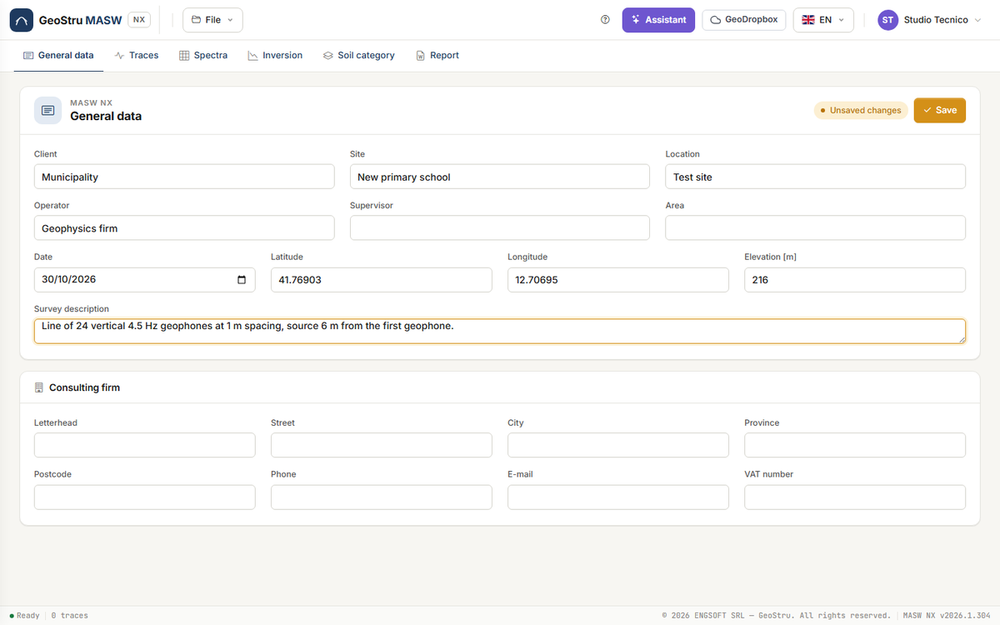
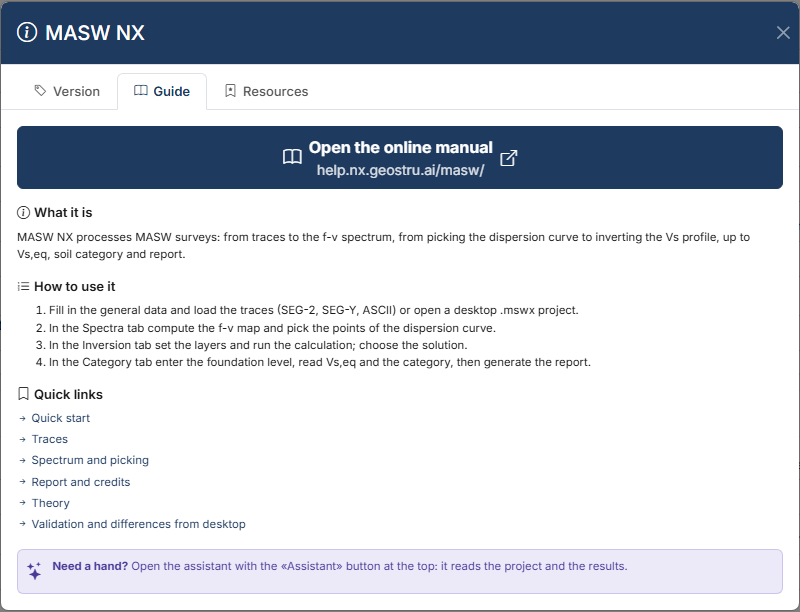

# MASW NX — MASW survey

**MASW NX** processes the active **MASW survey** (Multichannel Analysis of Surface Waves):
from the traces recorded by the geophone line to the **phase velocity – frequency spectrum**
(f-v), from **picking** the Rayleigh-wave dispersion curve to the **inversion** of the V~s~
profile, up to the equivalent velocity V~s,eq~, the **subsoil category** (Italian NTC 2018 and
NTC 2008), the dynamic elastic parameters and the Word report. It is the GeoStru Easy-MASW
desktop program brought to the browser, with the calculation checked against the desktop and
the differences declared.

[**Open the app**](https://nx.geostru.ai/masw/){ .md-button .md-button--primary }
[Quick start](quickstart.md){ .md-button }

## Who it is for

Geologists, geophysicists and geotechnical engineers, and site-investigation contractors who
run the survey and have to deliver its processing: V~s~ profile, V~s,eq~ and subsoil category
for the seismic characterisation of the site, small-strain elastic parameters.

## How you work

Six tabs, left to right, follow the order of the job:

1. **General data** — client, site, location, operator, date, WGS84 coordinates, elevation,
   survey description and your **Consulting firm** letterhead. They open the report.
2. **Traces** — you load the recorded files (SEG-2, SEG-Y, SU, Ambrogeo, SARA Doremi, Dolang,
   ASCII), check geometry, filter and crop, and choose the traces to use.
3. **Spectra** — you compute the f-v map and **pick** the dispersion curve, by hand or with
   **Automatic** picking on the ridges, over one or more modes.
4. **Inversion** — you set the initial model (or let **Propose layers** build it), run the
   calculation, browse the solutions and look at the V~s~ profile and stratigraphic column.
5. **Soil category** — V~s,eq~, H, subsoil category, elastic parameters, NSPT and Qc
   correlations, 1D transfer function.
6. **Report** — preview, Word, DXF and PDF drawings, CSV data.

At the top are the **File** menu, the **?** help button, the **Assistant**, **GeoDropbox**,
the language and the user menu.

In the **General data** tab latitude and longitude are entered in **decimal degrees** in
WGS84 (for example 41.76903 and 12.70695) and **elevation** in m a.s.l. They are descriptive
fields: no calculation reads them. Press **Save** to store them; the **Unsaved changes** badge
reminds you that the tab has pending edits.

## What it computes

- **f-v spectrum** with the phase-shift method (slant stack in the frequency domain): the
  phase velocity map for each frequency, normalised column by column.
- **Apparent curve** (map maxima) and **polynomial regression** of degree 2–10.
- **Automatic picking on the ridges** of the map, on one or more modes.
- **Synthetic model**: the theoretical curves of a trial profile, overlaid on the map.
- **Inversion** of the dispersion curve with the Nelder–Mead simplex: V~s~ and V~p~ profile in
  plane-parallel layers, with misfit and percentage error of each solution.
- **V~s,eq~** and depth H of the bedrock (NTC 2018), **V~s,30~** (NTC 2008), subsoil category.
- For each layer: ρ, ν, G~0~, E~d~, M~0~, E; NSPT (Ohta & Goto) and Qc (Jamiolkowski)
  estimated from V~s~.
- **1D transfer function** of the profile, with the frequency of the first peak.

Two aids are not part of the calculation but prepare it: **Automatic** picking and **Propose
layers**. They are proposals: you accept, correct or discard them.

The formulas are in [Theory](teoria.md); the test cases in [Validation](validazione.md).

## Limits to be aware of

- The model is **1D with horizontal, homogeneous layers**: lateral variations, topography and
  dipping layers are not represented.
- The inversion is **non-unique**: different profiles reproduce the same curve, and two runs
  give slightly different solutions. The misfit measures agreement with the picking, not the
  truth of the profile.
- The **investigation depth** is tied to the longest wavelength read reliably: below it, the
  profile is extrapolated.
- The result depends on the **picking**: a higher mode mistaken for the fundamental
  overestimates V~s~.
- It handles **active** MASW with Rayleigh waves. It does not handle passive sources (ReMi),
  Love waves, the f-k view or joint inversion with HVSR.
- The moduli are **dynamic**, at small strain; NSPT and Qc are empirical correlations,
  indicative only.

The full list is in [Validation](validazione.md#scope-and-limits) and in the [FAQ](faq.md).

## What uses credits

MASW NX runs on **NX credits**. Four actions use them:

| Action | Where |
|---|---|
| **Run inversion** | Inversion tab |
| **Generate Word** | Report tab |
| **Export DXF** / **Export PDF** | Report tab, and DXF / PDF of the column in the Inversion tab |
| Each **message to the assistant** | Assistant panel |

Loading and processing traces, computing the spectrum, picking (automatic too), proposing
layers, the synthetic model, the category, the report preview, the CSV files, saving and
opening projects **cost nothing**. If a paid operation fails, nothing is charged. This manual
does not list prices: they are in the price list on [geostru.ai](https://www.geostru.ai/), and
your balance is in the user menu at the top right. Details in
[Report, DXF, PDF and credits](relazione.md#credits).

## What you need

- A GeoStru account and an internet connection: the calculation runs on the server.
- An up-to-date desktop browser. The app is tested with Chromium-based browsers (Chrome,
  Edge) and a window at least 1200 px wide.
- The interface is in seven languages (Italian, English, French, Spanish, German, Romanian,
  Danish). The report is written in the interface language.

!!! warning "Save before you leave"
    The project lives on the server for the duration of the session: after 30 minutes of
    inactivity it is gone. Save the file with **File → Save** (Ctrl+S) or use **GeoDropbox**.
    See [Files, desktop projects and GeoDropbox](file.md).

## Help inside the app

The **?** button in the top bar opens the help. The **Guide** tab summarises the steps and
links to the pages of this manual; the **Resources** tab lists the features and lets you
download the example project `DefaultExample.maswnx`; the **Version** tab shows the version
in use.

## Where to start

1. [Quick start](quickstart.md) — the example, from opening to the category.
2. [Traces](tracce.md) and [f-v spectrum and picking](spettri.md) — the data.
3. [Inversion](inversione.md) and [Soil category and parameters](categoria.md) — the results.
4. [Report, DXF, PDF and credits](relazione.md), [AI assistant](assistente.md),
   [Files](file.md).
5. [Theory](teoria.md), [Validation and differences from the desktop version](validazione.md),
   [FAQ](faq.md).

---

*Found an error on this page? [Let us know](mailto:info@geostru.ai?subject=Help%20MASW%20NX) or open a [Pull Request](https://github.com/EngSoft-Geostru/geostru-help-nx/edit/main/masw/docs/en/index.md).*
