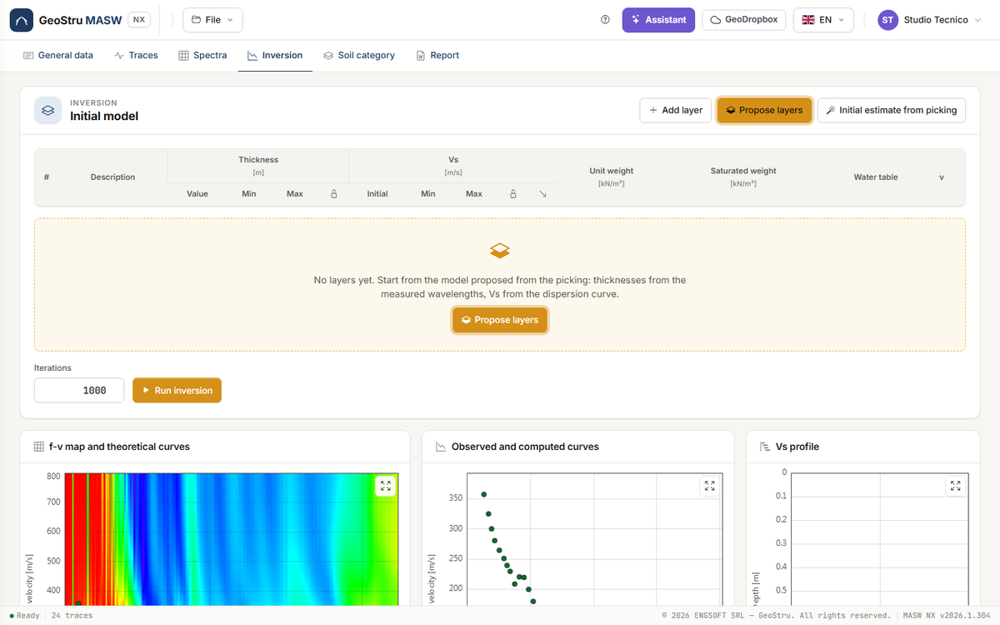
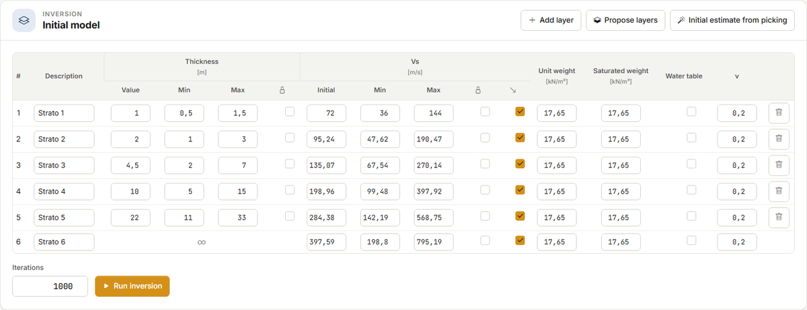
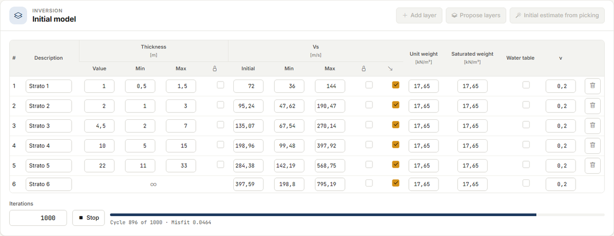
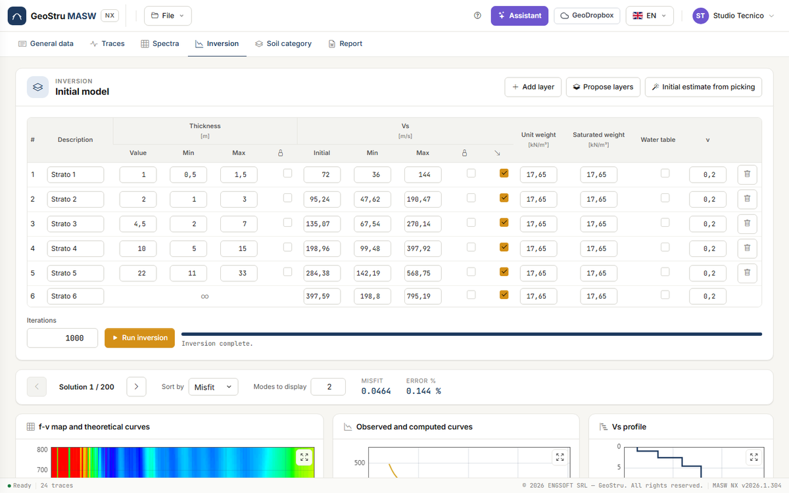
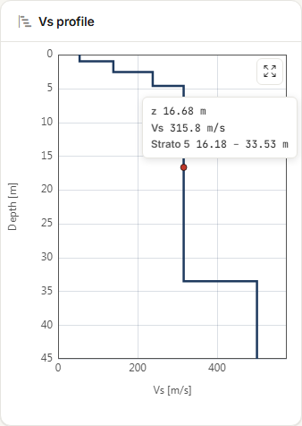
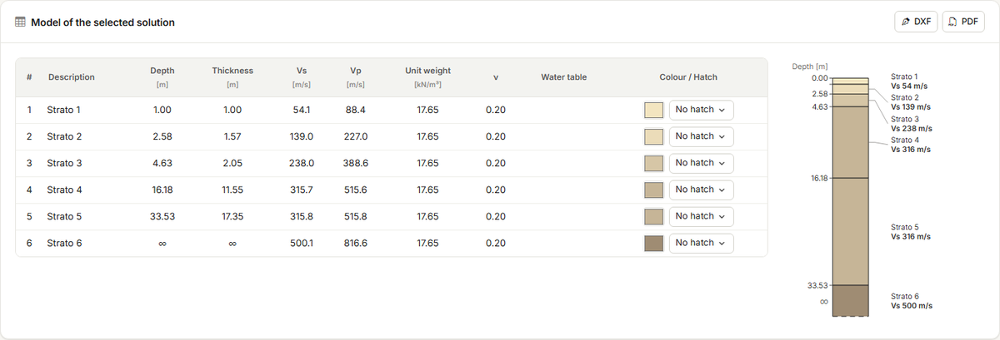

# Inversion

In the **Inversion** tab you go from the dispersion curve to the **V~s~ profile**: you set an
initial layered model, the app searches for the profiles whose theoretical curves best
reproduce the picking, and you choose the solution. Setting up the model is free; **Run
inversion** uses credits.

## The initial model

The **Initial model** card is the table of layers, from top to bottom. The last layer is the
**half-space**: its thickness is infinite (∞). For each layer:

| Column | Meaning |
|---|---|
| **Description** | The name of the layer, shown in the results and in the stratigraphic column. |
| **Thickness** — Value, Min, Max [m] | The starting thickness and the range within which the inversion can change it. |
| **Thickness** — padlock | **Locked**: the thickness is not optimised. |
| **V~s~** — Initial, Min, Max [m/s] | The starting V~s~ and the search range. |
| **V~s~** — padlock | The V~s~ of the layer is not optimised. |
| **V~s~** — arrow | **Vs does not decrease with depth**: the layer's V~s~ cannot be lower than that of the layer above. Clear it to look for a velocity inversion. |
| **Unit weight**, **Saturated weight** [kN/m³] | The weight of the layer, above and below the water table. |
| **Water table** | The layer is below the water table: the saturated weight is used. |
| **ν** | Poisson's ratio, which links V~p~ to V~s~. It is not optimised. |

**Add layer** adds a layer above the half-space; the bin deletes it. At least two layers are
needed, at most 40.

!!! note "Unit weight and density"
    On screen weights are in **kN/m³**. In the calculation the curve uses the density ρ in
    kg/m³, i.e. the weight divided by g (17.65 kN/m³ ↔ 1,800 kg/m³), as in the desktop
    version. The dispersion curve is not very sensitive to ρ and ν: what matters are
    thicknesses and V~s~.

### Propose layers

With an empty table and a picking available, the card shows **Propose layers** in the middle
and the button at the top **pulses**: it is the recommended first step.

**Propose layers** builds a six-layer model from the **picking wavelengths** (λ = v/f):

- the **first layer** is about **λ~min~/2** thick, the smallest depth the picking resolves;
- the **depth of the half-space** is about **λ~max~/3**, between 5 and 40 m;
- the intermediate thicknesses grow in **progression** from the first layer to the
  half-space, rounded to half a metre;
- each thickness can vary by **±50 %** (Min and Max), so that the inversion can move the
  depths;
- the initial V~s~, with Min = half and Max = double, come from the picking as in **Initial
  estimate from picking** (below); Poisson 0.2; the "does not decrease" arrow is on.

If the table already has layers, the app asks for confirmation in a yellow strip before
replacing them.

### Initial estimate from picking

**Initial estimate from picking** leaves the thicknesses as they are and recomputes only the
initial V~s~ and their bounds. Each picked point gives three depths, λ/2 computed on v and on
the two ends of its uncertainty bar; the initial V~s~ of a layer is the mean of the velocities
whose depths fall inside the layer. Min and Max are half and double. With an empty table, it
starts from the proposed layers.

## Run inversion

Enter the number of iterations in **Iterations** (up to 20,000; 1,000 is the usual value) and
press **Run inversion**. A bar shows the cycle and the current misfit; **Stop** halts the run
with no charge.

The inversion uses **all the picked points, on all modes**: each mode is compared with the
corresponding theoretical mode. The method (constrained Nelder–Mead simplex) and the
objective function are in [Theory](teoria.md#inversion).

!!! warning "Keep the page open"
    The calculation runs on the server, but the solutions are delivered to you, and the
    credits charged, when the page asks for the outcome at the end of the run. If you close
    the browser before the end, the run is neither delivered nor charged.

If you change picking or layers during the run, the result is discarded and not charged. A
failed, stopped or superseded run costs nothing.

## The solutions

When the run ends, the navigator shows **Solution 1 / N**: the solutions are the models
evaluated, up to 200, sorted from the best. The arrows browse them; **Sort by** chooses
between **Misfit** and **Error %**. Next to them you read misfit and percentage error of the
solution on screen.

The solution on screen is the one used for the category and the report: if you prefer
another one (for example with a more plausible layer and a slightly higher misfit), choose it
here.

**Modes to display** says how many theoretical curves to draw for the solution. It is
**display only**: it does not enter the calculation, and the inversion always uses every
mode in the picking.

Two runs on the same data give slightly different solutions: the search starts from random
points. If two runs lead to very different profiles with similar misfit, the picking is not
enough to tell them apart.

## The charts

Three charts follow the solution on screen:

- **f-v map and theoretical curves** — the spectrum map with the mode curves of the solution;
- **Observed and computed curves** — the picked points and the theoretical curves, one colour
  per mode;
- **Vs profile** — the step profile. Hovering over the profile shows the depth z, the V~s~
  and the layer, with its top and bottom depths.

To move around the charts (Ctrl+wheel, double click) see
[f-v spectrum and picking](spettri.md#moving-around-the-chart).

## Model of the selected solution and stratigraphic column

The **Model of the selected solution** card shows, for each layer, depth of the bottom,
thickness, V~s~, V~p~, unit weight, ν and water table. Next to it is the **stratigraphic
column** to scale, with the depths and V~s~ of each layer.

In the **Colour / Hatch** column you choose for each layer:

- the **colour** (the swatch opens the picker). With no choice, the colour comes from V~s~;
- the **hatch**: No hatch, Sand, Gravel, Silt, Clay, Organic, Rock.

Colour and hatch do not enter the calculation: they are used by the on-screen column, in the
report and in the drawings. The **DXF** and **PDF** buttons at the top of the card export the
stratigraphic column for the report; they use credits like the exports in the
[Report](relazione.md#dxf-and-pdf-drawings) tab.

## When the results are out of date

If after the inversion you change picking, layers, traces or filter, a strip warns that the
results no longer match the data. The Category tab shows the same warning, and the report and
drawings cannot be generated until you run the inversion again.

---

*Found an error on this page? [Let us know](mailto:info@geostru.ai?subject=Help%20MASW%20NX) or open a [Pull Request](https://github.com/EngSoft-Geostru/geostru-help-nx/edit/main/masw/docs/en/inversione.md).*
