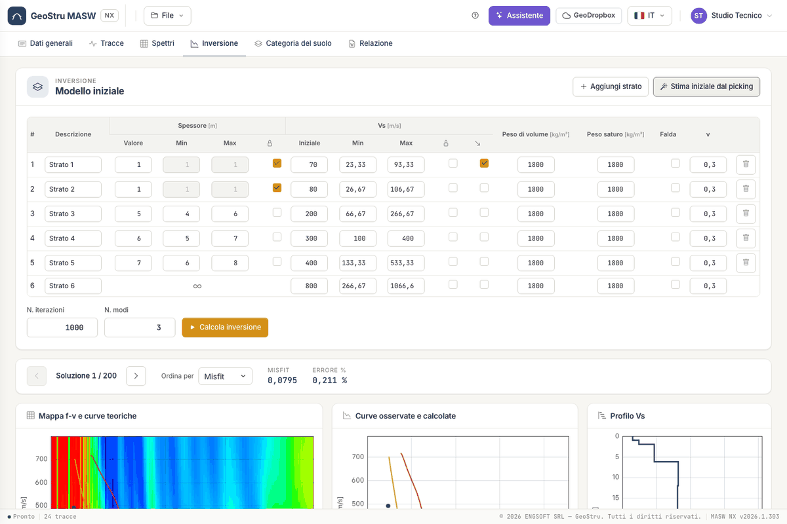
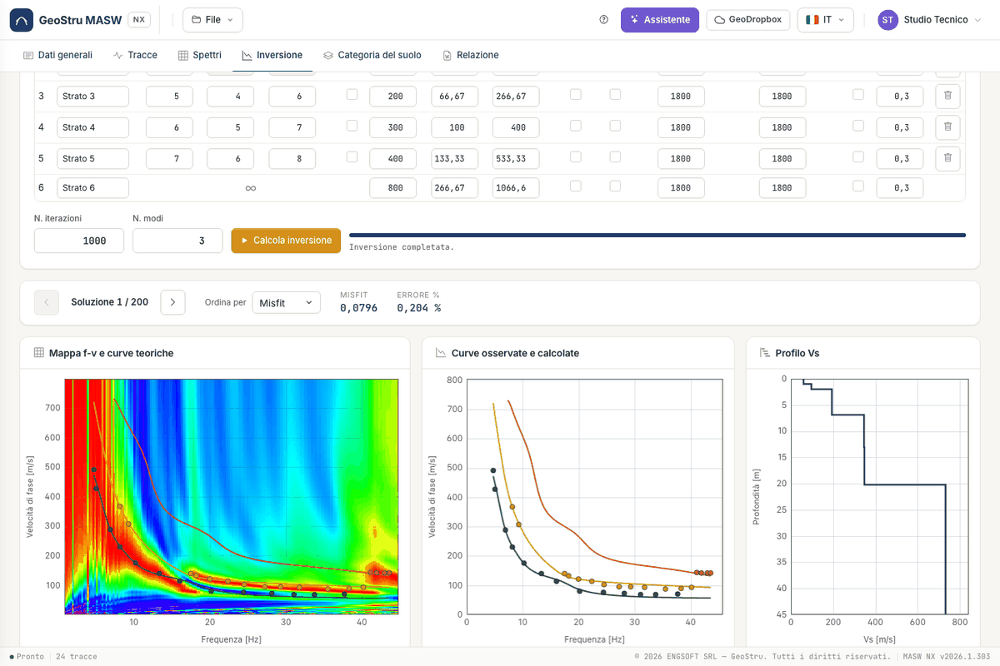

# Inversion

The inversion searches for the layered profile whose theoretical curve best matches the picking.

## The initial model

The table has one row per layer; the last is the **half-space** (∞). For each layer you set:

| Field | Meaning |
|---|---|
| Description | free text for the report |
| Thickness, Min, Max | value and bounds; with the lock it is not optimised |
| Initial V~s~, Min, Max | value and bounds; with the lock it stays fixed |
| Increasing V~s~ | V~s~ does not decrease with depth |
| Unit weight, Saturated weight, Water table | used as density in kg/m³; with water table the saturated value applies |
| ν | Poisson's ratio: links V~p~ to V~s~ |

**Stima iniziale dal picking (Initial estimate from picks)** proposes V~s~ and bounds from the rule that a wave of length λ
sees down to about λ/2. You can add and delete layers, up to 40.

## The run

Set the **number of iterations** and **modes**, then **Calcola inversione (Run inversion)**. You see the progress;
**Interrompi (Stop)** ends the run and uses no credits.

The inversion is stochastic: two runs give slightly different solutions. Repeating the same run on identical data is not
charged again.

## Reading the solutions

The browser steps through the models found, sorted by **misfit** or **error %**. For each one you see the map with
theoretical curves, observed and calculated curves, the stepped V~s~ profile and the model table. The chosen solution is the
one used by category and report.

!!! warning "Superseded results"
    If you change picks, layers, traces or filter after the inversion, a strip warns that results no longer match the data.
    The report is not generated until you run again.

!!! note "Misfit is not truth"
    Different profiles can reproduce the same curve. Misfit measures agreement with the picks: geological judgement stays with you.

---

*Found an error on this page? [Let us know](mailto:info@geostru.ai?subject=Help%20MASW%20NX) or open a [Pull Request](https://github.com/EngSoft-Geostru/geostru-help-nx/edit/main/masw/docs/en/inversione.md).*
