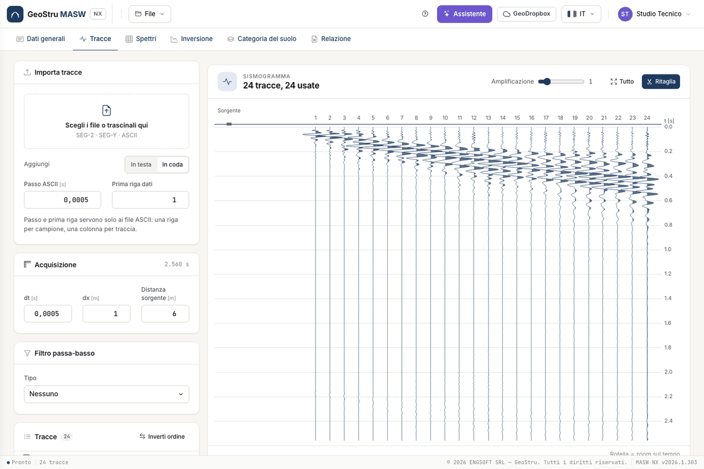

# Quick start (5 minutes)

Repeat the example project from start to finish. You need an account with access to the app. The interface is
available in seven languages; labels below are the Italian ones, with the meaning in brackets.

## 1. Load the example

Open [nx.geostru.ai/masw](https://nx.geostru.ai/masw/), then load the example from the **File** menu. The project has
24 traces, with picks and layers already set.

## 2. Compute the spectrum

In the **Spettri (Spectra)** tab press **Calcola (Compute)**. The f-v map appears with the maxima (blue), the regression
(black) and the picks, coloured by mode.

## 3. Run the inversion

In the **Inversione** tab check the layer table and press **Calcola inversione (Run inversion)**. This uses credits:
they are deducted only when the run delivers its solutions. You then see theoretical curves, V~s~ profile and the
solution browser.

## 4. Read the category

The **Categoria del suolo (Soil category)** tab shows V~s,eq~, H and the category for the chosen solution. If the
foundations are not at ground level, enter the **foundation depth**.

## 5. Generate the report

In the **Relazione (Report)** tab check the preview and press **Genera Word (Generate Word)**.

## Next steps

For your own survey start from [Traces](tracce.md).

---

*Found an error on this page? [Let us know](mailto:info@geostru.ai?subject=Help%20MASW%20NX) or open a [Pull Request](https://github.com/EngSoft-Geostru/geostru-help-nx/edit/main/masw/docs/en/quickstart.md).*
