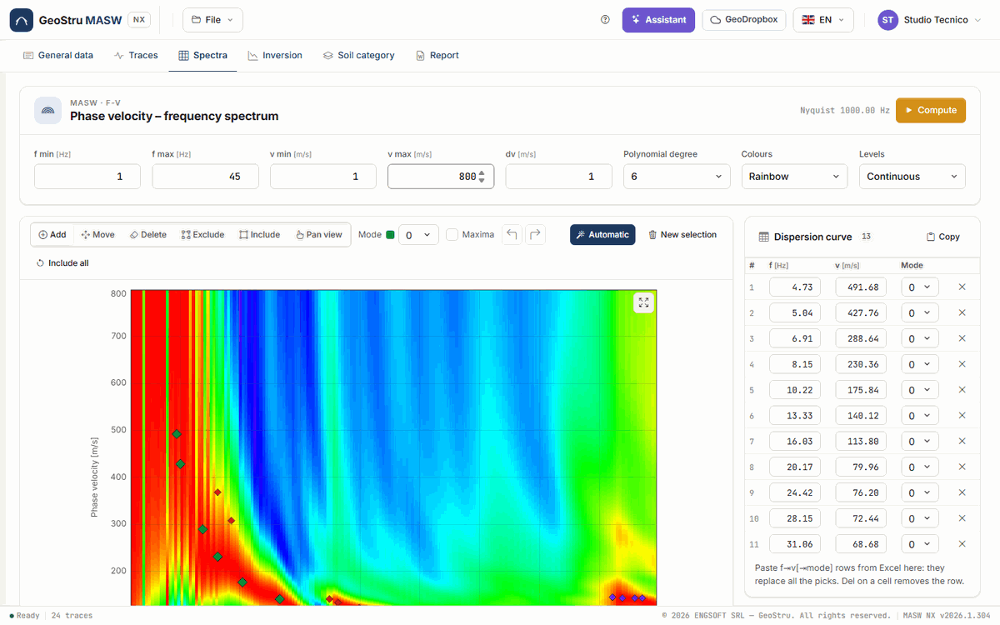
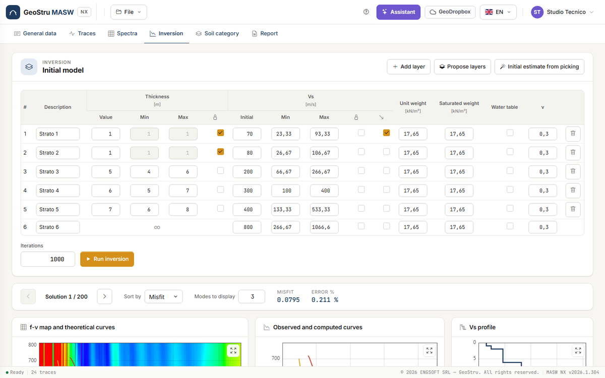
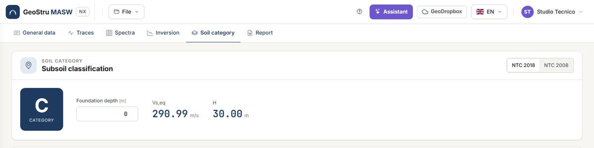

# Quick start (5 minutes)

Take the full tour with the desktop example project: **24 traces** at 1 m spacing, source
6 m from the first geophone, the dispersion curve picked on three modes and an inversion
already run. You do not need to load anything.

## 1. Open the example

Go to [nx.geostru.ai/masw](https://nx.geostru.ai/masw/) with your GeoStru account. Open the
**Traces** tab and press **Load the example**, or open the **File** menu and choose **Open
the example**. If the session already holds a project with unsaved changes, a strip under the
bar asks what to do: **Save first**, **Continue without saving** or **Cancel**.

## 2. Look at the traces

The **Traces** tab shows the **seismogram**: the 24 traces side by side, time running down,
and the red square of the **Source** to the left of the first geophone. In the
**Acquisition** card you read the sampling interval dt = 0.0005 s, the spacing dx = 1 m and
the **Source offset** of 6 m.

The mouse wheel on the seismogram zooms the time axis; **Fit** goes back to the full view.
See [Traces](tracce.md).

## 3. Look at the spectrum and the picking

Open the **Spectra** tab. The **Phase velocity – frequency spectrum** map is already
computed: frequency on the horizontal axis, phase velocity on the vertical axis, maximum
energy in red. The coloured diamonds are the **picked** points, one colour per mode; the
**Dispersion curve** table on the right lists the points of the mode chosen in the **Mode**
drop-down.

Moving the cursor over the map shows f, v and the wavelength λ = v/f in the line at the
bottom of the chart. See [f-v spectrum and picking](spettri.md).

## 4. Read the inversion

Open the **Inversion** tab. At the top is the **Initial model**: six layers with
thicknesses, initial V~s~ and the bounds within which the inversion searched them. Below is
the solution navigator: **Solution 1 / 200**, the best one, with **Misfit 0.0795** and
**Error % 0.211 %**.

Scroll down: the three charts show the f-v map with the theoretical curves of the solution,
the observed and computed curves, and the **Vs profile**. Hover over the profile to read
depth, V~s~ and layer. Further down are the **Model of the selected solution** table and the
stratigraphic column. See [Inversion](inversione.md).

## 5. Read the category

Open the **Soil category** tab. With the foundation at 0 m the example gives
**V~s,eq~ = 290.99 m/s**, **H = 30 m** and category **C** under NTC 2018; the category row is
highlighted in the table.

Try typing **3** in **Foundation depth**: V~s,eq~ is recomputed below the foundation. Press
**NTC 2008** for the classification based on V~s,30~. See
[Soil category and parameters](categoria.md).

## 6. Look at the report

Open the **Report** tab. On the right the **Preview** shows the laid-out document, free of
charge: scroll through it. When it is right, **Generate Word** downloads the `.docx`.

!!! note "This action uses credits"
    **Generate Word**, **Export DXF**, **Export PDF** and **Run inversion** use NX credits;
    everything else in this guide is free. If the operation fails nothing is charged.

## 7. Save the project

**File → Save as…** (Ctrl+Shift+S) saves the project to a `.maswnx` file on your computer;
from then on **File → Save** (Ctrl+S) overwrites the same file. Do it before closing: the
project lives on the server only for the duration of the session.

## With your own data

- **You have the recorded traces**: **File → New project**, then the [Traces](tracce.md) tab
  to load them; in the [Spectra](spettri.md) tab press **Compute** and then **Automatic** for
  a first picking to check; in the [Inversion](inversione.md) tab press **Propose layers** and
  then **Run inversion**.
- **You have an Easy-MASW desktop project** (`.mswx`): **File → Open…**. Traces, picking,
  layers and solutions come with the file. See
  [Files, desktop projects and GeoDropbox](file.md).
- **You already have the dispersion curve** (for example in a spreadsheet): copy the f, v and,
  if present, mode columns, and paste them into the **Dispersion curve** table. See
  [f-v spectrum and picking](spettri.md#copy-and-paste).

---

*Found an error on this page? [Let us know](mailto:info@geostru.ai?subject=Help%20MASW%20NX) or open a [Pull Request](https://github.com/EngSoft-Geostru/geostru-help-nx/edit/main/masw/docs/en/quickstart.md).*
