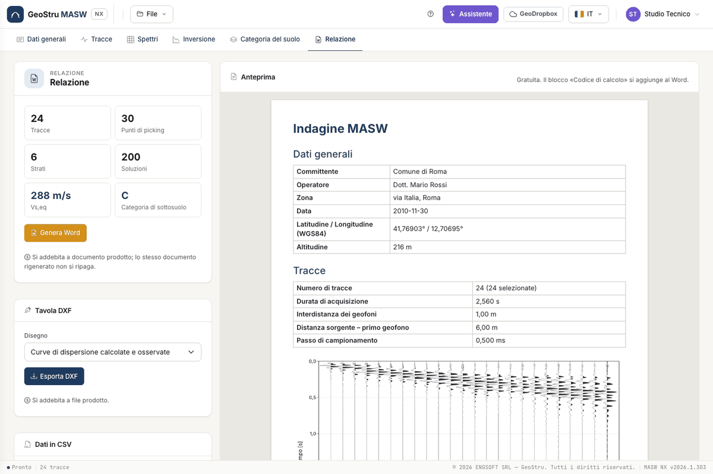

# Report, DXF and credits

## Word report

The tab shows a free **preview**. **Genera Word (Generate Word)** produces the document in the interface language: general
data, traces, spectral analysis, dispersion curve, inversion, results, geotechnical parameters. The header comes from the
consulting firm data in General data.

The report ends with the **calculation code** block required by §10.2 of the Italian NTC: software, engine version, document
code and data fingerprint. The code can be checked at `geostru.ai/verify/<code>`. The check says the document was issued,
not that the calculations are free of errors.

If data changed after the inversion, the report is not generated until you run again.

## DXF and CSV

**Esporta DXF (Export DXF)** produces the drawing of the dispersion curve or the V~s~ profile. Colour maps do not go into a DXF.
The **stratigraphic column** of the solution, with the colours and hatches chosen per layer, exports to DXF and A4 PDF.
The **CSV** files of dispersion curve and profile are free.

## What uses credits

| Action | Credits |
|---|---|
| Traces, spectrum, picking, synthetic curves, category, preview, CSV | free |
| Inversion run | yes, when solutions are delivered |
| Word report | yes, when the document is produced |
| DXF or PDF drawing | yes, when the file is produced |
| Assistant message | yes, on a successful reply |

If an operation fails or you stop it, you do not pay. Repeating the same operation on the same data after a success is not
charged again. Balance and credit expiry are in the user menu.

---

*Found an error on this page? [Let us know](mailto:info@geostru.ai?subject=Help%20MASW%20NX) or open a [Pull Request](https://github.com/EngSoft-Geostru/geostru-help-nx/edit/main/masw/docs/en/relazione.md).*
