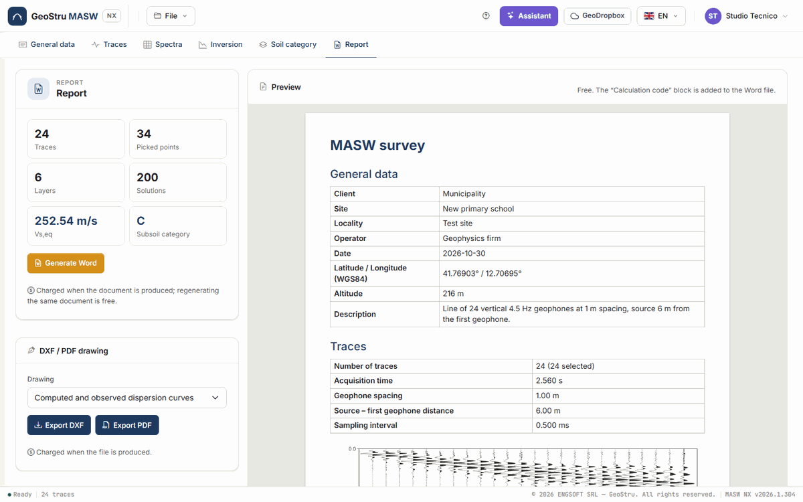

# Report, DXF, PDF and credits

The **Report** tab produces the deliverables of the survey: the **Word report**, the
**drawings** in DXF and PDF and the **CSV data**. The report **preview**, on the right, is
free, like the CSV files.

## Before generating

The summary at the top left counts **Traces**, **Picked points**, **Layers** and
**Solutions**, and shows V~s,eq~ and **Subsoil category** of the selected solution. Check three
things, all free:

1. the fields of the **General data** tab and of the **Consulting firm**: they open the
   document;
2. the selected solution in the [Inversion](inversione.md) tab: it is the one that goes into
   the document;
3. standard and foundation depth in the [Soil category](categoria.md) tab.

Then look at the **preview**: it is the document as it will come out.

Without an inversion solution **Generate Word** is disabled and a note points to the
inversion. If the data changed after the inversion, a strip warns that the report cannot be
generated until you run it again.

## The preview

The **Preview** card shows the laid-out document, with the same text, tables and figures as
the Word file: the server composes it with the same code. Compared with the Word file only the
**Calculation code** block is missing, as it exists only in the issued document. The preview
uses no credits.

## How the report is structured

In order:

1. the **Consulting firm** letterhead, if you filled it in, and the title **MASW survey**;
2. **General data** — client, site, location, operator, supervisor, area, date, WGS84
   coordinates, elevation, description. Empty fields are left out;
3. **Traces** — number of traces and how many are selected, record length, spacing, source –
   first geophone distance, sampling interval, filter; the **seismogram**;
4. **Spectral analysis** — frequencies and velocities of the map; the **f-v spectrum**;
5. **Dispersion curve** — the table of points with their mode; the **picking on the
   spectrum**;
6. **Inversion** — the layers of the solution with depth, thickness, unit weight, ν, water
   table, V~s~ and V~p~; misfit, error, number of iterations, selected solution; the figures
   **spectrum with the theoretical curves**, **computed and observed dispersion curves**,
   **Vs profile** and **stratigraphic column**;
7. **Results** — standard, foundation depth, V~s,eq~ (or V~s,30~), H, bedrock within 30 m,
   subsoil category; the **other geotechnical parameters**;
8. **Calculation code (NTC 2018 §10.2)** — the block that identifies the software and the
   document;
9. the **table of contents**.

## Generate Word

**Generate Word** produces a `.docx` file and the browser downloads it.

- The report is written **in the interface language**: to get it in Italian, change the
  language from the selector at the top before generating it.
- The figures are the same drawings you see on screen, with the colours and hatches chosen for
  the layers.
- When it opens, Word may ask to update the fields: accept, and the table of contents gets its
  page numbers. Alternatively, right-click the table of contents → **Update field**.
- Regenerating the same document, with the same data and language, is not charged again.

The document is a normal Word file: you can edit it, add your logo, convert it to PDF from
your word processor.

### The "Calculation code" block

The last chapter, **Calculation code (NTC 2018 §10.2)**, is a table written by the software
with what point 10.2 of the Italian building code asks to declare:

- software title and producer;
- app version, **calculation engine** version and code revision;
- licence, in the name of the person who generated the document;
- **document code**, in the form `NX-…-XXXX-XXXX`, and the address where it can be verified;
- the reference to the engine [validation](validazione.md);
- the fingerprint of the input data.

The code is registered on geostru.ai when you generate the Word file: anyone receiving the
report can check, at the address printed in the block, that the document was issued by MASW NX
with that version. The check says that the document was **issued**, not that the input data
are correct: those remain the responsibility of the signatory.

If the document registry does not respond, the report is **not produced** and nothing is
charged: try again in a few minutes.

## DXF and PDF drawings

In the **DXF / PDF drawing** card choose the **Drawing**:

- Computed and observed dispersion curves
- Vs profile
- Stratigraphic column

and press **Export DXF** or **Export PDF**:

- the **DXF** has layers by role (axes, grid, curves, points, layers, text), in the same
  units and colours you see on screen, to insert in your CAD drawings;
- the **PDF** is a vector A4 page with the drawing and a header with client, site, location,
  date and supervisor, to attach to the report.

The stratigraphic column can also be exported from the **DXF** and **PDF** buttons in the
[Inversion](inversione.md#model-of-the-selected-solution-and-stratigraphic-column) tab. Text
is in the interface language.

## CSV data

The **CSV data** card downloads, free of charge, the **Dispersion curve** (the picking) and
the **Vs profile** of the selected solution. The separator is the semicolon, the decimal
separator the point.

## Credits

### What uses them

| Action | When it is charged |
|---|---|
| **Run inversion** | When the solutions are delivered to the page, at the end of the run. |
| **Generate Word** | When the document is produced. |
| **Export DXF**, **Export PDF** | When the file is produced. |
| **Message to the assistant** | When the reply arrives. |

### What is free

Loading and processing traces, computing the spectrum, manual and automatic picking, the
synthetic model, proposing layers and estimating initial V~s~, browsing solutions, the
category, the parameters and the transfer function, the report preview, the CSV files, saving
and opening projects, opening the example.

### How much they cost

This manual does not list prices: they change with the price list, published on
[geostru.ai](https://www.geostru.ai/). Your **balance** is in the user menu, at the top right.

If the balance is not enough, the app does not run the action and shows a strip with the
**credits needed**, the **balance** and the **Buy credits** button. The project stays in the
session: top up and try again.

### If something goes wrong

**If an operation fails, nothing is charged.** This applies to every case the app can meet:

- inversion failed, halted with **Stop**, or superseded by a change of picking or layers
  during the run;
- error while generating the Word, DXF or PDF file, or empty drawing;
- session expired: the app says so and writes and charges nothing;
- credit service or document registry unreachable: try again in a few minutes;
- assistant unavailable or reply not received.

The full conditions (credit validity, refunds) are in the
[Terms of Service](https://geostru.ai/en/terms-of-service/).

---

*Found an error on this page? [Let us know](mailto:info@geostru.ai?subject=Help%20MASW%20NX) or open a [Pull Request](https://github.com/EngSoft-Geostru/geostru-help-nx/edit/main/masw/docs/en/relazione.md).*
