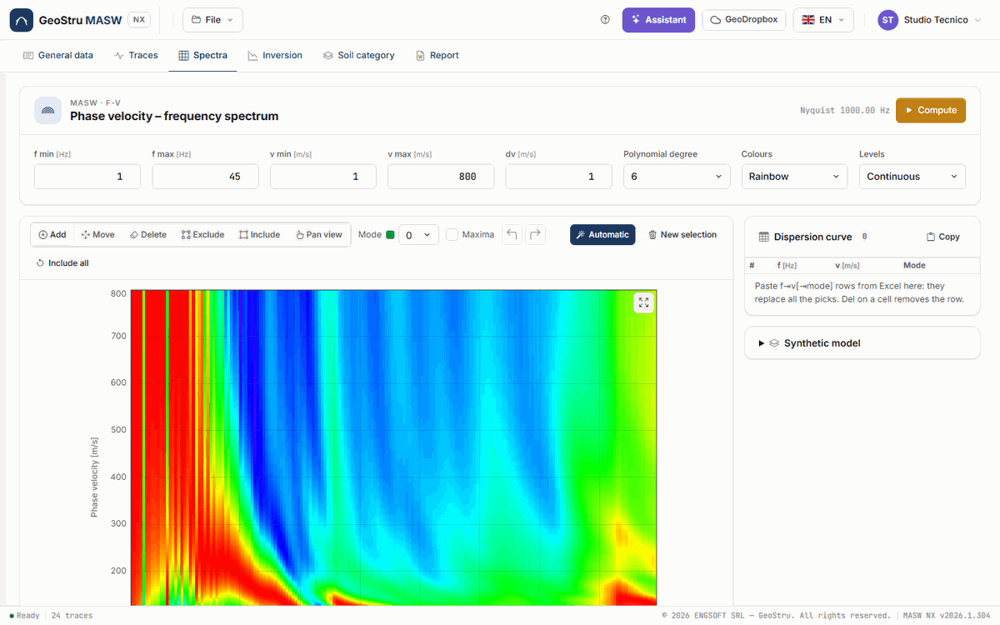
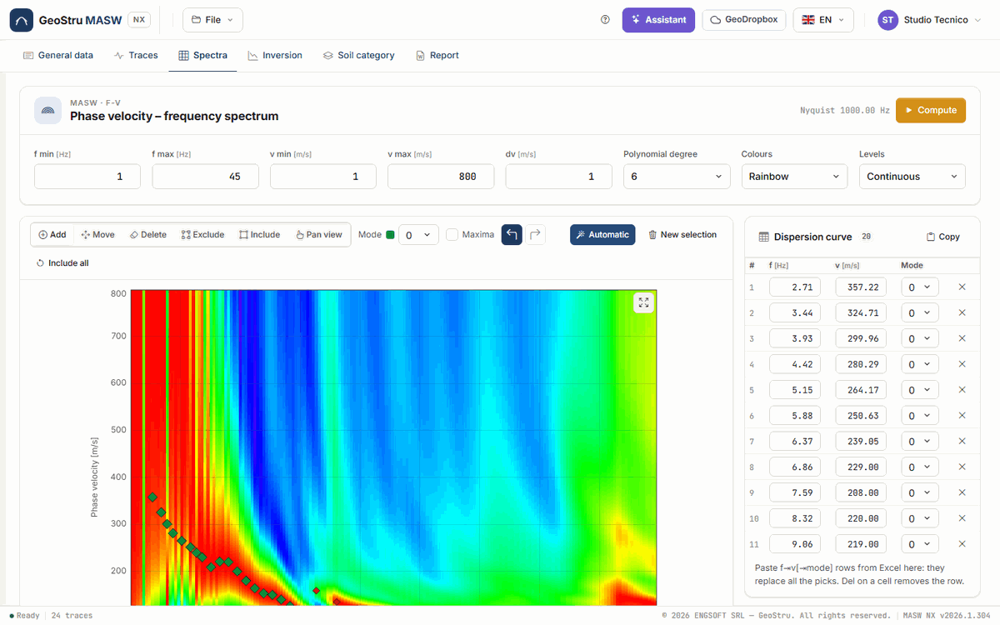
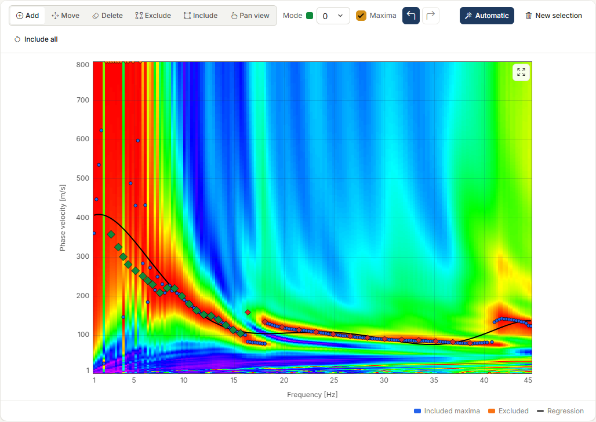
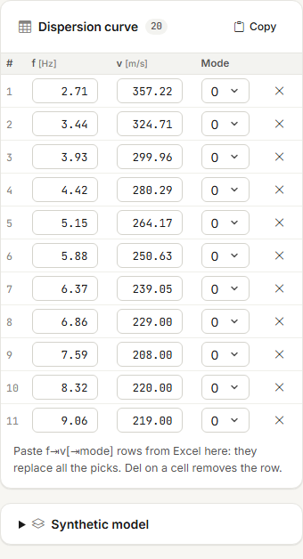
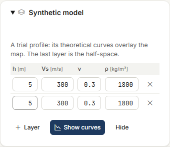

# f-v spectrum and picking

In the **Spectra** tab you compute the **phase velocity – frequency** (f-v) map of the
selected traces and read the Rayleigh-wave **dispersion curve** on it: this is the
**picking**, the data that the inversion tries to reproduce. Spectrum, picking and synthetic
model are free.

## Computing the spectrum

At the top, the **Phase velocity – frequency spectrum** card holds the limits of the map:

| Field | Meaning |
|---|---|
| **f min**, **f max** [Hz] | Frequency range. f max must stay below the Nyquist frequency, 1/(2·dt), shown next to the button. |
| **v min**, **v max** [m/s] | Range of trial phase velocities. |
| **dv** [m/s] | Velocity step. A finer step gives a larger map, not one more precise than the resolution of the line. |
| **Polynomial degree** | Degree (2–10) of the regression on the maxima. |
| **Colours**, **Levels** | Palette (Rainbow, Blue-white-red, Greys, Hot) and number of levels (Continuous, 8, 16, 32). Display only. |

Press **Compute** (or Enter in one of the fields): the server computes the map and draws it.
Each column is normalised to its maximum, so the colour tells you where the energy is at that
frequency, not how strong it is compared with the others.

As you move the cursor over the map, the line at the bottom of the chart shows f, v and the
wavelength λ = v/f: this is what tells you how deep each point looks.

### Moving around the chart

- **Ctrl+wheel** zooms around the cursor; with the **Pan view** tool the wheel alone is
  enough. Without Ctrl the wheel scrolls the page as usual.
- Right or middle button, or **Shift** + drag, pan the view; with the **Pan view** tool the
  left button is enough. A second click on **Pan view** or Esc go back to the previous tool.
- **Double click** or the button at the top right of the chart (**Fit to view**) go back to
  the full view. Zooming out stops at the data.

The same controls apply to every chart in the app (inversion, category).

## Picking

The picking is the set of points (f, v, mode) of the dispersion curve. **Modes** go from 0
(the **fundamental**) to 4, each with its own colour; the **Mode** drop-down chooses the mode
of the points you add and the one the table shows.

### Automatic picking

**Automatic** proposes a picking on the **ridges** of the map: for each frequency it looks
for the maxima that stand out in the column, joins them into continuous ridges, discards
short or weak ridges and those with wavelengths beyond the reach of the line, and samples the
remaining ridges at a regular step. If there is more than one ridge, they go to **several
modes**: to the nearest mode of the [synthetic model](#synthetic-model), if you have set one,
otherwise in order of velocity. Automatic picking replaces the existing one, so the app asks
for confirmation.

!!! warning "It is a proposal"
    Automatic picking follows the ridges it sees: where the fundamental mode does not form a
    ridge (often at high frequencies, or where a higher mode takes the energy) it does not
    reach it, and it may assign a stretch to the wrong mode. Look at the map, correct by hand
    the points you are not convinced of and complete the missing stretches.

### Picking tools

The bar above the chart has six tools:

| Tool | What it does |
|---|---|
| **Add** | A click adds a point of the current mode. Dragging vertically while adding it widens its uncertainty bar. |
| **Move** | Drags a point, of any mode. |
| **Delete** | A click on a point removes it. |
| **Exclude** | A rectangle dragged on the map excludes from the regression the maxima it contains. |
| **Include** | A rectangle puts excluded maxima back into the regression. |
| **Pan view** | Drag and wheel move and zoom the view. |

Other commands:

- **Undo** and **Redo** (Ctrl+Z and Ctrl+Y, or Ctrl+Shift+Z) on picking changes, up to 100
  steps: additions, moves, deletions, automatic picking, paste. Inside a text field the
  field's own apply.
- **New selection** clears the whole picking, after confirmation.
- **Maxima** shows the **maxima** of each column (included in blue, excluded in orange) and
  the polynomial **regression** (black). It is the desktop's apparent curve: a reading aid,
  not used by the inversion.
- **Include all** puts every excluded maximum back into the regression.

## The dispersion curve table

On the right, the **Dispersion curve** card lists the points of the **mode chosen** in the
drop-down, with their number next to the title. The f and v cells can be edited by hand, the
**Mode** drop-down moves a point to another mode, the × deletes it; Del on a fully selected
cell removes the row. Clicking a row highlights the point on the map.

### Copy and paste

- **Copy** puts the whole picking on the clipboard, one row per point: f, v and mode
  separated by tabs. It pastes into a spreadsheet.
- To **paste**, copy two or three columns from a spreadsheet (f, v and, if present, mode),
  click in the table and press Ctrl+V. The pasted rows **replace the whole picking**, after
  confirmation. Without the mode column, the points go to the current mode.

## Synthetic model

The **Synthetic model** card (click its title to open it) compares the map with a trial
profile: enter the layers, with thickness h, V~s~, ν and density ρ, and press **Show curves**.
The theoretical Rayleigh-mode curves of that profile are overlaid on the map; **Hide**
removes them. The last layer is the half-space.

The synthetic model does not enter the inversion. It serves two purposes: to understand
which ridge is the fundamental mode and which a higher mode, and to guide **Automatic**
picking, which assigns each ridge to the nearest synthetic mode.

## When to recompute

The spectrum depends on selected traces, geometry, filter and crop. If you change them the
Traces tab reminds you; recompute and check the picking again, because the points stay where
they were. If the picking changes after an inversion, the inversion results are marked as
out of date.

---

*Found an error on this page? [Let us know](mailto:info@geostru.ai?subject=Help%20MASW%20NX) or open a [Pull Request](https://github.com/EngSoft-Geostru/geostru-help-nx/edit/main/masw/docs/en/spettri.md).*
