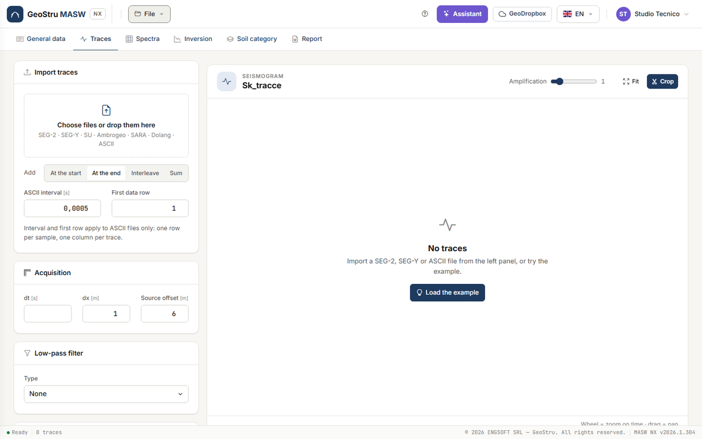
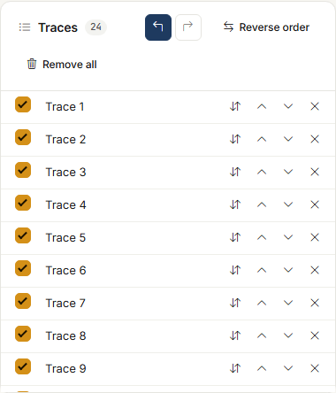
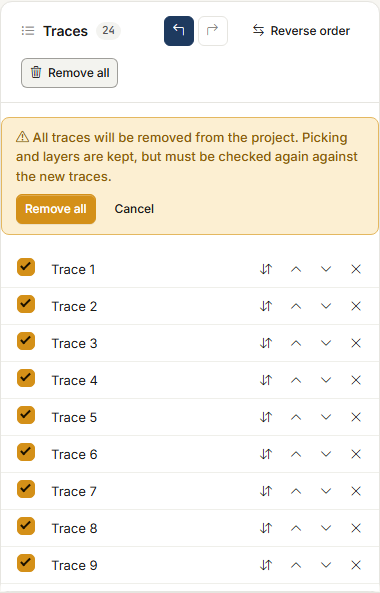
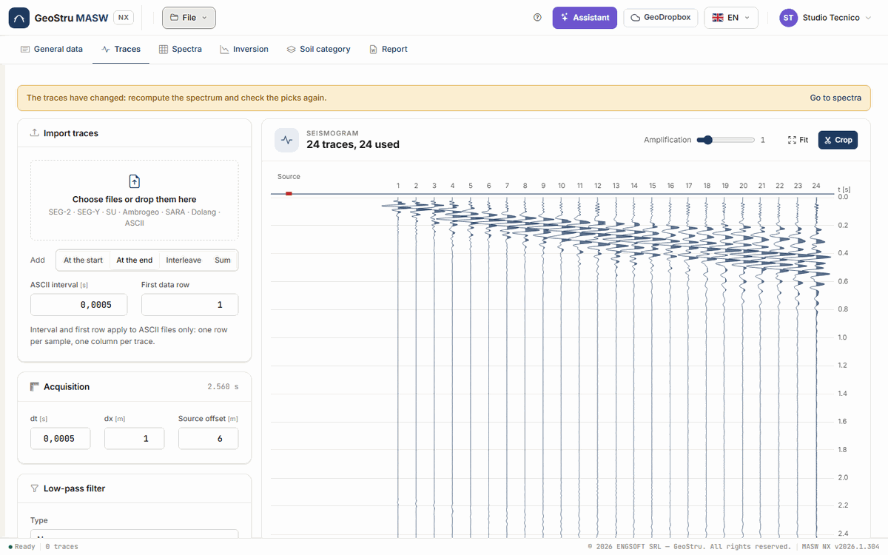
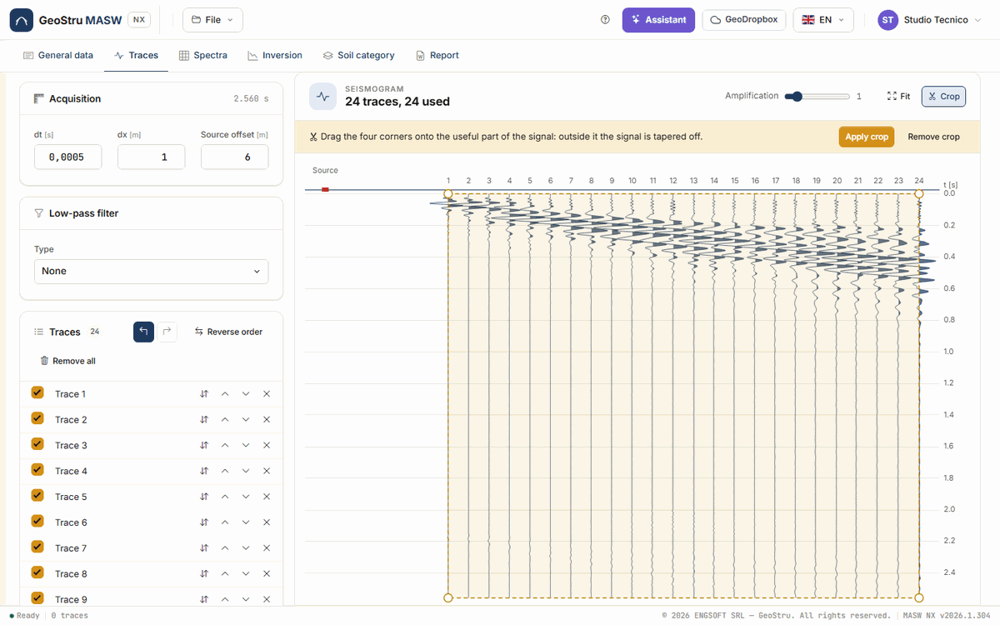

# Traces

The **Traces** tab is the starting point: you load the recordings of the geophone line, check
their geometry, apply a low-pass filter and a crop if needed, and choose which traces go into
the spectrum.

## Import traces

In the **Import traces** card click **Choose files or drop them here**, or drag the files into
the box. You can load several files at once.

| Format | Extensions | How it is recognised |
|---|---|---|
| **SEG-2** | `.sg2`, `.seg2`, `.dat` | from the first bytes of the file |
| **SEG-Y** | `.sgy`, `.segy` | from the extension; IBM and IEEE samples |
| **SU** (Seismic Unix) | `.su` | from the extension |
| **Ambrogeo** | `.dta` | from the extension |
| **SARA Doremi** | `.drm` | from the extension or the header |
| **Dolang** | `.txt` | from the header |
| **ASCII** | `.txt`, `.asc`, `.csv` | everything else: one row per sample, one column per trace |

**ASCII** files need two values that the file does not contain: the **ASCII interval** (the
sampling interval, in seconds) and the **First data row** (to skip header rows). The other
formats do not need them.

Each file can be up to **64 MB**; a project holds up to **512 traces**. The traces of a new
file must have the **same sampling interval** and the **same number of samples** as those
already loaded, otherwise the app says so and loads nothing.

!!! tip "An Easy-MASW desktop project"
    Desktop `.mswx` files are not loaded here but with **File → Open…**: they bring picking,
    layers and solutions with them. See [Files](file.md#desktop-projects).

### Where the new traces go

The **Add** selector decides where the traces of the file you load go, relative to those
already present:

| Choice | What it does |
|---|---|
| **At the start** | Puts them before the existing ones. |
| **At the end** | Puts them after (the default). |
| **Interleave** | Alternates them with the existing ones: 1, new 1, 2, new 2… For two acquisitions offset by half a spacing, which together make a line at half spacing. Remember to halve dx. |
| **Sum** | Adds them sample by sample to the existing ones, 1 with 1, 2 with 2… This is **stacking** of several shots on the same geometry, which improves the signal-to-noise ratio. Extra traces in the new file are left out. |

With no traces loaded, **Interleave** and **Sum** behave like **At the end**.

## Acquisition

The **Acquisition** card holds the geometry used by the spectrum:

- **dt** [s] — the sampling interval;
- **dx** [m] — the geophone spacing;
- **Source offset** [m] — the distance between the source and the first geophone.

On the first import dt comes from the file; from SEG-2 files the app also reads dx and the
source offset, if the file contains the source and receiver positions. Always check these
three values: a wrong dx scales every velocity of the spectrum. Next to the title you read
the length of the record.

## Low-pass filter

The **Low-pass filter** card filters the traces before the spectrum. **Type**: **None**,
**Butterworth** or **Chebyshev**. The parameters:

- **Cut-off** [Hz] — the frequency up to which the signal passes;
- **Stop at** [Hz] — the frequency at which the attenuation is reached;
- **Attenuation** [dB] — how much the signal is attenuated beyond that frequency;
- **Ripple** [%] — the ripple allowed in the pass band (Chebyshev only).

Both frequencies must stay below the Nyquist frequency, 1/(2·dt).

## The trace list

The **Traces** card lists the loaded traces, with a counter. For each row:

- the **Use in spectrum** check box: untick a noisy or dead trace and the spectrum ignores
  it. The phase still uses the real position of every geophone;
- **Reverse polarity**;
- **Move up** and **Move down**;
- **Delete trace**.

At the top of the card:

- **Undo** and **Redo** (Ctrl+Z and Ctrl+Y, or Ctrl+Shift+Z) step back and forward through the
  changes in the tab: deletions, moves, polarity, selection, order, geometry and filter, up
  to 50 steps. Inside a text field Ctrl+Z is the field's own. The history lives in the page:
  changing tab or reloading clears it.
- **Reverse order** reverses the order of the traces, for a line recorded with the source at
  the other end.
- **Remove all** removes all traces from the project. It cannot be undone, so it asks for
  confirmation in a yellow strip first. Picking and layers are kept, but must be checked
  again against the new traces.

## The seismogram

The **Seismogram** card draws the traces side by side, with time running down and the red
square of the **Source** at its offset from the first geophone. The title says how many
traces there are and how many are used.

- **Amplification** scales the amplitudes, on screen only.
- The **wheel** on the chart zooms the time axis around the cursor; drag to pan. **Fit** goes
  back to the full view.
- The line at the bottom of the chart shows the trace and time under the cursor.

### Crop

**Crop** opens the crop polygon: drag its four corners onto the useful part of the signal
(usually the surface-wave train). Outside the polygon the signal is tapered off. **Apply
crop** confirms it, **Remove crop** removes it.

## When the traces change

Any change to traces, geometry, filter or crop changes the spectrum. A yellow strip at the
top says so: **The traces have changed: recompute the spectrum and check the picks again**,
with the **Go to spectra** link. If there was already an inversion, its results are marked
as out of date until you run it again.

---

*Found an error on this page? [Let us know](mailto:info@geostru.ai?subject=Help%20MASW%20NX) or open a [Pull Request](https://github.com/EngSoft-Geostru/geostru-help-nx/edit/main/masw/docs/en/tracce.md).*
