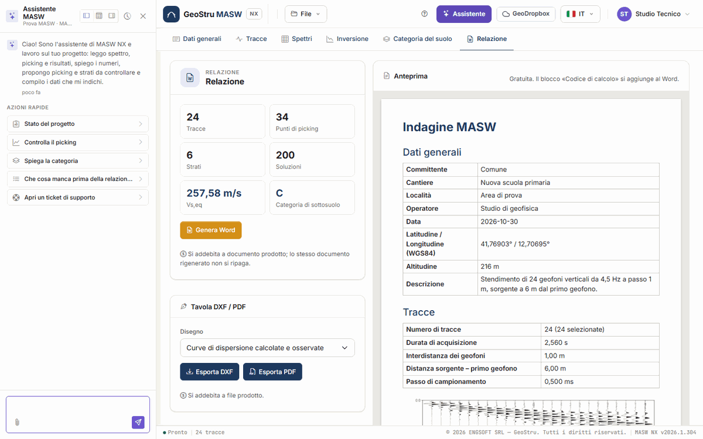

# Assistente AI

Il pulsante **Assistente**, nella barra in alto, apre una chat a fianco del progetto.
L'assistente legge il progetto, lo spettro e i risultati e può scrivere nel progetto al posto
tuo: tu chiedi, lui esegue, la pagina si aggiorna.

Ogni messaggio che invii consuma crediti NX, addebitati solo se la risposta arriva. Vedi
[Crediti](relazione.md#crediti).

Sopra ogni risposta, un'etichetta dice che cosa l'assistente ha fatto sul progetto: per
esempio «Lettura dello spettro…» o «Proposta degli strati…».

## Che cosa può fare

**Leggere e spiegare**

- legge dati generali, acquisizione, parametri dello spettro, picking per modo, strati e
  numero di soluzioni;
- riassume lo **spettro**: curva apparente, regressione, frequenza di Nyquist, lunghezza
  d'onda massima e profondità d'indagine indicativa;
- legge le **soluzioni** dell'inversione, i **risultati** (V~s,eq~, H, categoria, parametri
  per strato) e li spiega;
- controlla il picking: tratti mancanti, punti fuori cresta, dubbi sul modo;
- spiega il metodo, le formule e i limiti della prova.

**Scrivere nel progetto**

- compila i **dati generali**;
- imposta i **parametri dello spettro** e calcola la mappa (gratuito);
- fa il **picking automatico** sulle creste, o scrive nel picking i punti che gli detti o
  che legge da un file allegato;
- scrive il **modello iniziale** dell'inversione, oppure fa **proporre gli strati** dal
  picking e **stima le V~s~ iniziali**;
- **sceglie la soluzione** su cui calcolare categoria e relazione;
- imposta **piano di posa** e **normativa**.

Quando scrive, i numeri che ti riferisce li rilegge dal calcolo: non li rifà a mente.

## Che cosa non fa

- **Non lancia l'inversione.** L'unico modo di eseguirla, e di pagarla, è il pulsante
  **Calcola inversione**: l'assistente prepara il modello e ti dice quando premerlo.
- **Non elimina nulla**: tracce, punti e strati li togli tu.
- **Non sostituisce il picking o gli strati che hai già** se non glielo chiedi in modo
  esplicito («rifai il picking automatico», «sostituisci gli strati»).
- **Non carica le tracce e non genera relazione, DXF o PDF**: sono gesti tuoi.
- **Non inventa dati**: nel picking entrano solo i punti che gli dai o che legge da un tuo
  documento.

## Come si usa

Scrivi la richiesta nella casella in basso e invia. Alla prima apertura trovi le **Azioni
rapide**: **Stato del progetto**, **Controlla il picking**, **Spiega la categoria**, **Che
cosa manca prima della relazione?**, **Apri un ticket di supporto**.

Richieste che funzionano bene sono concrete:

- «Calcola lo spettro fra 2 e 60 Hz e fai il picking automatico»
- «Il picking è ragionevole? Ci sono tratti che potrebbero essere un modo superiore?»
- «Proponi gli strati, otto compreso il semispazio»
- «Fino a che profondità arriva l'indagine con questo picking?»
- «Scegli la soluzione 3 e dimmi come cambia la Vs,eq»
- «Piano di posa a 2 m, NTC 2018: che categoria esce e perché?»

Se la richiesta è ambigua, chiede prima di scrivere.

### Allegare un file

Con la **graffetta** alleghi un file, per esempio una curva di dispersione esportata da un
altro programma o un rapporto di prova. Se contiene coppie frequenza – velocità di fase,
l'assistente le scrive nel picking (modo 0 se il file non lo dice) e riassume che cosa ha
scritto; se trova committente, cantiere, località o data, compila i dati generali. Controlla
sempre il picking scritto sulla mappa.

### Mentre lavora

Mentre l'assistente scrive nel progetto la pagina è ferma, e una striscia lo dice:
*«L'assistente sta lavorando sul progetto: la pagina torna modificabile appena ha finito»*.

Prima di inviare il messaggio l'app salva la scheda che hai a video; a lavoro finito la
pagina si aggiorna con il progetto modificato.

In una risposta l'assistente può eseguire un numero limitato di operazioni: se lo raggiunge
lo dice, ciò che ha fatto è nel progetto, e gli scrivi per proseguire.

### Il pannello

In alto nel pannello: tre pulsanti per agganciarlo a sinistra, in basso o a destra, il
pulsante della cronologia per riprendere o azzerare la conversazione, e la chiusura.

## È un sistema di intelligenza artificiale

!!! warning "Verifica ciò che scrive"
    Le risposte dell'assistente sono generate da un sistema di intelligenza artificiale e
    possono contenere errori. Ciò che scrive nel progetto è una **proposta**: picking,
    strati e scelte vanno verificati. L'elaborazione è tua, e la firmi tu.

In particolare: il picking automatico va riguardato sulla mappa, modo per modo; gli strati
proposti sono un punto di partenza per l'inversione, non un'interpretazione geologica; una
curva letta da un file va confrontata con l'originale.

## Ticket di supporto

L'azione rapida **Apri un ticket di supporto** apre una richiesta di assistenza dalla stessa
chat. Finché il ticket è aperto i messaggi vanno al supporto, non all'assistente del
progetto, e non consumano crediti.

---

*Hai trovato un errore in questa pagina? [Segnalacelo](mailto:info@geostru.ai?subject=Help%20MASW%20NX) o apri una [Pull Request](https://github.com/EngSoft-Geostru/geostru-help-nx/edit/main/masw/docs/it/assistente.md).*
