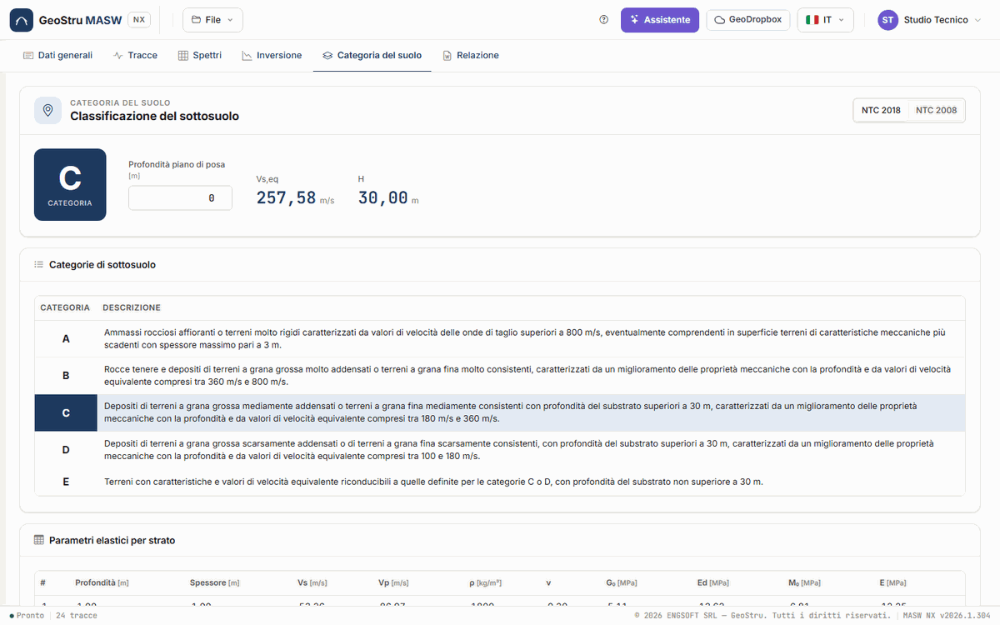
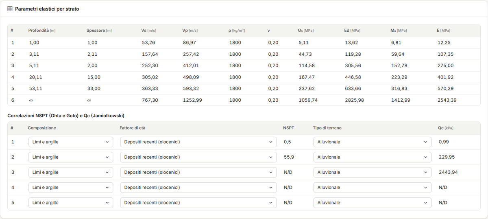
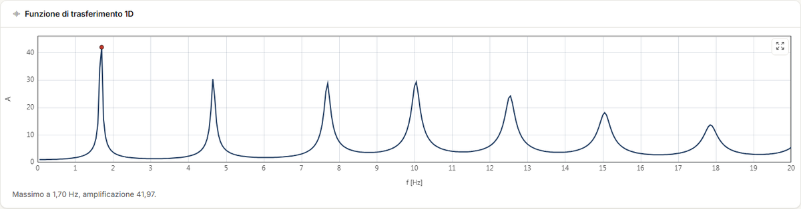

# Categoria di sottosuolo e parametri

La scheda **Categoria del suolo** lavora sulla **soluzione scelta** nella scheda
[Inversione](inversione.md): ne ricava V~s,eq~, la profondità H del substrato, la categoria di
sottosuolo, i parametri elastici per strato, le correlazioni NSPT e Qc e la funzione di
trasferimento 1D. Tutto è gratuito e si aggiorna appena cambi un dato. Senza un'inversione la
scheda dice di eseguirla prima.

## Normativa e piano di posa

I pulsanti in alto scelgono la normativa:

- **NTC 2018** (§3.2.2) — categoria da **V~s,eq~** e dalla profondità **H** del substrato;
- **NTC 2008** — categoria da **V~s,30~**, con le categorie speciali S1 e S2.

**Profondità piano di posa** [m] è la quota, sotto il piano campagna, da cui si misurano H,
V~s,eq~ e V~s,30~: per fondazioni superficiali è il piano di posa, per fondazioni su pali la
testa dei pali, per muri di sostegno di terrapieni la testa dell'opera.

## V~s,eq~ e H (NTC 2018)

V~s,eq~ = H / Σ (h~i~ / V~s,i~)

- **H** è la profondità del **substrato**, cioè del primo strato con V~s~ ≥ 800 m/s, misurata
  dal piano di posa.
- Se il substrato non c'è entro 30 m, H = 30 m (è la V~s,30~).
- Se il piano di posa cade **dentro** uno strato, conta solo la parte di quello strato sotto
  il piano di posa.

La categoria segue la tabella 3.2.II: **A** oltre 800 m/s (con al più 3 m di terreno più
scadente sopra il substrato), **B** fra 360 e 800, **C** fra 180 e 360 e **D** fra 100 e
180 m/s con substrato oltre 30 m, **E** per i casi C o D con substrato entro 30 m. La tabella
**Categorie di sottosuolo** riporta le descrizioni della norma ed evidenzia la categoria
calcolata.

!!! note "Valori sul bordo"
    Una V~s,eq~ esattamente pari a 100, 360 o 800 m/s non cade in nessuna fascia, come nel
    desktop. L'app non sceglie per te: dice che la categoria non è definita e chiede di
    verificare il modello.

## V~s,30~ (NTC 2008)

Con **NTC 2008** l'app mostra **V~s,30~**, la velocità media dei 30 m sotto il piano di posa,
e la categoria della tabella 3.2.II del 2008 (A, B, C, D, S1 sotto 100 m/s). La casella
**Probabile suolo di tipo E** trasforma C o D in **E**: la V~s~ da sola non distingue il caso
di uno strato C o D di spessore non superiore a 20 m sul substrato, quindi la scelta è tua.

## Parametri elastici per strato

La tabella **Parametri elastici per strato** riporta, per ogni strato della soluzione:
profondità della base, spessore, V~s~, V~p~, densità ρ [kg/m³], coefficiente di Poisson ν e
i moduli dinamici in MPa:

| Simbolo | Modulo | Formula |
|---|---|---|
| **G~0~** | modulo di deformazione al taglio | ρ·V~s~² |
| **E~d~** | modulo edometrico | ρ·V~p~² |
| **M~0~** | modulo di compressibilità volumetrica | E~d~ − 4/3·G~0~ |
| **E** | modulo di Young | 2·ρ·V~s~²·(1 + ν) |

M~0~ = E~d~ − 4/3·G~0~ è il modulo di compressibilità volumetrica K, con il nome del desktop.

!!! warning "Moduli dinamici"
    Sono moduli a **piccole deformazioni** (10⁻⁶–10⁻⁵), molto più alti dei moduli operativi di
    un calcolo di cedimenti. Per usarli in un calcolo statico vanno ridotti in funzione del
    livello di deformazione.

## Correlazioni NSPT e Qc

La tabella **Correlazioni NSPT (Ohta e Goto) e Qc (Jamiolkowski)** stima, per ogni strato
tranne il semispazio:

- **NSPT** dalla correlazione di **Ohta e Goto** (1978) invertita, alla **profondità media**
  dello strato. Scegli la **Composizione** (Limi e argille, Sabbie, Sabbie e ghiaie) e il
  **Fattore di età** (depositi recenti, olocenici, o del terziario, pleistocenici);
- **Qc** [kPa] dalla correlazione di **Jamiolkowski** (1985) invertita. Scegli il **Tipo di
  terreno** (Alluvionale, Pleistocenica, Alluvionale pleistocenica).

Le stime oltre il campo delle correlazioni (NSPT oltre 100, Qc oltre 5 000 kPa) sono indicate
**N/D**. Sono valori indicativi, utili per un confronto con le prove in sito, non per
sostituirle.

## Funzione di trasferimento 1D

Il grafico **Funzione di trasferimento 1D** è l'amplificazione A delle onde SH che salgono in
verticale dal semispazio (trattato come substrato) attraverso gli strati della soluzione, con
smorzamento dell'1 %. Sotto il grafico leggi la frequenza e l'ampiezza del massimo.

È un'indicazione della frequenza fondamentale del deposito, da confrontare per esempio con
una misura HVSR. L'ampiezza dipende dal contrasto con il semispazio e dallo smorzamento
fisso: non è un'analisi di risposta sismica locale.

---

*Hai trovato un errore in questa pagina? [Segnalacelo](mailto:info@geostru.ai?subject=Help%20MASW%20NX) o apri una [Pull Request](https://github.com/EngSoft-Geostru/geostru-help-nx/edit/main/masw/docs/it/categoria.md).*
