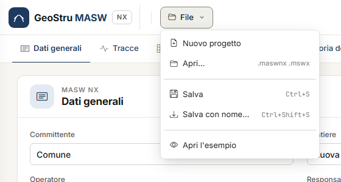
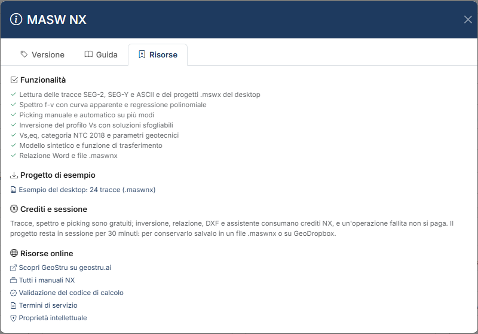

# File, progetti del desktop e GeoDropbox

Mentre lavori il progetto vive **sul server, nella tua sessione**. La copia che resta a te è
il file **`.maswnx`**: salvalo prima di uscire.

## Il menu File

| Voce | Che cosa fa |
|---|---|
| **Nuovo progetto** | Svuota il progetto in sessione. |
| **Apri…** | Apre un file `.maswnx`, oppure un `.mswx` di Easy-MASW desktop. |
| **Salva** (Ctrl+S) | Riscrive il file aperto o salvato per ultimo; se non ce n'è uno, fa come **Salva con nome**. |
| **Salva con nome…** (Ctrl+Maiusc+S) | Salva il progetto in un nuovo file `.maswnx`. |
| **Apri l'esempio** | Carica il progetto di esempio del desktop: 24 tracce, picking su tre modi, inversione eseguita. |

Nuovo, Apri ed esempio **sostituiscono** il progetto in sessione. Se ci sono modifiche che
non sono in un file, una striscia sotto la barra chiede che cosa fare: **Salva prima**,
**Continua senza salvare** o **Annulla**.

### Salva e Salva con nome

Nei browser che permettono a una pagina di scrivere un file scelto dall'utente (Chrome,
Edge):

- **Salva con nome…** apre la finestra del sistema e scrive il file dove scegli;
- da quel momento il nome del file compare nella barra in alto, accanto al menu **File**: è
  il file su cui scrive **Salva**;
- **Salva** lo riscrive senza chiedere nulla. La prima volta dopo una riapertura il browser
  può chiedere il permesso di modificare il file;
- **Apri…** di un `.maswnx` fa la stessa cosa: il file aperto diventa quello di **Salva**.

Dopo il salvataggio una striscia conferma *«Progetto salvato in …»*. Negli altri browser
**Salva** e **Salva con nome…** scaricano il file nella cartella dei download.

## Il file .maswnx

Il file `.maswnx` contiene tutto il progetto:

- dati generali e studio tecnico;
- acquisizione (dt, dx, distanza sorgente), filtro, ritaglio, stato di ogni traccia;
- parametri dello spettro e picking, con i massimi esclusi dalla regressione;
- modello iniziale, numero di iterazioni, soluzioni dell'inversione e soluzione scelta, con
  colori e retini degli strati;
- normativa, piano di posa e scelte delle correlazioni;
- le **tracce**, compresse, entro il limite descritto sotto.

La mappa f-v non è nel file: si ricalcola all'apertura, sempre con la versione corrente del
programma.

### Le tracce nel file

Le tracce viaggiano nel file finché i loro campioni non superano **30 MB**. Oltre, il file
contiene solo i **riferimenti** alle tracce depositate sul server, e una striscia lo dice
al salvataggio. Riaprendo il file, se le tracce non sono più sul server, l'app avvisa che
vanno ricaricate dalla scheda [Tracce](tracce.md): picking, strati e soluzioni restano.

## Progetti del desktop

**File → Apri…** legge i progetti `.mswx` di Easy-MASW desktop. Arrivano:

- dati generali e studio tecnico;
- tracce già elaborate, con la selezione, dt, dx e distanza sorgente;
- parametri dello spettro, picking con i modi, massimi esclusi;
- strati dell'inversione con vincoli, blocchi, pesi, falda e Poisson; le soluzioni salvate,
  fino a 200, ordinate per misfit; il modello che il desktop aveva a video diventa la
  soluzione scelta;
- normativa e piano di posa.

!!! note "Filtro e ritaglio già applicati"
    Il desktop salva nel `.mswx` i campioni **già filtrati e ritagliati**. Per non applicare
    il ritaglio due volte l'app lo azzera all'importazione, e una striscia lo dice. Per lo
    stesso motivo il filtro non viene importato: i campioni lo contengono già.

Un `.mswx` aperto qui non diventa il file di **Salva**: il primo salvataggio chiede il nome
del nuovo `.maswnx`. Il `.mswx` originale non viene modificato.

Le differenze di calcolo fra il desktop e MASW NX sono in
[Validazione e differenze dal desktop](validazione.md#differenze-dal-programma-desktop).

## GeoDropbox

Il pulsante **GeoDropbox** nella barra in alto salva il progetto in un tuo progetto
GeoDropbox, nel cloud GeoStru, e lo riapre da lì: è il modo per ritrovarlo da un altro
computer o condividerlo con i colleghi. Si salvano e si aprono i file `.maswnx`; da GeoDropbox
si aprono anche i `.mswx` del desktop.

## Il progetto di esempio

Lo stesso esempio di **Apri l'esempio** si scarica dall'aiuto: pulsante **?**, scheda
**Risorse**, **Esempio del desktop: 24 tracce (.maswnx)**.

## La sessione

Il progetto in sessione resta sul server per **30 minuti dall'ultima attività** e si perde
a ogni riavvio del servizio. Se la sessione è scaduta, l'app lo dice e non scrive né
addebita nulla: riapri il file salvato.

---

*Hai trovato un errore in questa pagina? [Segnalacelo](mailto:info@geostru.ai?subject=Help%20MASW%20NX) o apri una [Pull Request](https://github.com/EngSoft-Geostru/geostru-help-nx/edit/main/masw/docs/it/file.md).*
