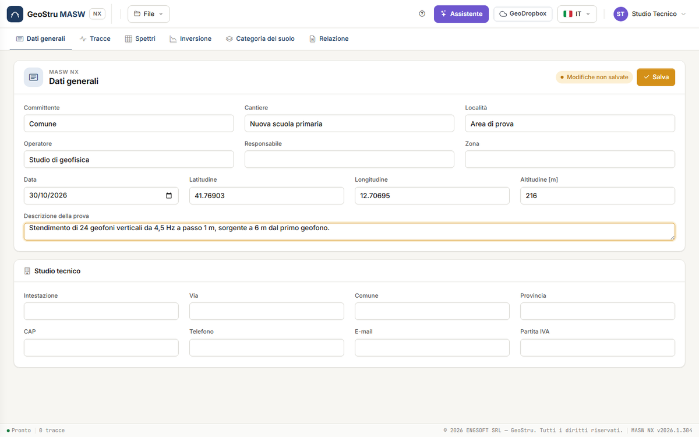
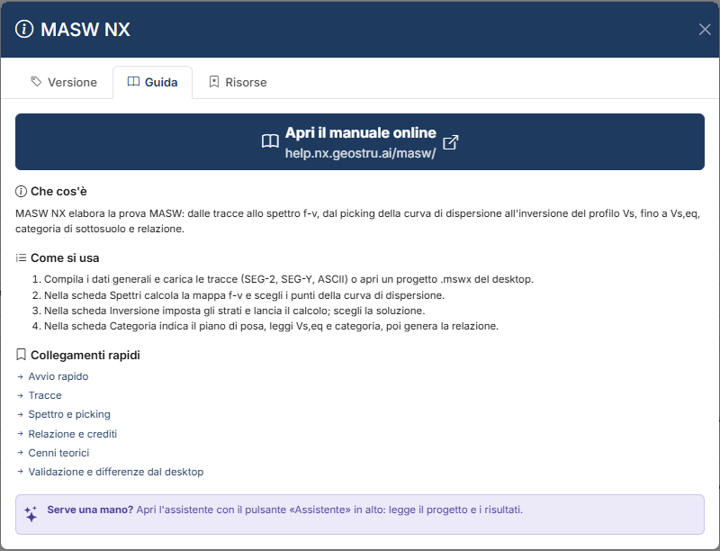

# MASW NX — Prova MASW

**MASW NX** elabora la **prova MASW** (Multichannel Analysis of Surface Waves) attiva: dalle
tracce registrate dallo stendimento di geofoni allo **spettro velocità di fase – frequenza**
(f-v), dal **picking** della curva di dispersione delle onde di Rayleigh all'**inversione**
del profilo di V~s~, fino alla velocità equivalente V~s,eq~, alla **categoria di sottosuolo**
(NTC 2018 e NTC 2008), ai parametri elastici dinamici e alla relazione Word. È il programma
desktop Easy-MASW di GeoStru portato nel browser, con il calcolo verificato contro quello del
desktop e le differenze dichiarate.

[**Apri l'app**](https://nx.geostru.ai/masw/){ .md-button .md-button--primary }
[Guida rapida](quickstart.md){ .md-button }

## A chi serve

A geologi, geofisici e ingegneri geotecnici, e alle imprese di indagini che eseguono la
prova e devono consegnarne l'elaborazione: profilo di V~s~, V~s,eq~ e categoria di
sottosuolo per la caratterizzazione sismica del sito, parametri elastici a piccole
deformazioni.

## Come si lavora

Sei schede, da sinistra a destra, seguono l'ordine del lavoro:

1. **Dati generali** — committente, cantiere, località, operatore, data, coordinate WGS84,
   altitudine, descrizione della prova e l'intestazione del tuo **Studio tecnico**. Aprono la
   relazione.
2. **Tracce** — carichi i file registrati (SEG-2, SEG-Y, SU, Ambrogeo, SARA Doremi, Dolang,
   ASCII), controlli geometria, filtro e ritaglio, scegli le tracce da usare.
3. **Spettri** — calcoli la mappa f-v e fai il **picking** della curva di dispersione, a mano
   o con il picking **Automatico** sulle creste, anche su più modi.
4. **Inversione** — imposti il modello iniziale (o lo fai proporre con **Proponi strati**),
   lanci il calcolo, sfogli le soluzioni e guardi profilo V~s~ e colonna stratigrafica.
5. **Categoria del suolo** — V~s,eq~, H, categoria di sottosuolo, parametri elastici,
   correlazioni NSPT e Qc, funzione di trasferimento 1D.
6. **Relazione** — anteprima, Word, disegni DXF e PDF, dati in CSV.

In alto ci sono il menu **File**, il pulsante **?** dell'aiuto, l'**Assistente**,
**GeoDropbox**, la lingua e il menu utente.

Nella scheda **Dati generali** latitudine e longitudine si scrivono in **gradi decimali**
nel sistema WGS84 (per esempio 41.76903 e 12.70695) e l'**altitudine** è in m s.l.m. Sono
campi descrittivi: nessun calcolo li legge. Premi **Salva** per registrarli; il badge
**Modifiche non salvate** ricorda che la scheda ha modifiche in sospeso.

## Che cosa calcola

- **Spettro f-v** con il metodo phase-shift (slant-stack in frequenza): la mappa delle
  velocità di fase per ogni frequenza, normalizzata colonna per colonna.
- **Curva apparente** (massimi della mappa) e **regressione polinomiale** di grado 2–10.
- **Picking automatico sulle creste** della mappa, su uno o più modi.
- **Modello sintetico**: le curve teoriche di un profilo di prova, sovrapposte alla mappa.
- **Inversione** della curva di dispersione con il simplesso di Nelder e Mead: profilo di
  V~s~ e V~p~ a strati piano-paralleli, con misfit ed errore percentuale di ogni soluzione.
- **V~s,eq~** e profondità H del substrato (NTC 2018), **V~s,30~** (NTC 2008), categoria di
  sottosuolo.
- Per ogni strato: ρ, ν, G~0~, E~d~, M~0~, E; NSPT (Ohta e Goto) e Qc (Jamiolkowski)
  stimati da V~s~.
- **Funzione di trasferimento 1D** del profilo, con la frequenza del primo massimo.

Due aiuti non fanno parte del calcolo ma lo preparano: il picking **Automatico** e
**Proponi strati**. Sono proposte: le accetti, le correggi o le scarti.

Le formule sono in [Cenni teorici](teoria.md); i casi di prova in
[Validazione](validazione.md).

## Limiti da conoscere

- Il modello è **1D a strati orizzontali e omogenei**: variazioni laterali, topografia e
  pendenze degli strati non sono rappresentate.
- L'inversione è **non unica**: profili diversi riproducono la stessa curva, e due corse
  danno soluzioni un po' diverse. Il misfit misura l'accordo con il picking, non la verità
  del profilo.
- La **profondità d'indagine** è legata alla lunghezza d'onda più lunga letta con
  affidabilità: sotto, il profilo è estrapolato.
- Il risultato dipende dal **picking**: un modo superiore scambiato per il fondamentale
  sovrastima V~s~.
- Tratta la MASW **attiva** con onde di Rayleigh. Non tratta sorgenti passive (ReMi), onde di
  Love, la vista f-k, l'inversione congiunta con l'HVSR.
- I moduli sono **dinamici**, a piccole deformazioni; NSPT e Qc sono correlazioni empiriche,
  indicative.

L'elenco completo è in [Validazione](validazione.md#campi-dimpiego-e-limiti) e nelle
[Domande frequenti](faq.md).

## Che cosa consuma crediti

MASW NX funziona a **crediti NX**. Li consumano quattro azioni:

| Azione | Dove |
|---|---|
| **Calcola inversione** | scheda Inversione |
| **Genera Word** | scheda Relazione |
| **Esporta DXF** / **Esporta PDF** | scheda Relazione, e DXF / PDF della colonna nella scheda Inversione |
| Ogni **messaggio all'assistente** | pannello Assistente |

Caricare ed elaborare le tracce, calcolare lo spettro, fare il picking (anche automatico),
proporre gli strati, il modello sintetico, la categoria, l'anteprima della relazione, i CSV,
salvare e aprire i progetti **non costano nulla**. Se un'operazione a crediti non va a buon
fine non viene addebitato nulla. Il manuale non riporta i prezzi: sono nel listino su
[geostru.ai](https://www.geostru.ai/), e il tuo saldo è nel menu utente in alto a destra.
Dettagli in [Relazione, DXF, PDF e crediti](relazione.md#crediti).

## Che cosa serve

- Un account GeoStru e una connessione a internet: il calcolo gira sul server.
- Un browser desktop aggiornato. L'app è collaudata con i browser basati su Chromium
  (Chrome, Edge) e con una finestra larga almeno 1200 px.
- L'interfaccia è in sette lingue (italiano, inglese, francese, spagnolo, tedesco, rumeno,
  danese). La relazione è scritta nella lingua dell'interfaccia.

!!! warning "Salva prima di uscire"
    Il progetto vive sul server per la durata della sessione: dopo 30 minuti di inattività
    non c'è più. Salva il file con **File → Salva** (Ctrl+S) o usa **GeoDropbox**. Vedi
    [File, progetti del desktop e GeoDropbox](file.md).

## L'aiuto dentro l'app

Il pulsante **?** nella barra in alto apre l'aiuto. La scheda **Guida** riassume i passi e
porta alle pagine di questo manuale; la scheda **Risorse** elenca le funzioni e fa scaricare
il progetto di esempio `DefaultExample.maswnx`; la scheda **Versione** mostra la versione in
uso.

## Da dove iniziare

1. [Guida rapida](quickstart.md) — l'esempio, dall'apertura alla categoria.
2. [Tracce](tracce.md) e [Spettro f-v e picking](spettri.md) — i dati.
3. [Inversione](inversione.md) e [Categoria di sottosuolo e parametri](categoria.md) — i
   risultati.
4. [Relazione, DXF, PDF e crediti](relazione.md), [Assistente AI](assistente.md),
   [File](file.md).
5. [Cenni teorici](teoria.md), [Validazione e differenze dal desktop](validazione.md),
   [Domande frequenti](faq.md).

---

*Hai trovato un errore in questa pagina? [Segnalacelo](mailto:info@geostru.ai?subject=Help%20MASW%20NX) o apri una [Pull Request](https://github.com/EngSoft-Geostru/geostru-help-nx/edit/main/masw/docs/it/index.md).*
