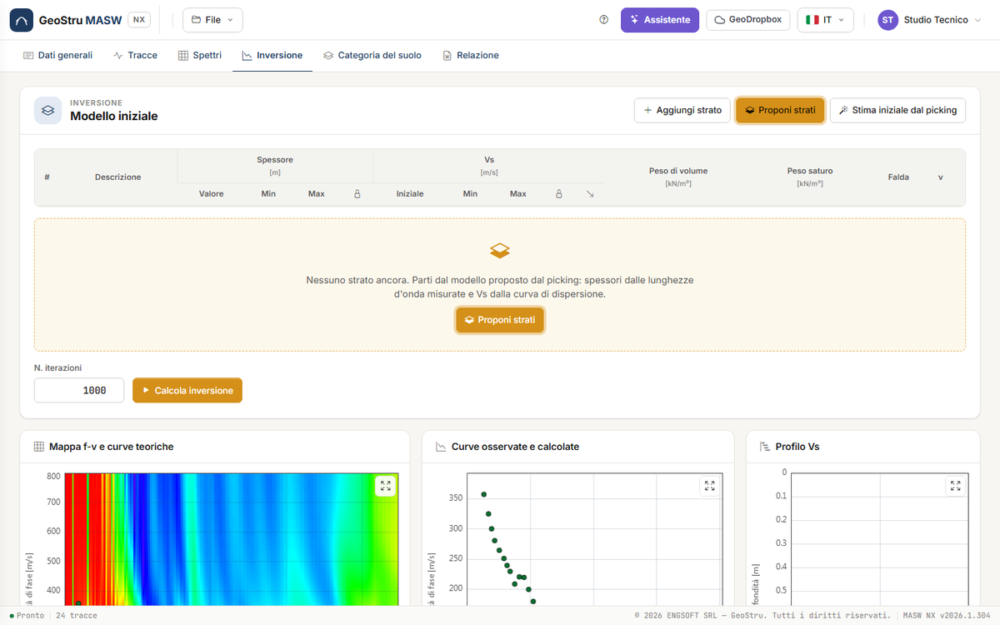
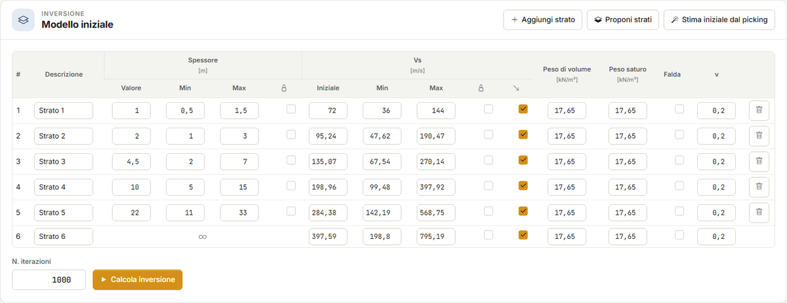
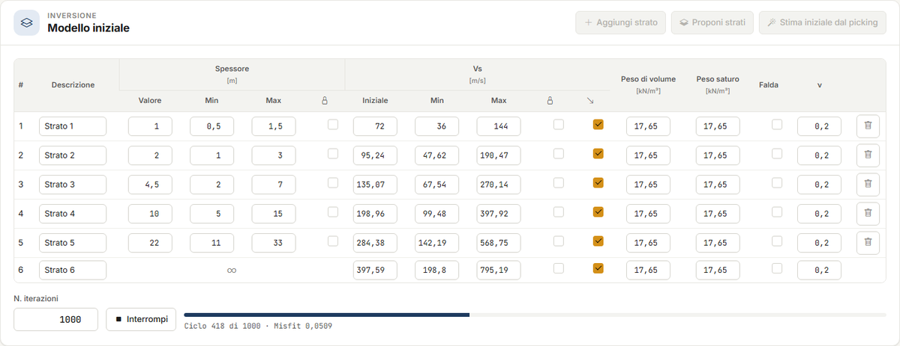
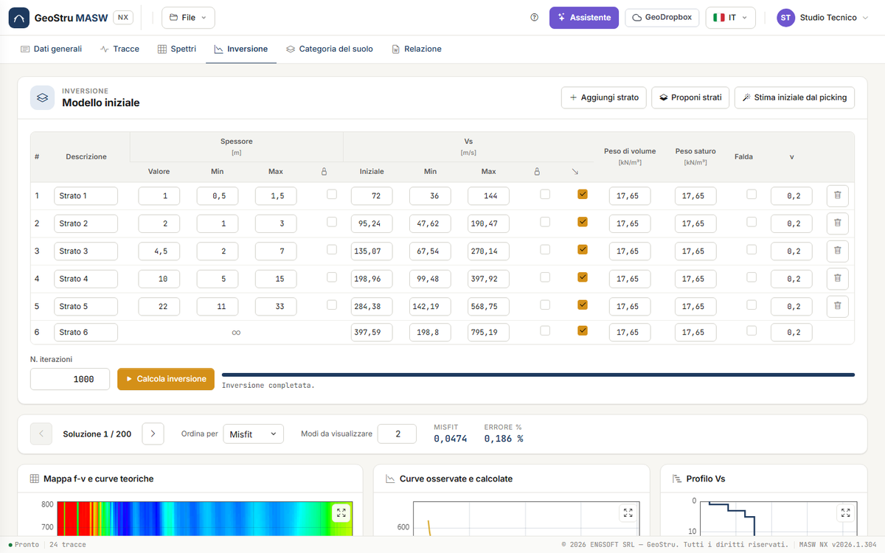
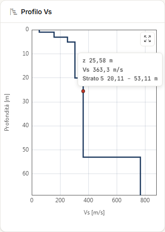
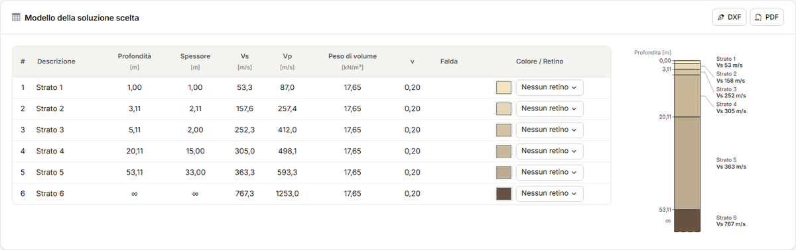

# Inversione

Nella scheda **Inversione** passi dalla curva di dispersione al **profilo di V~s~**: imposti
un modello iniziale a strati, l'app cerca i profili le cui curve teoriche riproducono meglio
il picking, e tu scegli la soluzione. Impostare il modello è gratuito; **Calcola inversione**
consuma crediti.

## Il modello iniziale

La card **Modello iniziale** è la tabella degli strati, dall'alto verso il basso. L'ultimo
strato è il **semispazio**: il suo spessore è infinito (∞). Per ogni strato:

| Colonna | Significato |
|---|---|
| **Descrizione** | Il nome dello strato, che compare nei risultati e nella colonna stratigrafica. |
| **Spessore** — Valore, Min, Max [m] | Lo spessore di partenza e l'intervallo entro cui l'inversione lo può cambiare. |
| **Spessore** — lucchetto | **Bloccato**: lo spessore non viene ottimizzato. |
| **V~s~** — Iniziale, Min, Max [m/s] | La V~s~ di partenza e l'intervallo di ricerca. |
| **V~s~** — lucchetto | La V~s~ dello strato non viene ottimizzata. |
| **V~s~** — freccia | **V~s~ non diminuisce con la profondità**: la V~s~ dello strato non può essere minore di quella dello strato sopra. Toglila per cercare un'inversione di velocità. |
| **Peso di volume**, **Peso saturo** [kN/m³] | Il peso dello strato, sopra e sotto falda. |
| **Falda** | Lo strato è sotto falda: si usa il peso saturo. |
| **ν** | Il coefficiente di Poisson, che lega V~p~ a V~s~. Non viene ottimizzato. |

**Aggiungi strato** aggiunge uno strato sopra il semispazio; il cestino lo elimina. Servono
almeno due strati, al massimo 40.

!!! note "Peso di volume e densità"
    A video i pesi sono in **kN/m³**. Nel calcolo la curva usa la densità ρ in kg/m³, che è
    il peso diviso per g (17,65 kN/m³ ↔ 1 800 kg/m³), come nel desktop. La curva di
    dispersione è poco sensibile a ρ e a ν: quello che conta sono spessori e V~s~.

### Proponi strati

Con la tabella vuota e un picking presente, la card mostra al centro **Proponi strati** e il
pulsante in alto **pulsa**: è il primo passo consigliato.

**Proponi strati** costruisce un modello di sei strati dalle **lunghezze d'onda del picking**
(λ = v/f):

- il **primo strato** è spesso circa **λ~min~/2**, la profondità più piccola che il picking
  risolve;
- la **profondità del semispazio** è circa **λ~max~/3**, fra 5 e 40 m;
- gli spessori intermedi crescono in **progressione** dal primo al semispazio, arrotondati al
  mezzo metro;
- ogni spessore può variare del **±50 %** (Min e Max), perché l'inversione possa spostare le
  profondità;
- le V~s~ iniziali, con Min = metà e Max = doppio, vengono dal picking come in **Stima
  iniziale dal picking** (sotto); Poisson 0,2; la freccia «non diminuisce» è attiva.

Se la tabella ha già strati, l'app chiede conferma in una striscia gialla prima di
sostituirli.

### Stima iniziale dal picking

**Stima iniziale dal picking** lascia gli spessori come sono e ricalcola solo le V~s~
iniziali e i loro limiti. Ogni punto del picking dà tre profondità, λ/2 calcolata su v e sui
due estremi della sua barra d'incertezza; la V~s~ iniziale di uno strato è la media delle
velocità le cui profondità cadono dentro lo strato. Min e Max sono metà e doppio. Con la
tabella vuota, parte dagli strati proposti.

## Calcola inversione

Scrivi il numero di iterazioni in **N. iterazioni** (fino a 20 000; 1 000 è il valore
abituale) e premi **Calcola inversione**. Una barra mostra il ciclo e il misfit corrente;
**Interrompi** ferma la corsa senza addebito.

L'inversione usa **tutti i punti del picking, su tutti i modi**: ogni modo è confrontato con
il modo teorico corrispondente. Il metodo (simplesso di Nelder e Mead con vincoli) e la
funzione obiettivo sono in [Cenni teorici](teoria.md#inversione).

!!! warning "Tieni aperta la pagina"
    Il calcolo gira sul server, ma le soluzioni ti vengono consegnate, e i crediti
    addebitati, quando la pagina chiede l'esito alla fine della corsa. Se chiudi il browser
    prima della fine, la corsa non viene consegnata né addebitata.

Se durante la corsa cambi picking o strati, il risultato viene scartato e non è addebitato.
Una corsa fallita, interrotta o superata non costa nulla.

## Le soluzioni

A corsa finita, il navigatore mostra **Soluzione 1 / N**: le soluzioni sono i modelli
valutati, fino a 200, ordinate dalla migliore. Le frecce le sfogliano; **Ordina per** sceglie
fra **Misfit** ed **Errore %**. Accanto leggi misfit ed errore percentuale della soluzione a
video.

La soluzione a video è quella che va nella categoria e nella relazione: se ne preferisci
un'altra (per esempio con uno strato più plausibile e un misfit di poco più alto), sceglila
qui.

**Modi da visualizzare** dice quante curve teoriche disegnare per la soluzione. È **solo
visualizzazione**: non entra nel calcolo, e l'inversione usa comunque tutti i modi del
picking.

Due corse sugli stessi dati danno soluzioni un po' diverse: la ricerca parte da punti
casuali. Se due corse portano a profili molto diversi con misfit simili, il picking non basta
a distinguerli.

## I grafici

Tre grafici seguono la soluzione a video:

- **Mappa f-v e curve teoriche** — la mappa dello spettro con le curve dei modi della
  soluzione;
- **Curve osservate e calcolate** — i punti del picking e le curve teoriche, un colore per
  modo;
- **Profilo Vs** — il profilo a gradini. Passando il mouse sul profilo leggi la profondità z,
  la V~s~ e lo strato, con le sue quote di tetto e letto.

Per muoverti sui grafici (Ctrl+rotella, doppio clic) vedi
[Spettro f-v e picking](spettri.md#muoversi-sul-grafico).

## Modello della soluzione scelta e colonna stratigrafica

La card **Modello della soluzione scelta** riporta, per ogni strato, profondità della base,
spessore, V~s~, V~p~, peso di volume, ν e falda. Accanto, la **colonna stratigrafica** in
scala, con le quote e la V~s~ di ogni strato.

Nella colonna **Colore / Retino** scegli per ogni strato:

- il **colore** (il quadratino apre il selettore). Senza scelta, il colore viene dalla V~s~;
- il **retino**: Nessun retino, Sabbia, Ghiaia, Limo, Argilla, Organico, Roccia.

Colore e retino non entrano nel calcolo: servono alla colonna a video, nella relazione e nei
disegni. I pulsanti **DXF** e **PDF** in testa alla card esportano la colonna stratigrafica
per la relazione; consumano crediti come le esportazioni della scheda
[Relazione](relazione.md#disegni-dxf-e-pdf).

## Quando i risultati sono superati

Se dopo l'inversione cambi picking, strati, tracce o filtro, una striscia avvisa che i
risultati non corrispondono più ai dati. La scheda Categoria mostra lo stesso avviso, e la
relazione e i disegni non si generano finché non rifai l'inversione.

---

*Hai trovato un errore in questa pagina? [Segnalacelo](mailto:info@geostru.ai?subject=Help%20MASW%20NX) o apri una [Pull Request](https://github.com/EngSoft-Geostru/geostru-help-nx/edit/main/masw/docs/it/inversione.md).*
