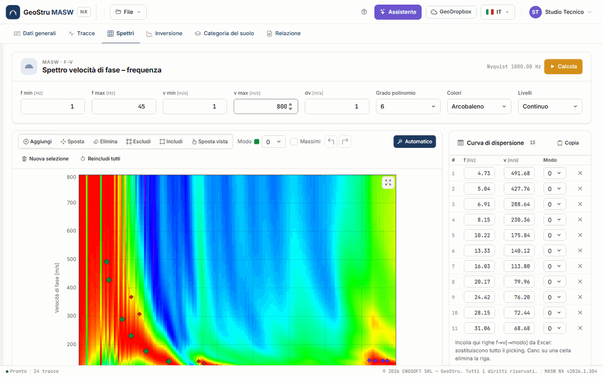
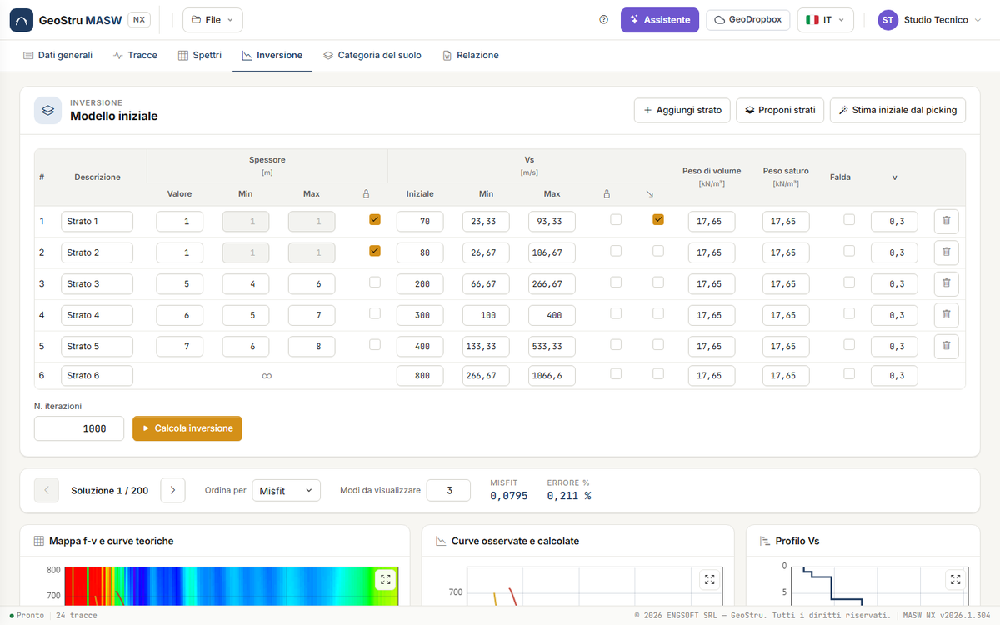
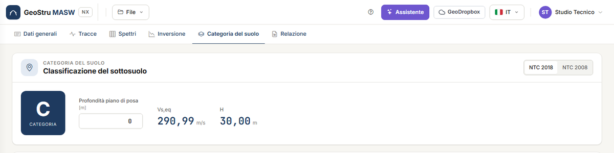

# Guida rapida (5 minuti)

Fai il giro completo con il progetto di esempio del desktop: **24 tracce** a passo 1 m,
sorgente a 6 m dal primo geofono, il picking della curva di dispersione su tre modi e
un'inversione già eseguita. Non serve caricare nulla.

## 1. Apri l'esempio

Vai su [nx.geostru.ai/masw](https://nx.geostru.ai/masw/) con il tuo account GeoStru. Apri la
scheda **Tracce** e premi **Carica l'esempio**, oppure apri il menu **File** e scegli **Apri
l'esempio**. Se in sessione c'è già un progetto con modifiche non salvate, una striscia sotto
la barra chiede che cosa fare: **Salva prima**, **Continua senza salvare** o **Annulla**.

## 2. Guarda le tracce

La scheda **Tracce** mostra il **sismogramma**: le 24 tracce affiancate, il tempo in verticale
e il quadratino rosso della **Sorgente** a sinistra del primo geofono. Nella card
**Acquisizione** leggi il passo di campionamento dt = 0,0005 s, l'interdistanza dx = 1 m e la
**Distanza sorgente** di 6 m.

La rotella del mouse sul sismogramma ingrandisce il tempo; **Tutto** torna alla vista intera.
Vedi [Tracce](tracce.md).

## 3. Guarda lo spettro e il picking

Apri la scheda **Spettri**. La mappa **Spettro velocità di fase – frequenza** è già calcolata:
in ascissa la frequenza, in ordinata la velocità di fase, in rosso le zone di massima energia.
I rombi colorati sono i punti del **picking**, un colore per modo; la tabella **Curva di
dispersione** a destra elenca i punti del modo scelto nella tendina **Modo**.

Il cursore sulla mappa mostra f, v e la lunghezza d'onda λ = v/f nella riga in fondo al
grafico. Vedi [Spettro f-v e picking](spettri.md).

## 4. Leggi l'inversione

Apri la scheda **Inversione**. In alto c'è il **Modello iniziale**: sei strati con spessori,
V~s~ iniziali e i limiti entro cui l'inversione li ha cercati. Sotto, il navigatore delle
soluzioni: **Soluzione 1 / 200**, la migliore, con **Misfit 0,0795** ed **Errore % 0,211 %**.

Scorri: i tre grafici mostrano la mappa f-v con le curve teoriche della soluzione, le curve
osservate e calcolate, il **Profilo Vs**. Passa il mouse sul profilo per leggere profondità,
V~s~ e strato. Più in basso la tabella **Modello della soluzione scelta** e la colonna
stratigrafica. Vedi [Inversione](inversione.md).

## 5. Leggi la categoria

Apri la scheda **Categoria del suolo**. Con il piano di posa a 0 m l'esempio dà
**V~s,eq~ = 290,99 m/s**, **H = 30 m** e categoria **C** secondo le NTC 2018; la riga della
categoria è evidenziata nella tabella.

Prova a scrivere **3** in **Profondità piano di posa**: V~s,eq~ si ricalcola sotto il piano di
posa. Premi **NTC 2008** per la classificazione con V~s,30~. Vedi
[Categoria di sottosuolo e parametri](categoria.md).

## 6. Guarda la relazione

Apri la scheda **Relazione**. A destra l'**Anteprima** mostra il documento impaginato, gratis:
scorrila. Quando va bene, **Genera Word** scarica il `.docx`.

!!! note "Questa azione consuma crediti"
    **Genera Word**, **Esporta DXF**, **Esporta PDF** e **Calcola inversione** consumano
    crediti NX; tutto il resto di questa guida è gratuito. Se l'operazione non va a buon
    fine non viene addebitato nulla.

## 7. Salva il progetto

**File → Salva con nome…** (Ctrl+Maiusc+S) salva il progetto in un file `.maswnx` sul tuo
computer; da lì in poi **File → Salva** (Ctrl+S) riscrive lo stesso file. Fallo prima di
chiudere: il progetto vive sul server solo per la durata della sessione.

## Con i tuoi dati

- **Hai le tracce registrate**: **File → Nuovo progetto**, poi la scheda [Tracce](tracce.md)
  per caricarle; nella scheda [Spettri](spettri.md) premi **Calcola** e poi **Automatico** per
  un primo picking da controllare; nella scheda [Inversione](inversione.md) premi **Proponi
  strati** e poi **Calcola inversione**.
- **Hai un progetto di Easy-MASW desktop** (`.mswx`): **File → Apri…**. Tracce, picking,
  strati e soluzioni arrivano con il file. Vedi
  [File, progetti del desktop e GeoDropbox](file.md).
- **Hai già la curva di dispersione** (per esempio in un foglio di calcolo): copia le colonne
  f, v e, se c'è, il modo, e incollale nella tabella **Curva di dispersione**. Vedi
  [Spettro f-v e picking](spettri.md#copia-e-incolla).

---

*Hai trovato un errore in questa pagina? [Segnalacelo](mailto:info@geostru.ai?subject=Help%20MASW%20NX) o apri una [Pull Request](https://github.com/EngSoft-Geostru/geostru-help-nx/edit/main/masw/docs/it/quickstart.md).*
