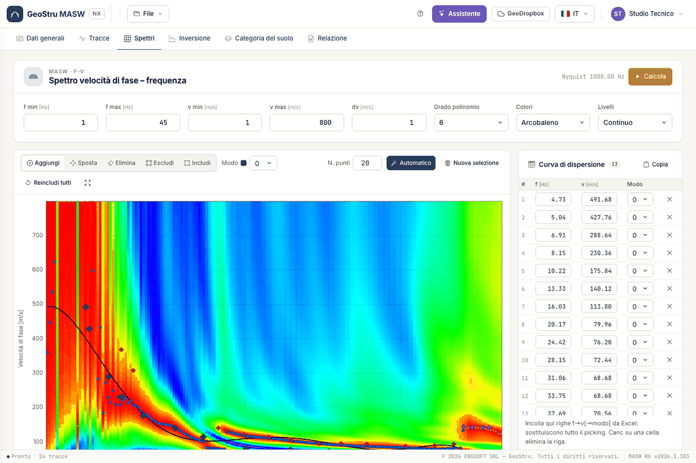
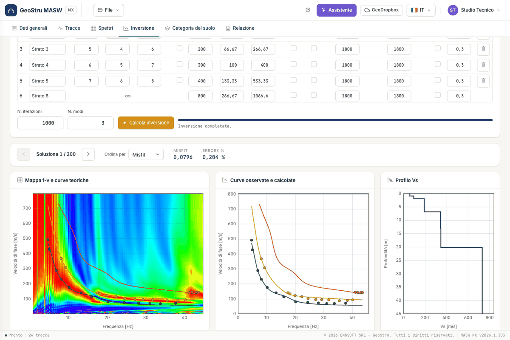
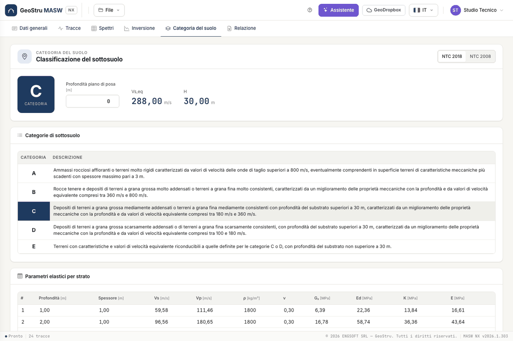

# Guida rapida (5 minuti)

Rifai il progetto di esempio dall'inizio alla fine. Serve un account con accesso all'app.

## 1. Carica l'esempio

Apri [nx.geostru.ai/masw](https://nx.geostru.ai/masw/), poi dal menu **File** carica l'esempio. Il progetto ha
24 tracce, picking e strati già pronti.

## 2. Calcola lo spettro

Nella scheda **Spettri** premi **Calcola**. Appare la mappa f-v con i massimi (blu), la regressione (nera) e i punti
di picking colorati per modo.

## 3. Lancia l'inversione

Nella scheda **Inversione** controlla la tabella degli strati e premi **Calcola inversione**. L'operazione consuma
crediti: il costo si scala solo quando la corsa consegna le soluzioni. Alla fine vedi curve teoriche, profilo V~s~ e
navigatore delle soluzioni.

## 4. Leggi la categoria

Nella scheda **Categoria del suolo** trovi V~s,eq~, H e categoria per la soluzione scelta. Se le fondazioni non
sono al piano campagna, scrivi la **Profondità piano di posa**.

## 5. Genera la relazione

Nella scheda **Relazione** controlla l'anteprima e premi **Genera Word**.

## Passi successivi

Per un rilievo tuo parti da [Tracce](tracce.md).

---

*Hai trovato un errore in questa pagina? [Segnalacelo](mailto:info@geostru.ai?subject=Help%20MASW%20NX) o apri una [Pull Request](https://github.com/EngSoft-Geostru/geostru-help-nx/edit/main/masw/docs/it/quickstart.md).*
