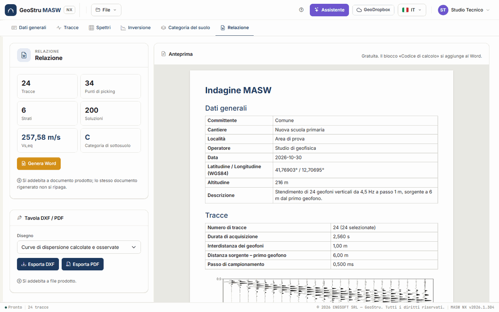

# Relazione, DXF, PDF e crediti

Dalla scheda **Relazione** escono gli elaborati della prova: la **relazione in Word**, i
**disegni** in DXF e in PDF e i **dati in CSV**. L'**anteprima** della relazione, a destra, è
gratuita, come i CSV.

## Prima di generare

Il riepilogo in alto a sinistra conta **Tracce**, **Punti di picking**, **Strati** e
**Soluzioni**, e riporta V~s,eq~ e **Categoria di sottosuolo** della soluzione scelta.
Controlla tre cose, tutte gratuite:

1. i campi della scheda **Dati generali** e dello **Studio tecnico**: aprono il documento;
2. la soluzione scelta nella scheda [Inversione](inversione.md): è quella che va nel
   documento;
3. normativa e piano di posa nella scheda [Categoria del suolo](categoria.md).

Poi guarda l'**anteprima**: è il documento come uscirà.

Senza una soluzione d'inversione **Genera Word** è disattivato e una nota rimanda
all'inversione. Se i dati sono cambiati dopo l'inversione, una striscia avvisa che la
relazione non si genera finché non la rifai.

## L'anteprima

La card **Anteprima** mostra il documento impaginato, con gli stessi testi, tabelle e figure
del Word: lo compone il server con lo stesso codice. Rispetto al Word manca solo il blocco
**Codice di calcolo**, che esiste solo nel documento emesso. L'anteprima non consuma crediti.

## Com'è fatta la relazione

Nell'ordine:

1. l'intestazione dello **Studio tecnico**, se l'hai compilata, e il titolo **Indagine
   MASW**;
2. **Dati generali** — committente, cantiere, località, operatore, responsabile, zona, data,
   coordinate WGS84, altitudine, descrizione. I campi vuoti non compaiono;
3. **Tracce** — numero di tracce e quante selezionate, durata, interdistanza, distanza
   sorgente – primo geofono, passo di campionamento, filtro; il **sismogramma**;
4. **Analisi spettrale** — frequenze e velocità della mappa; lo **spettro f-v**;
5. **Curva di dispersione** — la tabella dei punti con il modo; il **picking sullo spettro**;
6. **Inversione** — gli strati della soluzione con profondità, spessore, peso di volume, ν,
   falda, V~s~ e V~p~; misfit, errore, numero di iterazioni, soluzione scelta; le figure
   **spettro con le curve teoriche**, **curve di dispersione calcolate e osservate**,
   **profilo Vs** e **colonna stratigrafica**;
7. **Risultati** — normativa, piano di posa, V~s,eq~ (o V~s,30~), H, substrato entro 30 m,
   categoria di sottosuolo; gli **altri parametri geotecnici**;
8. **Codice di calcolo (NTC 2018 §10.2)** — il blocco che identifica il software e il
   documento;
9. l'**indice**.

## Genera Word

**Genera Word** produce un file `.docx` e il browser lo scarica.

- La relazione è scritta **nella lingua dell'interfaccia**: per averla in inglese, cambia
  lingua dal selettore in alto prima di generarla.
- Le figure sono gli stessi disegni che vedi a video, con colori e retini scelti per gli
  strati.
- All'apertura Word può chiedere di aggiornare i campi: accetta, e l'indice prende i numeri
  di pagina. In alternativa, tasto destro sull'indice → **Aggiorna campo**.
- Rigenerare lo stesso documento, con gli stessi dati e la stessa lingua, non si ripaga.

Il documento è un file Word normale: puoi modificarlo, aggiungere il tuo logo, convertirlo in
PDF dal tuo programma di scrittura.

### Il blocco «Codice di calcolo»

L'ultimo capitolo, **Codice di calcolo (NTC 2018 §10.2)**, è una tabella scritta dal software
con ciò che il punto 10.2 chiede di dichiarare:

- titolo del software e produttore;
- versione dell'app, versione del **motore di calcolo** e revisione del codice;
- licenza d'uso, intestata a chi ha generato il documento;
- **codice del documento**, nella forma `NX-…-XXXX-XXXX`, e l'indirizzo dove verificarlo;
- il rimando alla [validazione](validazione.md) del motore;
- l'impronta dei dati di ingresso.

Il codice è registrato su geostru.ai quando generi il Word: chiunque riceva la relazione può
verificare, all'indirizzo stampato nel blocco, che il documento è stato emesso da MASW NX con
quella versione. La verifica dice che il documento è stato **emesso**, non che i dati di
partenza sono corretti: quelli restano responsabilità di chi firma.

Se il registro dei documenti non risponde, la relazione **non esce** e non viene addebitato
nulla: riprova fra qualche minuto.

## Disegni DXF e PDF

Nella card **Tavola DXF / PDF** scegli il **Disegno**:

- Curve di dispersione calcolate e osservate
- Profilo Vs
- Colonna stratigrafica

e premi **Esporta DXF** o **Esporta PDF**:

- il **DXF** ha layer per ruolo (assi, griglia, curve, punti, strati, testi), nelle stesse
  unità e con gli stessi colori che vedi a video, da inserire nelle tue tavole CAD;
- il **PDF** è una pagina A4 vettoriale con il disegno e un'intestazione con committente,
  cantiere, località, data e responsabile, da allegare alla relazione.

La colonna stratigrafica si esporta anche dai pulsanti **DXF** e **PDF** della scheda
[Inversione](inversione.md#modello-della-soluzione-scelta-e-colonna-stratigrafica). I testi
sono nella lingua dell'interfaccia.

## Dati in CSV

La card **Dati in CSV** scarica, gratis, la **Curva di dispersione** (il picking) e il
**Profilo Vs** della soluzione scelta. Il separatore è il punto e virgola, il separatore
decimale il punto.

## Crediti

### Che cosa li consuma

| Azione | Quando viene addebitata |
|---|---|
| **Calcola inversione** | Quando le soluzioni vengono consegnate alla pagina, a fine corsa. |
| **Genera Word** | A documento prodotto. |
| **Esporta DXF**, **Esporta PDF** | A file prodotto. |
| **Messaggio all'assistente** | Quando la risposta arriva. |

### Che cosa è gratuito

Caricare ed elaborare le tracce, calcolare lo spettro, fare il picking manuale e automatico,
il modello sintetico, proporre gli strati e stimare le V~s~ iniziali, sfogliare le soluzioni,
la categoria, i parametri e la funzione di trasferimento, l'anteprima della relazione, i CSV,
salvare e aprire i progetti, aprire l'esempio.

### Quanto costano

Questo manuale non riporta i prezzi: cambiano con il listino, pubblicato su
[geostru.ai](https://www.geostru.ai/). Il tuo **saldo** è nel menu utente, in alto a destra.

Se il saldo non basta, l'app non esegue l'azione e mostra una striscia con i **crediti
necessari**, il **saldo** e il pulsante **Acquista crediti**. Il progetto resta in sessione:
ricarica i crediti e riprova.

### Se qualcosa va storto

**Se un'operazione non va a buon fine, non viene addebitato nulla.** Vale per ogni caso che
l'app può incontrare:

- inversione fallita, interrotta con **Interrompi**, o superata da una modifica di picking o
  strati durante il calcolo;
- errore durante la generazione del Word, del DXF o del PDF, o disegno vuoto;
- sessione scaduta: l'app lo dice e non scrive né addebita nulla;
- servizio dei crediti o registro dei documenti non raggiungibile: riprova fra qualche
  minuto;
- assistente non disponibile o risposta non arrivata.

Le condizioni complete (validità dei crediti, rimborsi) sono nei
[Termini di servizio](https://geostru.ai/it/terms-of-service/).

---

*Hai trovato un errore in questa pagina? [Segnalacelo](mailto:info@geostru.ai?subject=Help%20MASW%20NX) o apri una [Pull Request](https://github.com/EngSoft-Geostru/geostru-help-nx/edit/main/masw/docs/it/relazione.md).*
