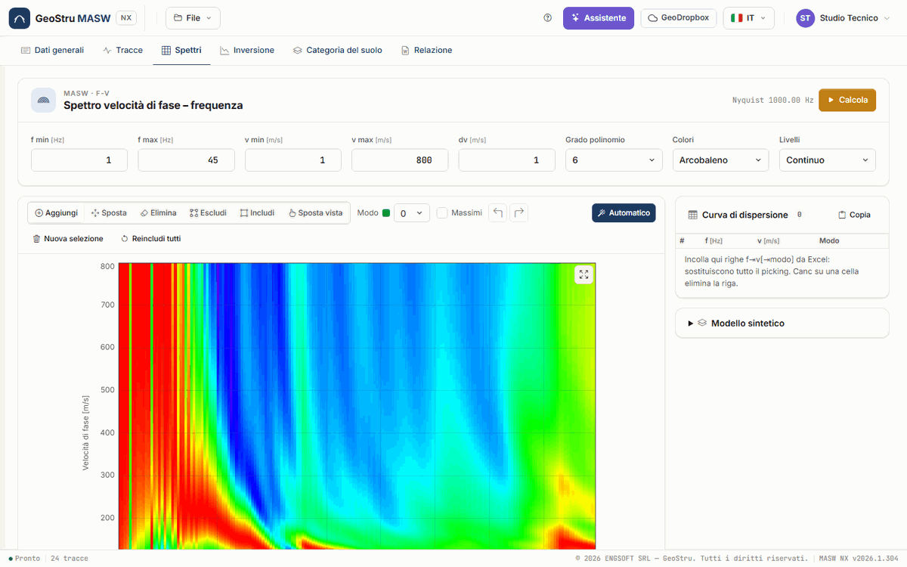
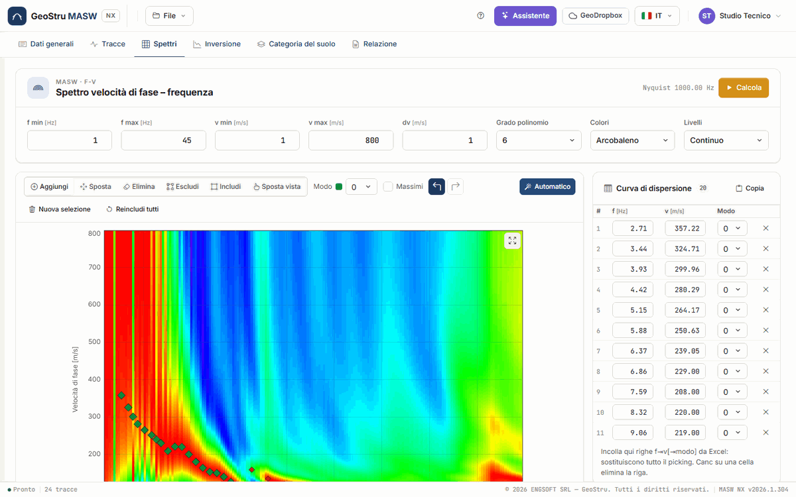
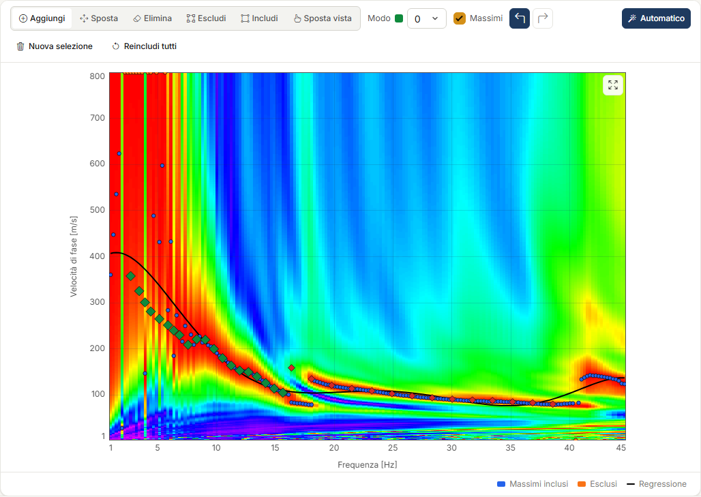
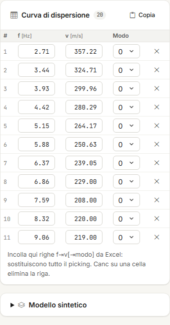
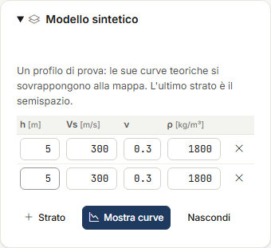

# Spettro f-v e picking

Nella scheda **Spettri** calcoli la mappa **velocità di fase – frequenza** (f-v) delle tracce
selezionate e ci leggi sopra la **curva di dispersione** delle onde di Rayleigh: è il
**picking**, il dato che l'inversione cerca di riprodurre. Calcolo, picking e modello
sintetico sono gratuiti.

## Calcolare lo spettro

In alto, la card **Spettro velocità di fase – frequenza** contiene i limiti della mappa:

| Campo | Significato |
|---|---|
| **f min**, **f max** [Hz] | Intervallo di frequenze. f max deve restare sotto la frequenza di Nyquist, 1/(2·dt), che leggi accanto al pulsante. |
| **v min**, **v max** [m/s] | Intervallo delle velocità di fase provate. |
| **dv** [m/s] | Passo di velocità. Un passo più fine dà una mappa più grande, non più precisa della risoluzione dello stendimento. |
| **Grado polinomio** | Grado (2–10) della regressione sui massimi. |
| **Colori**, **Livelli** | Tavolozza (Arcobaleno, Blu-bianco-rosso, Grigi, Caldo) e numero di livelli (Continuo, 8, 16, 32). Solo vista. |

Premi **Calcola** (o Invio in uno dei campi): il server calcola la mappa e la disegna. Ogni
colonna è normalizzata al suo massimo, quindi il colore dice dove sta l'energia a quella
frequenza, non quanto è forte rispetto alle altre.

Muovendo il cursore sulla mappa, la riga in fondo al grafico riporta f, v e la lunghezza
d'onda λ = v/f: è il dato che ti serve per capire a che profondità guarda ciascun punto.

### Muoversi sul grafico

- **Ctrl+rotella** ingrandisce attorno al cursore; con lo strumento **Sposta vista** basta la
  rotella. Senza Ctrl la rotella fa scorrere la pagina come al solito.
- Tasto destro o centrale, o **Maiusc** + trascinamento, spostano la vista; con lo strumento
  **Sposta vista** basta il tasto sinistro. Un secondo clic su **Sposta vista** o Esc
  riportano allo strumento di prima.
- **Doppio clic** o il pulsante in alto a destra del grafico (**Adatta alla vista**) tornano
  alla vista intera. Lo zoom indietro si ferma ai dati.

Gli stessi comandi valgono per tutti i grafici dell'app (inversione, categoria).

## Il picking

Il picking è l'insieme dei punti (f, v, modo) della curva di dispersione. I **modi** vanno da
0 (il **fondamentale**) a 4, ciascuno con il suo colore; la tendina **Modo** sceglie il modo
dei punti che aggiungi e quello che la tabella mostra.

### Picking automatico

**Automatico** propone un picking sulle **creste** della mappa: per ogni frequenza cerca i
massimi che emergono dalla colonna, li unisce in creste continue, scarta quelle corte o
deboli e quelle con lunghezze d'onda fuori dalla portata dello stendimento, e campiona le
creste rimaste a passo regolare. Se le creste sono più d'una, vanno su **più modi**: al modo
del [modello sintetico](#modello-sintetico) più vicino, se lo hai impostato, altrimenti in
ordine di velocità. Il picking automatico sostituisce quello presente, quindi l'app chiede
conferma.

!!! warning "È una proposta"
    Il picking automatico segue le creste che vede: dove il modo fondamentale non forma una
    cresta (spesso alle frequenze alte, o dove un modo superiore prende l'energia) non lo
    raggiunge, e può assegnare un tratto al modo sbagliato. Guarda la mappa, correggi a mano
    i punti che non ti convincono e completa i tratti mancanti.

### Strumenti di picking

La barra sopra il grafico ha sei strumenti:

| Strumento | Che cosa fa |
|---|---|
| **Aggiungi** | Un clic aggiunge un punto del modo corrente. Trascinando in verticale mentre lo aggiungi allarghi la sua barra d'incertezza. |
| **Sposta** | Trascina un punto, di qualunque modo. |
| **Elimina** | Un clic sul punto lo toglie. |
| **Escludi** | Un rettangolo trascinato sulla mappa esclude dalla regressione i massimi che contiene. |
| **Includi** | Un rettangolo rimette nella regressione i massimi esclusi. |
| **Sposta vista** | Trascinamento e rotella muovono e ingrandiscono la vista. |

Altri comandi:

- **Annulla** e **Ripristina** (Ctrl+Z e Ctrl+Y, o Ctrl+Maiusc+Z) sulle modifiche del
  picking, fino a 100 passi: aggiunte, spostamenti, eliminazioni, picking automatico,
  incolla. Dentro un campo di testo valgono quelli del campo.
- **Nuova selezione** svuota tutto il picking, dopo conferma.
- **Massimi** mostra i **massimi** di ogni colonna (in blu gli inclusi, in arancio gli
  esclusi) e la **regressione** polinomiale (in nero). È la curva apparente del desktop: un
  aiuto alla lettura, non entra nell'inversione.
- **Reincludi tutti** rimette nella regressione tutti i massimi esclusi.

## La tabella della curva di dispersione

A destra, la card **Curva di dispersione** elenca i punti del **modo scelto** nella tendina,
con il loro numero accanto al titolo. Le celle f e v si modificano a mano, la tendina
**Modo** sposta un punto su un altro modo, la × lo elimina; Canc su una cella tutta
selezionata toglie la riga. Un clic su una riga evidenzia il punto sulla mappa.

### Copia e incolla

- **Copia** mette negli appunti tutto il picking, una riga per punto: f, v e modo separati da
  tabulazione. Si incolla in un foglio di calcolo.
- Per **incollare**, copia dal foglio di calcolo due o tre colonne (f, v e, se c'è, il modo),
  fai clic nella tabella e premi Ctrl+V. Le righe incollate **sostituiscono tutto il
  picking**, dopo conferma. Senza la colonna del modo, i punti vanno sul modo corrente.

## Modello sintetico

La card **Modello sintetico** (si apre con un clic sul titolo) serve a confrontare la mappa
con un profilo di prova: scrivi gli strati, con spessore h, V~s~, ν e densità ρ, e premi
**Mostra curve**. Le curve teoriche dei modi di Rayleigh di quel profilo si sovrappongono
alla mappa; **Nascondi** le toglie. L'ultimo strato è il semispazio.

Il modello sintetico non entra nell'inversione. Serve a due cose: a capire quale cresta è il
modo fondamentale e quale un modo superiore, e a guidare il picking **Automatico**, che
assegna ogni cresta al modo sintetico più vicino.

## Quando ricalcolare

Lo spettro dipende da tracce selezionate, geometria, filtro e ritaglio. Se li cambi la
scheda Tracce lo ricorda; ricalcola e ricontrolla il picking, perché i punti restano dove
erano. Se il picking cambia dopo un'inversione, i risultati dell'inversione sono marcati come
superati.

---

*Hai trovato un errore in questa pagina? [Segnalacelo](mailto:info@geostru.ai?subject=Help%20MASW%20NX) o apri una [Pull Request](https://github.com/EngSoft-Geostru/geostru-help-nx/edit/main/masw/docs/it/spettri.md).*
