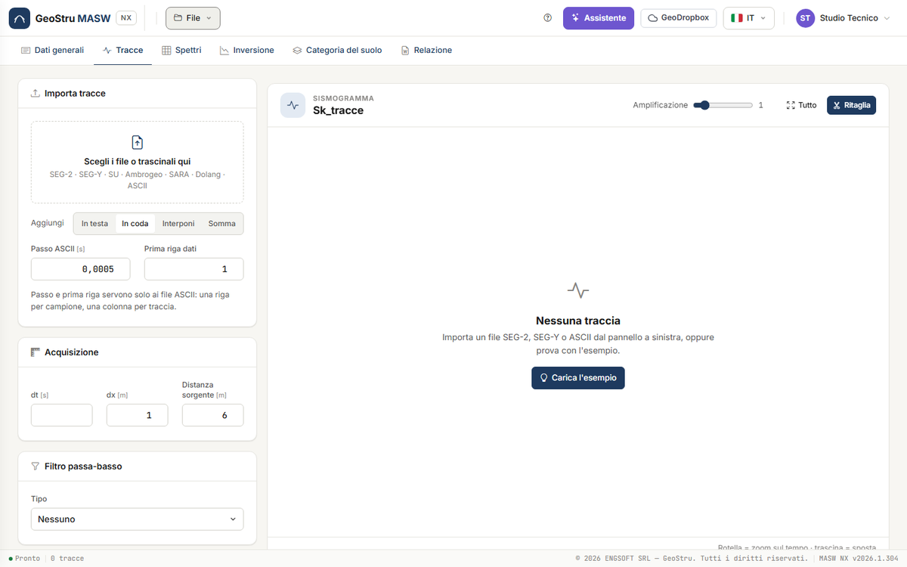
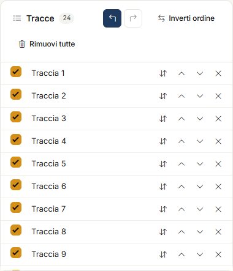
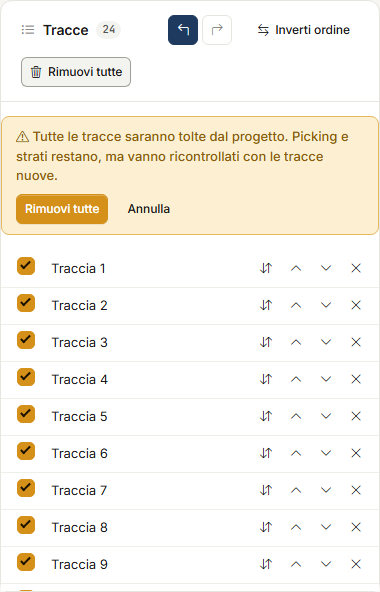
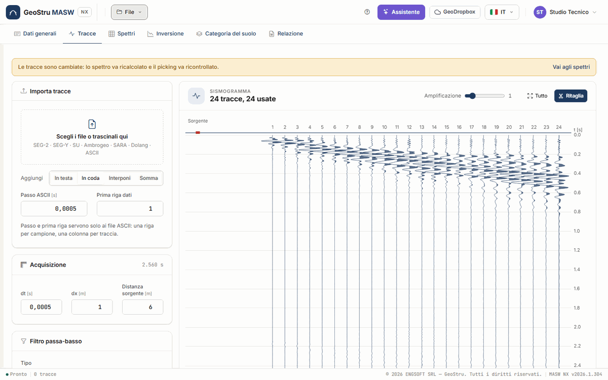
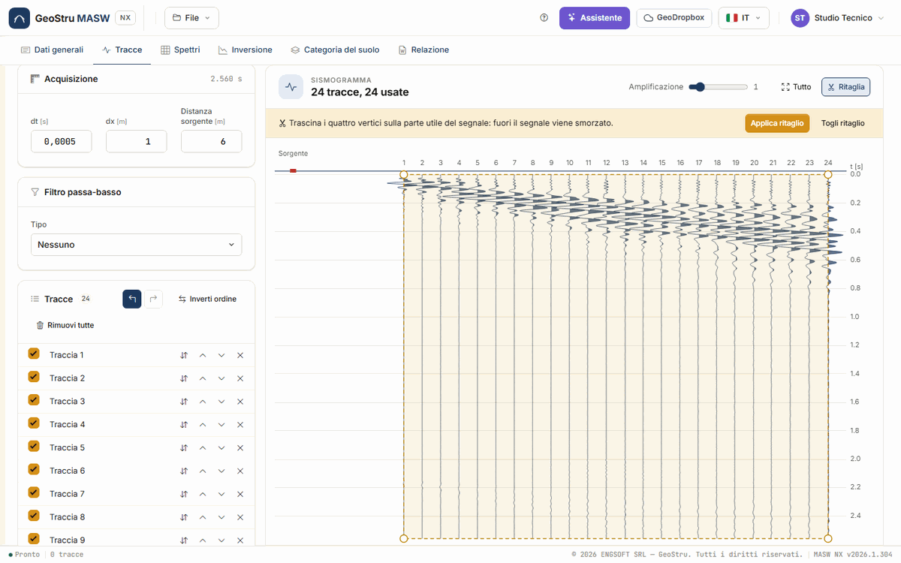

# Tracce

La scheda **Tracce** è il punto di partenza: carichi le registrazioni dello stendimento, ne
controlli la geometria, applichi se serve un filtro passa-basso e un ritaglio, e scegli quali
tracce entrano nello spettro.

## Importa tracce

Nella card **Importa tracce** fai clic su **Scegli i file o trascinali qui**, oppure trascina
i file nel riquadro. Puoi caricare più file insieme.

| Formato | Estensioni | Come viene riconosciuto |
|---|---|---|
| **SEG-2** | `.sg2`, `.seg2`, `.dat` | dai primi byte del file |
| **SEG-Y** | `.sgy`, `.segy` | dall'estensione; campioni IBM e IEEE |
| **SU** (Seismic Unix) | `.su` | dall'estensione |
| **Ambrogeo** | `.dta` | dall'estensione |
| **SARA Doremi** | `.drm` | dall'estensione o dall'intestazione |
| **Dolang** | `.txt` | dall'intestazione |
| **ASCII** | `.txt`, `.asc`, `.csv` | ciò che resta: una riga per campione, una colonna per traccia |

Per i file **ASCII** servono due dati che il file non contiene: il **Passo ASCII** (il passo
di campionamento, in secondi) e la **Prima riga dati** (per saltare le righe d'intestazione).
Agli altri formati non servono.

Ogni file può pesare fino a **64 MB**; un progetto tiene fino a **512 tracce**. Le tracce di
un file nuovo devono avere lo **stesso passo di campionamento** e lo **stesso numero di
campioni** di quelle già presenti, altrimenti l'app lo dice e non carica nulla.

!!! tip "Un progetto di Easy-MASW desktop"
    I file `.mswx` del desktop non si caricano da qui ma con **File → Apri…**: portano con sé
    anche picking, strati e soluzioni. Vedi [File](file.md#progetti-del-desktop).

### Dove vanno le tracce nuove

Il selettore **Aggiungi** decide dove vanno le tracce del file che carichi, rispetto a quelle
già presenti:

| Scelta | Che cosa fa |
|---|---|
| **In testa** | Le mette prima di quelle presenti. |
| **In coda** | Le mette dopo (è la scelta predefinita). |
| **Interponi** | Le alterna a quelle presenti: 1, nuova 1, 2, nuova 2… Serve per due acquisizioni sfalsate di mezzo passo, che insieme danno uno stendimento a passo dimezzato. Ricordati di dimezzare dx. |
| **Somma** | Le somma campione per campione a quelle presenti, la 1 con la 1, la 2 con la 2… È lo **stacking** di più colpi sulla stessa geometria, che migliora il rapporto segnale/rumore. Le tracce in più del file nuovo restano fuori. |

Senza tracce presenti, **Interponi** e **Somma** si comportano come **In coda**.

## Acquisizione

La card **Acquisizione** contiene la geometria che entra nel calcolo dello spettro:

- **dt** [s] — il passo di campionamento;
- **dx** [m] — l'interdistanza dei geofoni;
- **Distanza sorgente** [m] — la distanza fra la sorgente e il primo geofono (offset).

Alla prima importazione dt viene dal file; dai file SEG-2 l'app legge anche dx e la distanza
sorgente, se il file contiene le posizioni di sorgente e ricevitori. Controlla sempre questi
tre valori: un dx sbagliato scala tutte le velocità dello spettro. Accanto al titolo leggi la
durata dell'acquisizione.

## Filtro passa-basso

La card **Filtro passa-basso** applica un filtro alle tracce prima dello spettro. **Tipo**:
**Nessuno**, **Butterworth** o **Chebyshev**. I parametri:

- **Taglio** [Hz] — la frequenza fino alla quale il segnale passa;
- **Attenuazione a** [Hz] — la frequenza alla quale l'attenuazione è raggiunta;
- **Attenuazione** [dB] — quanto viene attenuato il segnale oltre quella frequenza;
- **Ripple** [%] — l'ondulazione ammessa in banda passante (solo Chebyshev).

Le due frequenze devono stare sotto la frequenza di Nyquist, 1/(2·dt).

## L'elenco delle tracce

La card **Tracce** elenca le tracce caricate, con il contatore. Per ogni riga:

- la casella **Usa nello spettro**: togli la spunta a una traccia rumorosa o morta, e lo
  spettro la ignora. La fase usa comunque la posizione reale di ogni geofono;
- **Inverti polarità**;
- **Sposta su** e **Sposta giù**;
- **Elimina traccia**.

In testa alla card:

- **Annulla** e **Ripristina** (Ctrl+Z e Ctrl+Y, o Ctrl+Maiusc+Z) tornano indietro e avanti
  sulle modifiche della scheda: eliminazioni, spostamenti, polarità, selezione, ordine,
  geometria e filtro, fino a 50 passi. Dentro un campo di testo Ctrl+Z resta quello del campo.
  La storia vive nella pagina: cambiare scheda o ricaricare la azzera.
- **Inverti ordine** rovescia l'ordine delle tracce, per uno stendimento registrato con la
  sorgente dall'altro lato.
- **Rimuovi tutte** toglie tutte le tracce dal progetto. Non si annulla, quindi chiede prima
  conferma in una striscia gialla. Picking e strati restano, ma vanno ricontrollati con le
  tracce nuove.

## Il sismogramma

La card **Sismogramma** disegna le tracce affiancate, con il tempo verso il basso e il
quadratino rosso della **Sorgente** alla sua distanza dal primo geofono. Il titolo dice
quante tracce ci sono e quante sono usate.

- **Amplificazione** scala le ampiezze, solo a video.
- La **rotella** sul grafico ingrandisce il tempo attorno al cursore; trascina per spostarti.
  **Tutto** torna alla vista intera.
- La riga in fondo al grafico riporta traccia e tempo sotto il cursore.

### Ritaglio

**Ritaglia** apre il ritaglio: trascina i quattro vertici del poligono sulla parte utile del
segnale (di solito il treno delle onde superficiali). Fuori dal poligono il segnale viene
smorzato. **Applica ritaglio** lo conferma, **Togli ritaglio** lo rimuove.

## Quando le tracce cambiano

Ogni modifica a tracce, geometria, filtro o ritaglio cambia lo spettro. Una striscia gialla
in alto lo ricorda: **Le tracce sono cambiate: lo spettro va ricalcolato e il picking va
ricontrollato**, con il collegamento **Vai agli spettri**. Se c'era già un'inversione, i suoi
risultati sono marcati come superati finché non la rifai.

---

*Hai trovato un errore in questa pagina? [Segnalacelo](mailto:info@geostru.ai?subject=Help%20MASW%20NX) o apri una [Pull Request](https://github.com/EngSoft-Geostru/geostru-help-nx/edit/main/masw/docs/it/tracce.md).*
