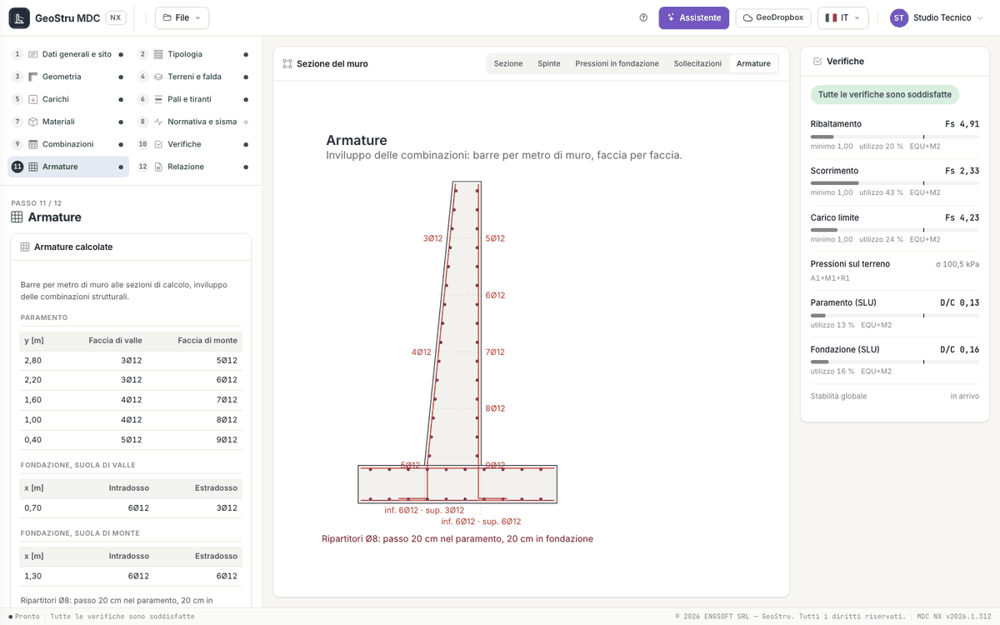
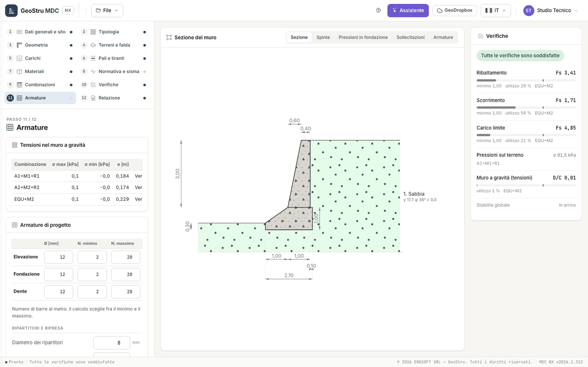

# Sections, reinforcement and bar schedule

## Design sections

The stem is divided into sections along its height; toe, heel, shear key and front shelf have their own. For every section and every
combination the program computes axial force N, shear T and moment M (**Internal forces** view) and checks them with the GeoStru RC section
solver:

| Check | Code | Combinations |
|---|---|---|
| ULS bending with axial force | NTC 2018 §4.1.2.3.4, parabola-rectangle law | STR and GEO+STR |
| Shear without shear reinforcement | NTC 2018 §4.1.2.3.5 | STR and GEO+STR |
| Service stresses and crack width | NTC 2018 §4.1.2.2.4-5 | SLE |
| Allowable stresses | D.M. 1996 | with **Section checks: Allowable stress** |

The demand/capacity ratio of each part (the most severe of bending, shear, cracking and stresses) appears in the panel as **Stem (ULS)**,
**Foundation (ULS)** and **Shear key (ULS)**, and per section in the summary of the Checks step and in the report. The formulas are in
[RC sections, piles and anchors](teoria-strutture.md).

!!! note "Note"
    The wall sections have no stirrups: shear is checked as for a member without shear reinforcement, as in the desktop program. If shear
    fails, increase the thickness or the tensile longitudinal reinforcement.

## Computed reinforcement

Step 11 · **Reinforcement** shows at the top the bars the program designed on the **envelope of the structural combinations**, within the
limits of the "Design reinforcement" panel, as bars per metre of wall:

- **stem**: for every section (level y) the bars on the front face and on the back face;
- **toe and heel** (and shear key): for every section (abscissa x) the bottom and top bars;
- **distribution bars**: diameter and spacing in the stem and in the foundation;
- **pile reinforcement** (bars and stirrups) and **anchor check**, when present.

In the centre, the **Reinforcement** view draws the bars in the section with "n Ø d" and the distribution bars.

Manual editing of the bars and the drawing of bent bars are **coming soon**. Reinforcement assigned by hand in a desktop project stays in the
file ("The file carries reinforcement assigned or edited in the desktop: it is kept"), but the calculation always designs the bars again.

## The bar schedule

Below the reinforcement, the **Bar schedule**: for every mark (P stem, F foundation, R distribution bars) description, diameter Ø [mm], number
n, length L [m] and weight [kg], with the total and the weight per diameter. The unit weight is 0.006165·Ø² kg/m (Ø in mm); weights are per
metre of wall. The shapes are the typical ones of the cantilever wall. The schedule goes into the report.

## Design reinforcement

| Field | Unit | Notes |
|---|---|---|
| Stem, Foundation, Shear key: Ø, Min. no., Max. no. | mm, bars per metre | the calculation picks the number of bars between minimum and maximum |
| Distribution bar diameter | mm | |
| Minimum distribution spacing | m | |
| Distribution percentage | % | secondary reinforcement relative to the main one |
| Starter bars | | |
| Geometric ratios (rectangular sections): Minimum, Maximum | | ratio of steel area to concrete area (e.g. 0.003 and 0.06) |

## Gravity wall

There is no reinforcement to design: the step shows the **Stresses in the gravity wall** table with, for every combination, σ max, σ min,
eccentricity e and outcome. If the eccentricity lies within the kern the section is fully compressed; outside the kern the section cracks
and the maximum compression grows. The stresses are compared with the strengths of the [Materials](materiali.md#gravity-wall) step and the
ratio appears in the panel as **Gravity wall (stresses)**.

---

*Found an error on this page? [Let us know](mailto:info@geostru.ai?subject=Help%20MDC%20NX) or open a [Pull Request](https://github.com/EngSoft-Geostru/geostru-help-nx/edit/main/mdc/docs/en/armature.md).*
