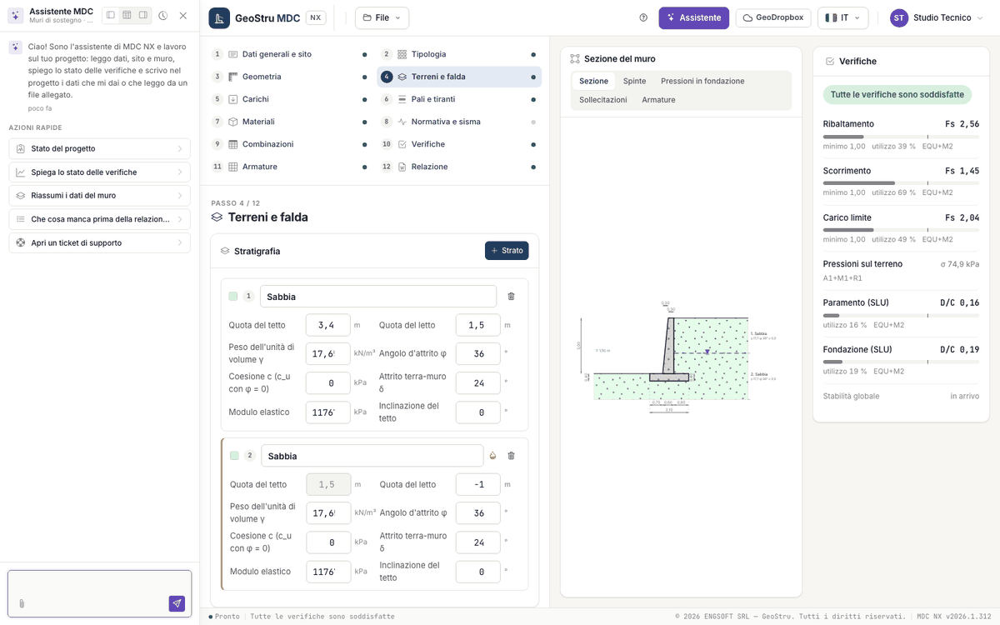

# AI assistant

The **Assistant** button in the top bar opens the chat in a side panel, which can be docked left, right or at the bottom. The assistant is
an artificial intelligence system that works on the open project: it reads general data, site and wall, runs the calculation, explains the
state of the checks and writes into the project the data you give it or that it reads from an attached file (paper clip next to the
message field).

The **quick actions** are: Project status, Explain the state of the checks, Summarise the wall data, What is missing before the report?,
Open a support ticket. Other examples:

- "Why does the seismic combination fail in sliding?"
- "Set the heel to 1.40 m."
- "Put the water table 1.5 m above the founding plane."
- "How much does the reinforcement weigh per metre of wall?"

While it works, the operations in progress appear under the message (reading the project, writing to the project, calculating the wall,
explaining a check…). It can also create a wall with the guided setup or load an example.

Rules:

- The numbers are computed by the engine: the assistant reads them with its tools and quotes them, it does not estimate them. To explain a
  check it reports the numbers of the combination and the levers of the project.
- Existing data are replaced only if you ask explicitly. Before rewriting the stratigraphy, creating a new wall in place of the existing one
  or loading an example it asks for confirmation. No tool deletes data: rows, layers and loads are removed from the page.
- The seismic parameters from the service are computed with the button of the [Code and seismic action](sisma.md) step; the assistant
  writes them only if you give them or if it reads them from a file.
- It does not generate the report or the DXF (they use credits: you download them from the Report step).
- While the assistant writes, the page does not accept changes; after a change by the assistant it refreshes by itself.

Every message uses NX credits; a message that ends in an error is not charged. From the chat you can also open a support ticket.

---

*Found an error on this page? [Let us know](mailto:info@geostru.ai?subject=Help%20MDC%20NX) or open a [Pull Request](https://github.com/EngSoft-Geostru/geostru-help-nx/edit/main/mdc/docs/en/assistente.md).*
