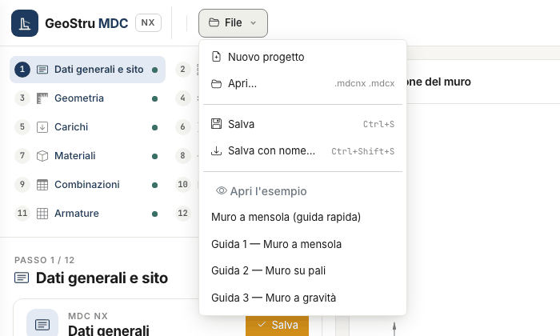

# Files, desktop projects and GeoDropbox

The **File** menu at the top left collects opening, saving and examples.

| Item | What it does |
|---|---|
| New project | empties the project; the wall is then created with the guided setup of the Wall type step |
| Open… | opens an MDC NX `.mdcnx` file or a desktop `.mdcx` file |
| Save (Ctrl+S) | rewrites the open file; if there is none, asks where to save |
| Save as… (Ctrl+Shift+S) | saves the project in a new `.mdcnx` file |
| Open the example | Cantilever wall (quick guide), Guide 1 — Cantilever wall, Guide 2 — Wall on piles, Guide 3 — Gravity wall |

New project, Open and the examples replace the open project: if there are unsaved changes, a strip below the bar offers **Save first**,
**Continue without saving** or **Cancel**. Next to the menu appears the name of the file that "Save" writes to, when the browser can rewrite
it.

## The `.mdcnx` file

The project lives on the server while you work and expires after a period of inactivity: save it. The `.mdcnx` file is JSON in SI units and
contains only the input data: the results are computed again on opening.

## Desktop projects

**File → Open…** also accepts the `.mdcx` projects of MDC desktop. The app reads wall type, geometry, profile, layers, water table, loads,
materials, combinations, seismic parameters, piles and anchors, converts the desktop units (cm, t/m², kg/cm²) into SI and **recalculates**
everything.

After opening, the active step shows a strip: "Desktop project opened: check the data before calculating", with the **Import notes** to
expand. What to expect:

- **the code of the file stays**: if the first release does not compute it (D.M. 1996, OPCM 3274, foreign codes) the app shows a warning in
  the Code and seismic action step;
- **the combinations of the file stay** and are customised; **Back to the code** replaces them with the generated ones;
- **gabions, stone masonry and counterforts** are kept but not computed: they come with the second release;
- **reinforcement assigned by hand** in the desktop: kept in the file, but the calculation always designs the reinforcement;
- **results stored in the file**: not used, because they may come from an older version or from different data.

Results may differ from the desktop where MDC NX corrects a defect of the program: the list is in [Validation and limits](validazione.md).

## GeoDropbox

The **GeoDropbox** button in the top bar saves the project (`.mdcnx`) into a GeoDropbox project, also a new one, or opens a `.mdcnx` or
`.mdcx` file stored there. The project in the cloud is available from any workstation and can be shared with your office.

## Examples

The examples load a complete wall, useful to see all views without typing data: **Guide 1** is a 3 m cantilever wall on sand, **Guide 2** a
wall on two rows of piles, **Guide 3** a gravity wall. Their numbers are those of the test cases of the [validation](validazione.md).

---

*Found an error on this page? [Let us know](mailto:info@geostru.ai?subject=Help%20MDC%20NX) or open a [Pull Request](https://github.com/EngSoft-Geostru/geostru-help-nx/edit/main/mdc/docs/en/file.md).*
