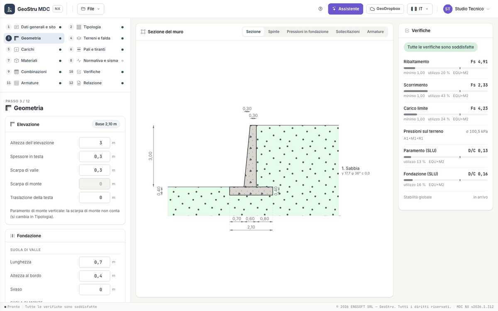

# Geometry

Step 3 describes the wall section by elements. All dimensions are in **metres**, slopes in **degrees**. Every field is saved when you leave
it: the section in the centre is redrawn and the checks are updated. The dimensions of the section can also be changed with a click on
their value in the drawing.

## Reference

The calculation is per **metre of wall**. The toe side (downhill) is on the left, the backfill (uphill) on the right. The wall coordinates
have x = 0 at the toe edge of the foundation and y = 0 on the founding plane; the moment pole for overturning is the toe corner of the base.
At the top of the stem panel the app shows the base width that results from the dimensions.

## Stem

| Field | Unit | Notes |
|---|---|---|
| Stem height | m | from the foundation to the top |
| Top thickness | m | |
| Front batter | m | projection of the front face foot relative to the top |
| Back batter | m | used only with a battered back face (chosen in Wall type) |
| Top shift | m | |

With a **stepped** back face the list of steps appears (**Rise** and **Tread**, from the top): the sum of the rises is the wall height and
the last tread is 0.

## Foundation

| Group | Fields | Notes |
|---|---|---|
| Toe | Length, Edge depth, Haunch | the haunch is the increase in depth from the edge to the stem |
| Heel | Length, Edge depth, Haunch | the soil above the heel enters the checks as stabilising weight |
| Slopes and length | Base inclination (°), Heel face inclination (°), Wall length (m) | the founding plane can be inclined only with a shallow foundation or with shear key; the wall length is used only for quantities |

## Shear key

The panel opens when the foundation in the Wall type step is **With shear key**. Fields: **Width**, **Depth** and **Distance from the heel
edge** (m). The shear key increases the sliding resistance: the sliding plane passes through its bottom.

## Shelves and blinding

Each part has a switch, the same as in the Wall type step.

| Part | Fields |
|---|---|
| Back shelf | Width, Depth, Distance from the top (m) |
| Front shelf | Distance from the top, Overhang, Depth at root, Depth at tip (m); Number of bars; Bar diameter (mm) |
| Blinding concrete | Projection, Thickness (m) |

The actions carried by the front shelf are entered as point loads in the [Loads](carichi.md) step: without them the shelf is designed with
the minimum reinforcement.

## Checks on the data

A negative dimension, a foundation narrower than the top thickness, a shear key outside the foundation or a founding plane inclined more
than 45° are **errors**: they appear next to the field and in the "To check in the project" box, and the wall is not calculated until you
fix them. **Warnings** (for instance a code that the first release does not compute) do not stop the calculation.

---

*Found an error on this page? [Let us know](mailto:info@geostru.ai?subject=Help%20MDC%20NX) or open a [Pull Request](https://github.com/EngSoft-Geostru/geostru-help-nx/edit/main/mdc/docs/en/geometria.md).*
