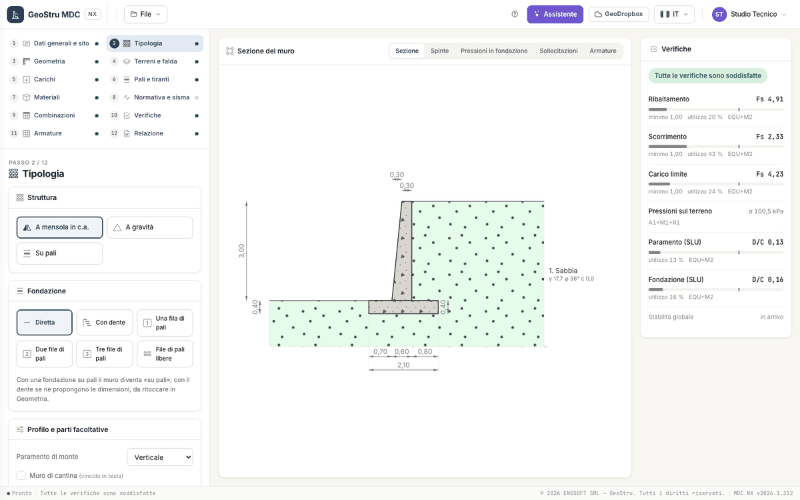

# MDC NX

**MDC NX** is the GeoStru web app for the design and verification of **retaining walls** to **NTC 2018** and the **Eurocodes**. It is the
port of the MDC desktop program: same calculation phases, same results where the desktop is right, declared corrections where it is not
(see [Validation and limits](validazione.md)).

You describe the wall section, the soil, the water table and the loads; the app generates the load combinations of the code, computes the
earth pressures, runs the global and structural checks, designs the reinforcement and prepares the report. The calculation runs on the
server and restarts at every change; in the browser you see the section, the diagrams and the checks.

[**Open the app**](https://nx.geostru.ai/mdc/){ .md-button .md-button--primary }

## What it does

1. **Earth pressures** on the stem and on the virtual back: active (Coulomb/Müller-Breslau or Rankine) or at rest, seismic
   (Mononobe-Okabe), on layered soil with water table, ground profile in segments, distributed surcharges and point loads.
2. **Global checks** for every combination: sliding on the founding plane, overturning, bearing capacity (Vesic or Brinch Hansen), ground
   pressures under the foundation.
3. **Pseudo-static seismic action** to NTC 2018: site parameters from the coordinates, k~h~ and k~v~ for retaining walls, inertia forces.
4. **RC sections** of stem, toe, heel and shear key: ULS bending with axial force and shear, SLS stresses and cracking (or allowable
   stresses).
5. **Reinforcement** designed on the envelope of the combinations, with **bar schedule** and weights.
6. **Piles** (one, two, three rows or free rows) and **ground anchors**, with the distribution of actions and the checks of every row and
   every anchor.
7. **Word report** with the "Calculation code" block and a code that can be verified online, **section in DXF**, `.mdcnx` project.

## Wall types

| Type | What changes |
|---|---|
| RC cantilever wall | the base case: stem, toe and heel; shear key, back shelf, front shelf and blinding concrete optional |
| Gravity wall | no reinforcement; the stresses in the wall body are checked |
| Wall on piles | the foundation actions go to the piles under a rigid cap; every row is checked |
| Anchored wall | one or more ground anchors on the stem, each one checked |

Counterfort and gabion walls, seismic displacements, seismic capacity and global stability are **coming** with the second release. A desktop
project that contains them opens and keeps them, but does not compute them.

## The page

Everything is on one page: on the left the **12 steps** of the project and, below them, the active step; in the centre the live **wall
section**, with the views Section, Thrusts, Foundation pressures, Internal forces and Reinforcement; on the right the **Checks** panel. There
are no pop-up windows: confirmations and messages are strips in the page, data errors appear next to the field.

The dot next to each step tells whether it is complete or something is missing.

| Step | What you do |
|---|---|
| 1 · [General data and site](progetto.md) | description, client, site, site location, engineering firm |
| 2 · [Wall type](progetto.md#wall-type) | structure, foundation, back face profile, optional parts, guided setup |
| 3 · [Geometry](geometria.md) | stem, toe and heel, slopes, shear key, shelves, blinding |
| 4 · [Soils and water table](terreno.md) | layers, water table, ground profile, backfills |
| 5 · [Loads](carichi.md) | distributed surcharges on the backfill and point loads |
| 6 · [Piles and anchors](pali-tiranti.md) | piles (only with a piled foundation) and ground anchors |
| 7 · [Materials](materiali.md) | concrete, steel, factors, covers, gravity wall |
| 8 · [Code and seismic action](sisma.md) | code, earth pressure and bearing capacity options, seismic parameters, k~h~ and k~v~ |
| 9 · [Load combinations](verifiche.md#load-combinations) | combinations generated from the code or customised |
| 10 · [Checks](verifiche.md) | safety factors per combination, partial factors, check × combination summary |
| 11 · [Reinforcement](armature.md) | computed reinforcement, bar schedule, design data for the bars |
| 12 · [Report](relazione.md) | free preview, Word and DXF for credits |

Start with the [Quick start](quickstart.md). Before using the results in a project, read [Validation and limits](validazione.md).

---

*Found an error on this page? [Let us know](mailto:info@geostru.ai?subject=Help%20MDC%20NX) or open a [Pull Request](https://github.com/EngSoft-Geostru/geostru-help-nx/edit/main/mdc/docs/en/index.md).*
