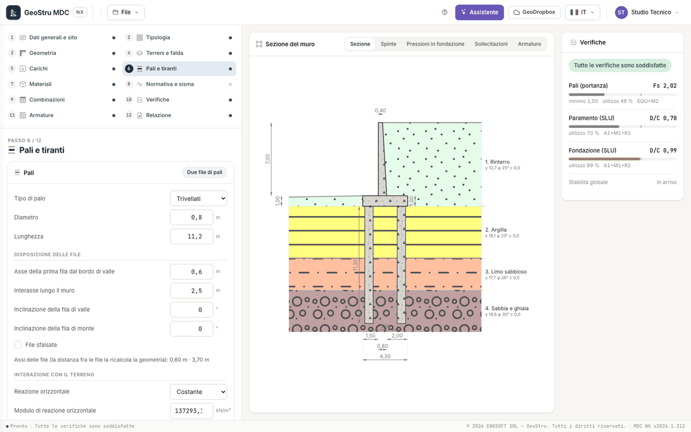

# Piles and anchors

Step 6 has two panels: **Piles** and **Ground anchors**.

## Piles

The panel is filled in only with a piled foundation, chosen in the [Wall type](progetto.md#wall-type) step (one, two, three rows or free pile
rows): otherwise a link leads to that step. The actions that the wall transmits to the foundation (horizontal force, vertical force and
moment) reach the piles through a **rigid cap**.

### Pile

| Field | Unit | Choices and notes |
|---|---|---|
| Pile type | | Bored, Driven, Micropiles |
| Diameter | m | |
| Length | m | the last soil layer must reach below the pile tip |

### Row layout

With one, two or three rows:

| Field | Unit | Notes |
|---|---|---|
| First row axis from the toe edge | m | |
| Spacing along the wall | m | the same for all rows |
| Front, back, middle row inclination | ° | those needed by the number of rows |
| Staggered rows | | from two rows up |

Below, the app shows the resulting row axes: the distance between the rows follows from the foundation geometry. With **Free pile rows**
there is instead a table (**+ Row**) with, for each row, abscissa x [m], inclination [°], spacing [m] and stagger [m], up to eight rows.

The app checks the layout: inclination over 30°, axis outside the foundation or spacing smaller than the diameter are errors; spacing smaller
than three diameters is a warning.

### Soil interaction and actions on piles

| Field | Unit | Choices and notes |
|---|---|---|
| Lateral reaction | | Constant, Increasing with depth |
| Lateral subgrade modulus | kN/m³ | |
| Poisson's ratio | | |
| Fixed-head piles | | checkbox; otherwise pinned |
| Group efficiency (Converse-Labarre) | | checkbox |
| Actions on piles | | Overturning moment, Resultant moment |
| Share of load to piles | % | the rest goes to the soil under the cap |
| Investigated verticals | | for the NTC 2018 correlation factors ξ |

### Pile reinforcement

| Field | Unit | Notes |
|---|---|---|
| Reinforcement | | Bars, Steel tube |
| Bar diameter, Minimum number of bars | mm, — | with bars |
| Tube outer and inner diameter | mm | with the steel tube |
| Stirrup diameter | mm | |
| Maximum stirrup spacing | m | |

The program distributes the actions among the rows, then checks **every row**: axial force, shear and moment at the head of the single pile,
capacity and safety factor. The capacity of the pile group is that of the **critical row**, with the lowest factor; the reinforcement is on
the envelope of the structural combinations and is shown in the [Reinforcement](armature.md) step. The formulas are in
[RC sections, piles and anchors](teoria-strutture.md).

!!! note "Note"
    For the **wall on piles** sliding, overturning and bearing capacity of the shallow foundation do not appear: the **Piles (capacity)**
    check replaces them. The **Foundation pressures** view shows the actions at the head of every row.

## Ground anchors

Anchors are added with **+ Anchor** (up to ten). Each one is a force applied to the stem, the working load divided by the spacing, which
enters the equilibrium of the wall in all combinations with the TIR factor of the combination (1 in the generated ones).

| Field | Unit | Notes |
|---|---|---|
| Distance from the wall top | m | the anchor head must be on the stem |
| Downward inclination | ° | 0 to 60 |
| Free length, Bond length | m | |
| Bond diameter, Hole diameter | m | |
| Working load | kN | |
| Spacing | m | the force per metre of wall is the load divided by the spacing |
| Bond adhesion | kPa | |
| Bond friction | ° | |
| Number of strands | | |
| Steel strength | MPa | |

With at least one anchor the **common parameters** appear: Safety factor, Prestress losses (%), Grout-steel bond (kPa), Strand diameter (mm)
and Factor ξ.

The anchorage resistance is the smallest of the **bond** in the soil, the grout-strand **adhesion** and the **steel**; the check compares the
design load with this resistance and appears in the panel as **Anchors**.

!!! note "Note"
    The free length is not checked against a slip surface: that check belongs to global stability, which is coming.

---

*Found an error on this page? [Let us know](mailto:info@geostru.ai?subject=Help%20MDC%20NX) or open a [Pull Request](https://github.com/EngSoft-Geostru/geostru-help-nx/edit/main/mdc/docs/en/pali-tiranti.md).*
