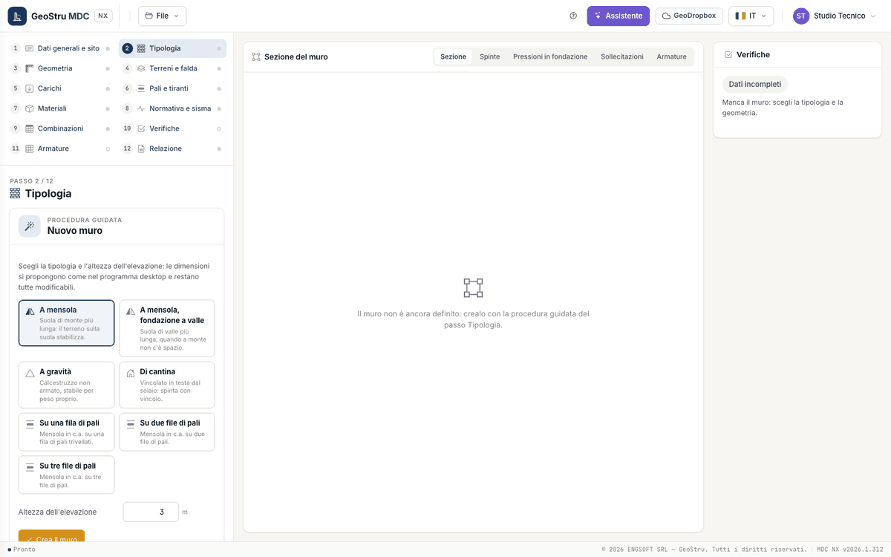

# General data and wall type

The first two steps collect what applies to the whole project: who, where and what kind of wall. The code and the analysis options are in
the [Code and seismic action](sisma.md) step.

## General data and site

Step 1 has three panels. The data are typed in the form and stored with **Save**.

| Panel | Fields |
|---|---|
| General data | Description, Client, Site, Designer, Date |
| Site location | Address or place (with **Search**), Latitude, Longitude, Elevation [m], map |
| Engineering firm | Header, Street, Town, Province, Postcode, Phone, E-mail, VAT number |

Description, site, designer and engineering firm go into the report. For the site click on the map or drag the marker: latitude and
longitude (WGS84) are updated. **Search** finds the place typed in the address field. The coordinates are used by the
[Code and seismic action](sisma.md) step to obtain the seismic hazard parameters of the site.

## Wall type

### Guided setup

In a project without a wall, step 2 shows the **guided setup** (the same as the desktop): choose the type, type the **Stem height** (0.5 to
20 m) and press **Create the wall**. The seven choices:

| Choice | Wall created |
|---|---|
| Cantilever | RC cantilever, longer heel |
| Cantilever, toe foundation | RC cantilever, longer toe (when there is no room uphill) |
| Gravity | plain concrete |
| Basement | RC cantilever restrained at the top (floor slab) |
| On one, two or three rows of piles | RC cantilever on bored piles |

The proposed dimensions follow the rules of the desktop program:

- **cantilever and piles**: base 0.7·H, top thickness and front batter 0.30 m, foundation depth H/10 (0.40 m if the result is less than
  0.35 m), toe one third of the base (or heel, with the toe foundation);
- **gravity**: top thickness 0.40 m, front batter 0.2·H, toe H/3;
- **piles**: diameter 0.40 m, length 12 m, first row axis 0.60 m from the toe edge, spacing 1 m.

The setup also adds a sand layer (γ = 17.65 kN/m³, φ = 36°, δ = 24°) and the materials C25/30 and B450C. It is a starting point: the checks
tell you whether it works. With a wall already defined, the setup is available again at the bottom of the step under **Start over with the
guided setup**: it replaces the wall (general data and site stay) after a confirmation strip.

### Structure, foundation and optional parts

With the wall defined, the step shows three panels.

| Panel | Choices |
|---|---|
| Structure | RC cantilever, Gravity, On piles |
| Foundation | Shallow, With shear key, One row of piles, Two rows of piles, Three rows of piles, Free pile rows |
| Profile and optional parts | Back face (Vertical, Battered, Reverse battered, Stepped); Basement wall (restrained at the top); Back shelf; Front shelf; Blinding concrete |

With a piled foundation the wall becomes "on piles"; with the shear key the app proposes its dimensions, to be adjusted in
[Geometry](geometria.md). The piled foundation applies only to the cantilever wall: with a gravity wall the app reports an error and does
not compute. The dimensions of the optional parts are typed in the Geometry step.

!!! note "Note"
    **Gabion or block** walls, **stone masonry** walls and **counterforts** in a desktop project open and stay in the file, but their
    calculation comes with the second release: the app says so in the step.

---

*Found an error on this page? [Let us know](mailto:info@geostru.ai?subject=Help%20MDC%20NX) or open a [Pull Request](https://github.com/EngSoft-Geostru/geostru-help-nx/edit/main/mdc/docs/en/progetto.md).*
