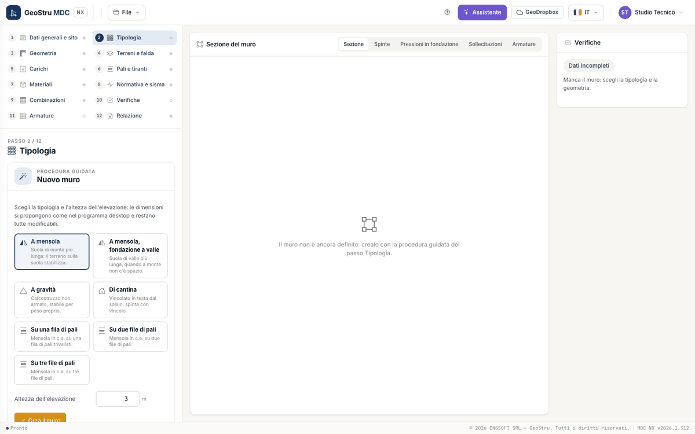
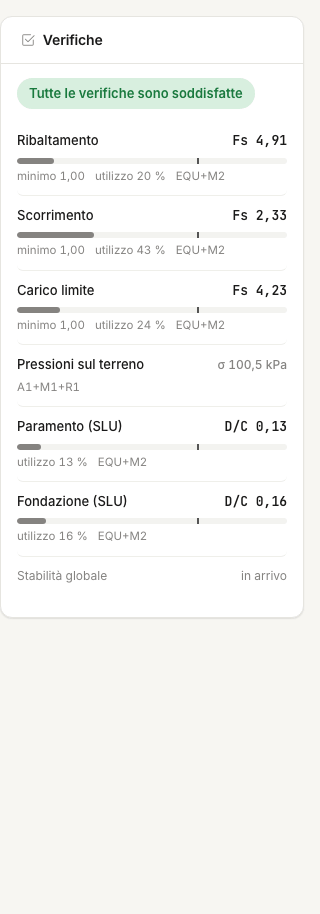

# Quick start (5 minutes)

A 4 m cantilever wall, a single soil layer, NTC 2018 checks with the site's seismic action. No credits are spent until the report.

## 1. Open the app

Go to [nx.geostru.ai/mdc](https://nx.geostru.ai/mdc/) and sign in with your GeoStru account. If you only want to look around, **File → Open
the example** loads a complete wall (Guide 1, 2 or 3): you can skip to point 5.

## 2. Create the wall

Open step **2 · Wall type**. In a new project it shows the **guided setup**: choose **Cantilever**, type the **Stem height** (4 m) and press
**Create the wall**. The app proposes the dimensions as the desktop program does (base 0.7·H, toe one third of the base, foundation depth
H/10 and at least 40 cm), adds a sand layer and takes you to the **Geometry** step, where every dimension can be changed.

## 3. Soil

In step **4 · Soils and water table** check the proposed layer ("Sabbia", γ = 17.65 kN/m³, φ = 36°, δ = 24°) and type the parameters of
your soil. Leave the water table out. The section in the centre is redrawn at every change.

## 4. Site and seismic action

1. In step **1 · General data and site** click on the map at the site (or type latitude and longitude) and press **Save**.
2. In step **8 · Code and seismic action** keep the **NTC 2018** code, choose nominal life, use class, subsoil and topographic category,
   then press **Calculate from the site**: the table fills with T~R~, a~g~, F~0~ and T~c~* of the four limit states.
3. Press **k_h and k_v from the site parameters (ULS-LS)**: the two wall coefficients go into the seismic combinations.

## 5. Read the checks

The **Checks** panel on the right shows overturning, sliding and bearing capacity with the safety factor of the governing combination, the
required minimum and a utilisation bar; below, the ground pressures and the demand/capacity ratio of the RC sections. Red appears only on
what fails. A click on an item opens the section view that explains it.

If sliding fails, lengthen the heel or choose the **With shear key** foundation in the Wall type step and watch the number change.

## 6. Reinforcement, report and saving

Step **11 · Reinforcement** lists the computed bars and the bar schedule. In step **12 · Report** the preview is free; **Generate Word** and
**Download the section (DXF)** use credits. Save the project with **File → Save** (`.mdcnx`) or to **GeoDropbox**.

The rest of the manual explains every step: start with the [Workflow](workflow.md).

---

*Found an error on this page? [Let us know](mailto:info@geostru.ai?subject=Help%20MDC%20NX) or open a [Pull Request](https://github.com/EngSoft-Geostru/geostru-help-nx/edit/main/mdc/docs/en/quickstart.md).*
