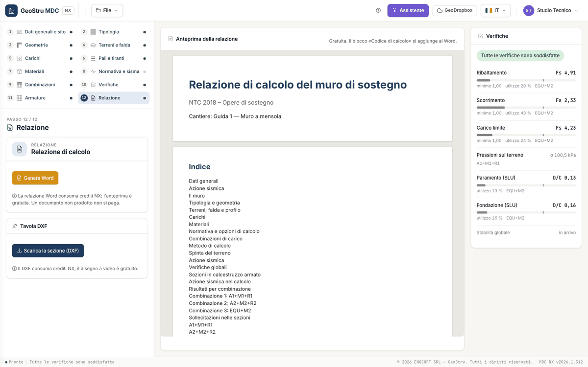

# Report, DXF and credits

Step 12 · **Report** has two panels, **Calculation report** and **DXF drawing**; in the centre, instead of the section, there is the report
preview.

## Preview

The preview is composed by the server with the same code as the document and is **free**. It shows all the content of the report except the
"Calculation code" block, which is added only to the Word file. If the calculation is not complete the step says so, with the link
**Complete the data**, and the Word button stays disabled.

## The Word document

**Generate Word** produces the document in the interface language (Italian or English):

1. general data and seismic action (nominal life, use class, V~R~, categories, site parameters);
2. the wall: type and geometry with the section figure, soils, water table and profile, loads, materials, code and analysis options,
   combinations with their factors;
3. calculation method with the formulas (Müller-Breslau, Rankine/Jaky, Mononobe-Okabe, sliding, overturning, bearing capacity, pressures,
   RC sections, piles) and references;
4. seismic action in the calculation (k~h~, k~v~ of the seismic combinations);
5. for every combination: factors, earth pressure strips on the stem and on the virtual back, force resultants, global checks with details
   and bearing capacity factors, ground pressures or actions on the pile rows, figures of thrusts and pressures;
6. internal forces in the sections per combination and envelope, with the figure;
7. section checks, reinforcement with the figure and bar schedule; piles and anchors, when present; calculation notes;
8. summary of the checks and check × combination summary;
9. **"Calculation code"** block (NTC 2018 §10.2): title, producer, app and engine version, licence, document code, validation document,
   data fingerprint.

The report states that global stability is not computed by this version and must be checked separately. The **document code** printed in the
block is registered on geostru.ai: anyone can verify it at `geostru.ai/verify/<code>`. The verification says that the document was issued by
MDC NX with those data, not that the design is correct: the responsibility for the choices stays with the designer.

## The section in DXF

**Download the section (DXF)** produces the drawing of the **wall section** as on screen, with the **bars**: wall and foundation, soil and
water table, loads, piles and anchors, dimensions and texts on separate layers (`muro`, `fondazione`, `terreno`, `falda`, `carichi`,
`ferri`, `pali`, `tiranti`, `quote`, `testi`…). Texts are in the interface language. The file carries the GeoStru NX provenance signature in a
comment, which CAD programs ignore. The bar schedule is in the report; the working drawing of bent bars is coming.

## Credits

| Action | Cost |
|---|---|
| Modelling, calculation, checks, drawings and diagrams on screen, preview | free |
| Word report | NX credits |
| Section in DXF | NX credits |
| Message to the assistant | NX credits |

A failed operation is not charged, and regenerating the same document with the same data and the same language is not charged again.
Credits expire 12 months after purchase: the expiry of the oldest pack is shown on the balance at the top.

---

*Found an error on this page? [Let us know](mailto:info@geostru.ai?subject=Help%20MDC%20NX) or open a [Pull Request](https://github.com/EngSoft-Geostru/geostru-help-nx/edit/main/mdc/docs/en/relazione.md).*
