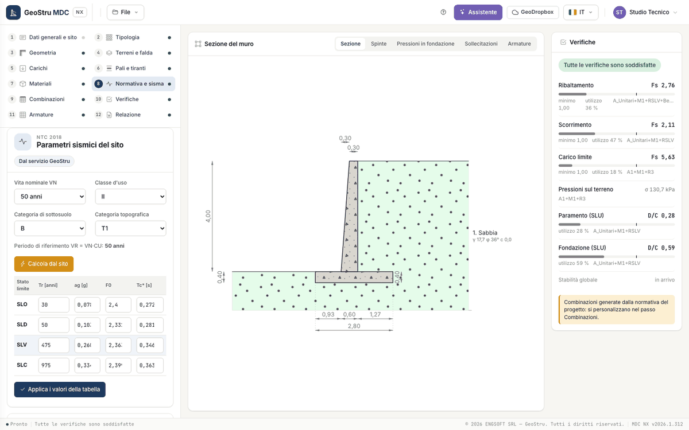

# Code and seismic action

Step 8 has three panels: **Code and analysis options**, **Site seismic parameters** and **Wall seismic coefficients**.

## Code and analysis options

| Field | Choices |
|---|---|
| Geotechnical code | D.M. 1996 allowable stress, D.M. 1996 limit states, OPCM 3274, NTC 2008, Eurocodes, STAS 3300, BS 8004, SR EN 1997-1, NTC 2018 |
| Structural code | D.M. 1996 allowable stress, D.M. 1996 limit states, OPCM 3274, NTC 2008, Eurocode 2, STAS 10107, BS 8110, SR EN 1992-1-1, NTC 2018 |
| Section checks | Limit states, Allowable stress |

The geotechnical code decides the combinations and the partial factors (see [Combinations and checks](verifiche.md)). The list is the one of
the desktop, because imported projects keep their code; the first release computes with **NTC 2018**, **NTC 2008** and the **Eurocodes**.
With the other codes the app shows a warning; calculation with the historical codes is coming.

Below the code, the analysis options:

| Group | Field | Choices and unit |
|---|---|---|
| Earth pressure | Condition | At rest, Active |
| | Method | Rankine, Coulomb / Mononobe-Okabe |
| | Seismic increment application point | at 2/3 of the height from the base, at 1/3, at mid-height |
| | Passive thrust share | % (0 to ignore it) |
| | Wall friction δ also on the virtual plane (instead of δ = φ) | checkbox |
| Bearing capacity | Method | Vesic, Hansen |
| | Exclude shape, inclination, depth factors | checkboxes |
| | Base friction angle | ° (0 = from the founding layer) |
| | Base adhesion | kPa (0 = from the founding layer) |

With D.M. 1996 allowable stress the **Required safety factors** group also appears (overturning, sliding, bearing capacity); with limit
state codes the minimum is 1. The formulas are in [Earth pressure and seismic action](teoria-spinte.md) and [Global checks](teoria-verifiche.md).

!!! note "Note"
    Base friction and adhesion typed by hand are reduced with the factors γ~φ~ and γ~c~ of the combination, like the layer parameters. The
    desktop program used them unreduced.

## Site seismic parameters

| Field | Choices |
|---|---|
| Nominal life V~N~ | 10, 50, 100 years |
| Use class | I, II, III, IV |
| Subsoil category | A, B, C, D, E |
| Topographic category | T1, T2, T3, T4 |

The step shows the reference period V~R~ = V~N~·C~U~, which sets the return periods. **Calculate from the site** queries the GeoStru
Seismic Parameters service with the coordinates of the [General data and site](progetto.md) step and fills the table of the four limit states
(SLO, SLD, SLV, SLC) with T~R~ [years], a~g~ [g], F~0~ and T~c~* [s]. Without coordinates the button is disabled and a link leads to step 1.

The values can also be typed or corrected in the table and stored with **Apply the table values**. The label at the top tells where they come
from: "From the GeoStru service", "Entered by hand", "From the file" or "No parameters". If you change nominal life or use class, the
parameters taken from the service were valid for other return periods: the app removes them and asks you to compute them again.

## Wall seismic coefficients

| Field | Notes |
|---|---|
| Horizontal coefficient k~h~ | |
| Vertical coefficient k~v~ | |
| Wall that does not allow displacements | β~m~ = 1 |

**k_h and k_v from the site parameters (ULS-LS)** computes the two coefficients from the SLV limit state and writes them in the fields; they
can also be typed by hand. Below, a table per limit state shows S~S~, S~T~, a~max~, β~m~, k~h~ and k~v~:

$$a_{max} = S_S\,S_T\,a_g \qquad k_h = \beta_m\,\frac{a_{max}}{g} \qquad k_v = 0.5\,k_h$$

| Quantity | Value |
|---|---|
| S~S~ (stratigraphic amplification) | A 1; B 1.40 − 0.40·F~0~·a~g~/g between 1 and 1.2; C 1.70 − 0.60·F~0~·a~g~/g between 1 and 1.5; D 2.40 − 1.50·F~0~·a~g~/g between 0.9 and 1.8; E 2.00 − 1.10·F~0~·a~g~/g between 1 and 1.6 |
| S~T~ (topographic amplification) | T1 1.0; T2 1.2; T3 1.2; T4 1.4 |
| β~m~ (NTC 2018 §7.11.6.2.1) | 0.38 at SLV, 0.47 at SLD; 1 if the wall does not allow displacements |

## In the combinations

With the combinations generated from the code, k~h~ and k~v~ of the wall go into the seismic combinations by themselves: no need to copy
them. In the NTC 2018 seismic combination for overturning (EQU) the program increases them by 50 % (at most 1), as the code requires.

The vertical seismic action has a single direction: the inertia force k~v~·W acts upwards on the masses, which is the unfavourable direction
for the global checks.

!!! warning "Warning"
    In the desktop program the NTC 2018 seismic combinations were created with k~h~ = 0 unless the seismic action was computed again: the
    calculation was static without the user knowing. In MDC NX the seismic combinations always take the wall coefficients. Check in the Load
    combinations step that k~h~ is not zero.

## Coming soon

Permanent displacements of the wall (Newmark, Richards-Elms) and seismic capacity (limit PGA) come with the second release.

---

*Found an error on this page? [Let us know](mailto:info@geostru.ai?subject=Help%20MDC%20NX) or open a [Pull Request](https://github.com/EngSoft-Geostru/geostru-help-nx/edit/main/mdc/docs/en/sisma.md).*
