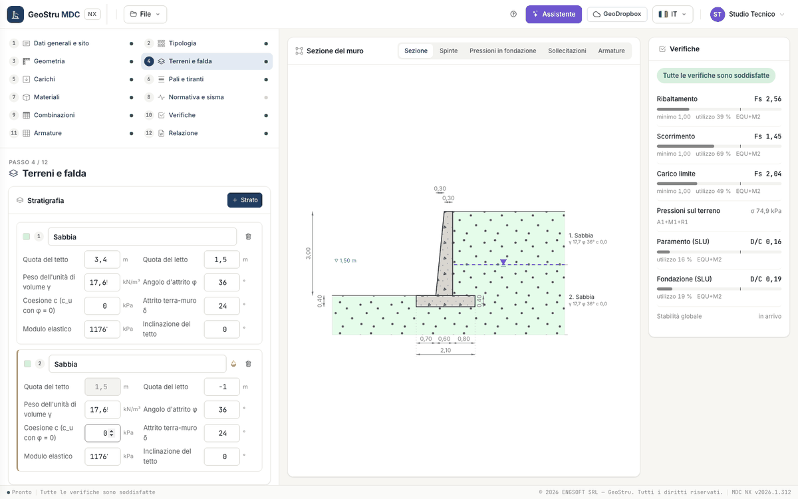

# Soils and water table

Step 4 has three panels: **Stratigraphy**, **Ground profile** and **Backfills**. Levels are in the wall system (y = 0 on the founding
plane, positive upwards), in metres.

## Stratigraphy

Layers are read from top to bottom and are contiguous: the top of a layer is the bottom of the one above and is changed from there (the top
field is read-only from the second layer down). **+ Layer** adds a 3 m layer below the last one, with the same parameters; the bin removes
it. Up to **ten layers**. For each layer, besides the description:

| Field | Unit | Notes |
|---|---|---|
| Top level | m | |
| Bottom level | m | |
| Unit weight γ | kN/m³ | below the water table the program uses γ − γ~w~ |
| Friction angle φ | ° | |
| Cohesion c (c~u~ with φ = 0) | kPa | with φ = 0 the layer is undrained |
| Wall friction δ | ° | usually 2/3 of φ; δ = 0 is a smooth wall |
| Young's modulus | kPa | used by the piles |
| Top inclination | ° | |

A layer needs a friction angle or a cohesion greater than zero.

## Water table

The water table is given as **Water table level (from the founding level)**, in metres, with **Set the water table**; **Remove the water
table** deletes it. The layers below the level are submerged (drop icon) and the layer cut by the level is split in two. In the section the
water table is a dashed blue line with its level.

Below the water table the soil pushes with its submerged weight, the water adds its hydrostatic pressure on the stem and the base of the wall
receives the **uplift** (downhill the water table is taken at most at ground level).

!!! note "Note"
    The desktop program applied no uplift on the base. MDC NX does: with a high water table sliding, overturning and bearing capacity can be
    less favourable than in the desktop. See [Validation and limits](validazione.md).

## Ground profile

A table with **three segments uphill**, measured from the top of the wall, and **one segment downhill**, from the foundation edge: for each,
**Length** (m) and **Slope** (°). Below the table:

| Field | Unit | Notes |
|---|---|---|
| Fill above the top | m | negative: lowered ground level |
| Fill unit weight | kN/m³ | |
| Embedment below the front ground | m | the downhill soil above the founding plane |

For the earth pressure the program uses, like the desktop, a **design slope** of the backfill: the line from the top of the wall to the
point where the failure wedge, starting from the heel corner of the foundation, meets the profile. If the wedge does not meet the profile,
the slope of the first uphill segment applies. The downhill slope enters the bearing capacity (ground slope factors).

## Backfills

Two switches: **Backfill behind the wall** and **Fill on the toe**. Each has Thickness (m), Unit weight γ (kN/m³), Friction angle φ (°),
Cohesion c (kPa), Wall friction δ (°) and Drain height (m).

---

*Found an error on this page? [Let us know](mailto:info@geostru.ai?subject=Help%20MDC%20NX) or open a [Pull Request](https://github.com/EngSoft-Geostru/geostru-help-nx/edit/main/mdc/docs/en/terreno.md).*
