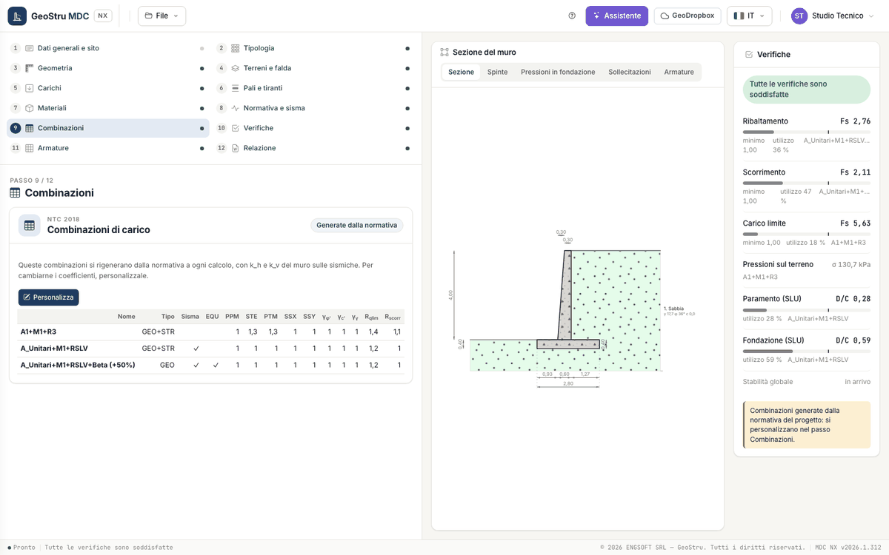
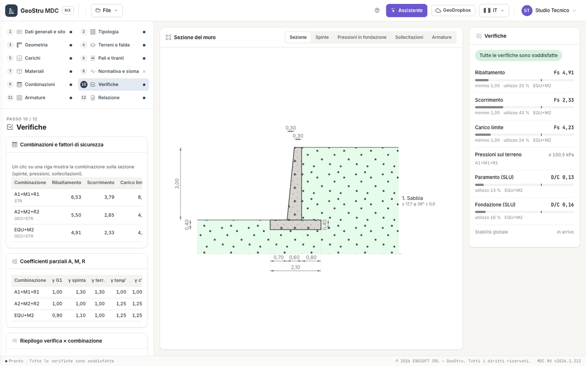
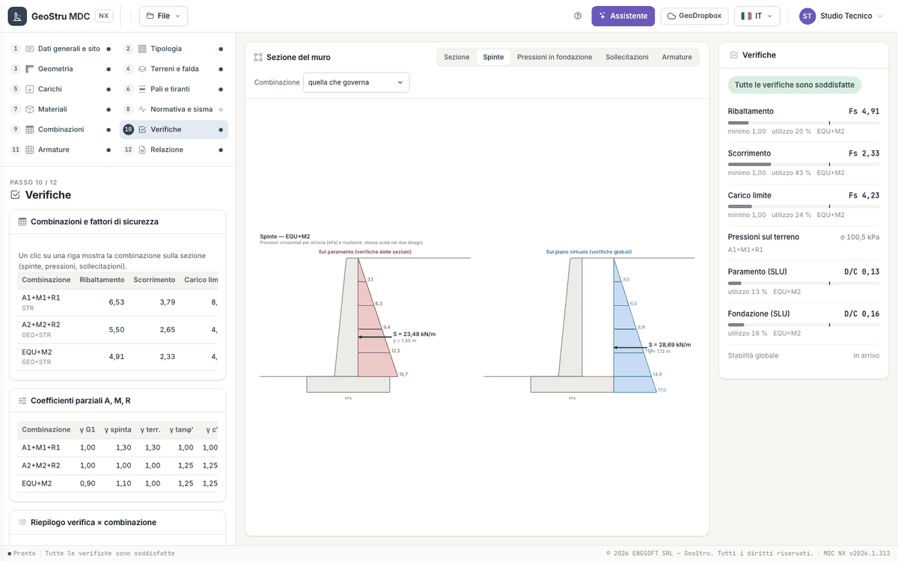
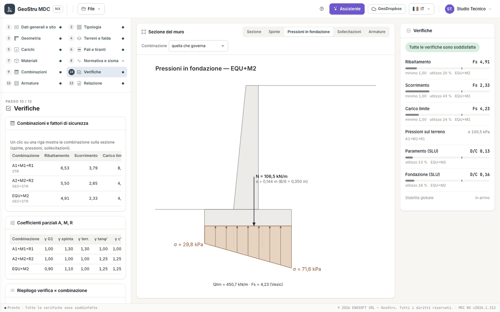
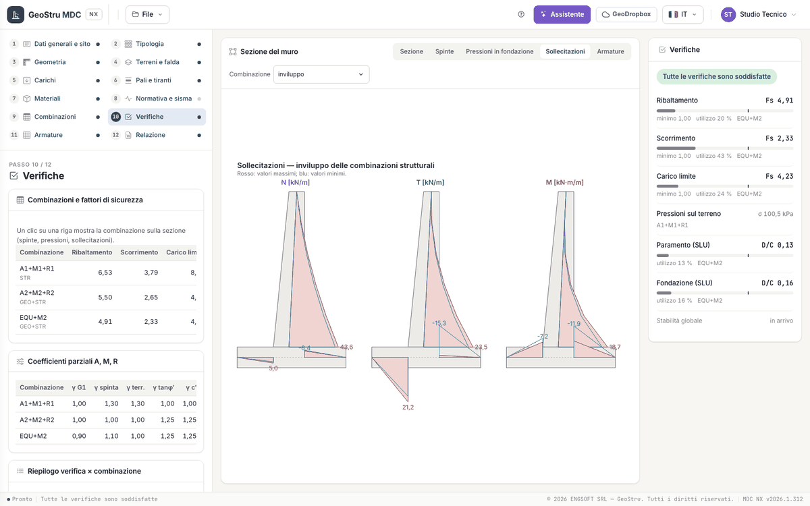
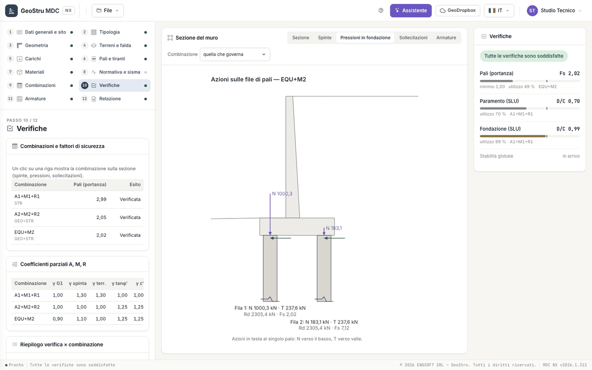

# Combinations and checks

## Load combinations

Step 9 · **Load combinations** shows the load combinations of the project. The label at the top says whether they are **Generated from the
code** or **Customised**.

- **Generated from the code** (new project): they are regenerated at every calculation from the geotechnical code of the
  [Code and seismic action](sisma.md) step, with k~h~ and k~v~ of the wall on the seismic ones. The table is read-only.
- **Customise** copies them into the project: from then on name, type, checkboxes and factors are edited in the table. **Back to the code**
  regenerates them, after a confirmation (the customisations are lost).

A project opened from the desktop carries its own combinations, which are therefore customised.

| Column | Meaning |
|---|---|
| Name, Type | Type GEO, STR, GEO+STR or SLE: decides which checks use the combination (global, structural, serviceability) |
| Seismic, EQU | seismic combination; equilibrium combination (overturning) |
| PPM, STE, PTM | factors on wall self-weight, earth pressure, weight of the soil on the heel |
| SSX, SSY | factors on the horizontal and vertical seismic increment |
| TIR | factor on the anchor load (only with anchors) |
| γ~φ'~, γ~c'~, γ~γ~ | partial factors on tan φ′, c′ and soil unit weight |
| R~qlim~, R~scorr~, R~rib~ | R factors for bearing capacity, sliding and overturning |
| k~h~, k~v~ | seismic coefficients of the combination |

The factors of each distributed surcharge and point load are in the project, one per load; the assistant reads and writes them.

### NTC 2018

| Combination | Type | Actions | M | R (bearing capacity / sliding / overturning / soil at the toe) |
|---|---|---|---|---|
| A1+M1+R3 | GEO+STR | PPM 1; STE 1.3; PTM 1.3; loads 1.5 | 1 | 1.4 / 1.1 / 1.15 / 1.4 |
| A_Unitari+M1+RSLV | GEO+STR, seismic | all 1 | 1 | 1.2 / 1.0 / 1.0 / 1.2 |
| A_Unitari+M1+RSLV+Beta (+50%) | GEO, seismic, EQU | all 1 | 1 | 1.2 / 1.0 / 1.0 / 1.2; k~h~ and k~v~ × 1.5 |

### NTC 2008 and Eurocodes

| Combination | Type | Actions | M |
|---|---|---|---|
| A1+M1+R1 | STR | PPM 1; STE 1.3; PTM 1.3; loads 1.5 | 1 |
| A2+M2+R2 | GEO+STR | all 1; loads 1.3 | NTC 2008: γ~φ'~ = γ~c'~ = 1.25; Eurocodes: 1.1 and 1.2 as in the desktop |
| EQU+M2 | GEO+STR | PPM 0.9; STE 1.1; PTM 1; loads 1 | as A2+M2+R2 |

In these codes the R factors are 1. The generated combinations include no serviceability combinations: for stress and crack checks,
customise the combinations and give type **SLE** to the ones you need. NTC 2008 and the Eurocodes generate no seismic combinations: with an
earthquake, customise and tick **Seismic**, typing k~h~ and k~v~ in the row.

The M factors reduce the soil parameters (tan φ′/γ~φ'~, c′/γ~c'~); the A factors amplify the actions; the R factors divide the resistances.

## The Checks step

Step 10 · **Checks** has three tables, plus the site seismic coefficients and the calculation notes.

| Table | What you read |
|---|---|
| Combinations and safety factors | for every combination: overturning, sliding, bearing capacity, σ max [kPa] and outcome; for the wall on piles, the pile capacity. "--" where the check does not concern the combination |
| Partial factors A, M, R | γ G1, γ thrust, γ soil, γ tanφ′, γ c′, γR qlim, γR sliding, γR overturning |
| Check × combination summary | demand, capacity, D/C ratio and outcome of every global check and every RC part |

A click on a row of the first table shows that combination in the section in the centre.

## The Checks panel

On the right, always visible, the panel summarises the project with the value of the **governing combination**: safety factor F~s~ against
the minimum, or demand/capacity ratio D/C, with a utilisation bar.

| Item | What it shows |
|---|---|
| Overturning | F~s~ = stabilising moment / overturning moment about the toe corner |
| Sliding | F~s~ = resistance / action along the founding plane |
| Bearing capacity | F~s~ = design bearing capacity / vertical load |
| Ground pressures | maximum σ under the base (for information) |
| Stem, Foundation, Shear key (ULS) | D/C of the RC sections |
| Piles (capacity) | F~s~ of the critical row |
| Gravity wall (stresses) | D/C of the stresses in the wall body |
| Anchors | D/C between design load and resistance |
| Global stability | coming soon |

At the top, the summary: "All checks are satisfied", "Some checks are not satisfied", "Checks not computed" or "Incomplete data". **Red**
appears only on what fails; **amber** marks a margin below 10 %. A click on an item opens the view that explains it. Below, the calculation
notes: the first two in full, the others under **More calculation notes**.

## The section views

Above the section there are five tabs: **Section**, **Thrusts**, **Foundation pressures**, **Internal forces**, **Reinforcement**. In the
result views the **Combination** list chooses the "governing one", a single combination or the "envelope".

| View | Content |
|---|---|
| Section | the dimensioned wall with layers, water table, loads, piles and anchors |
| Thrusts | pressure diagrams on the stem and on the virtual back, at the same scale, with the resultants |
| Foundation pressures | trapezoidal or triangular diagram under the base with kern, eccentricity and bearing capacity; for the wall on piles the actions at the head of every row |
| Internal forces | N, T and M drawn on stem and foundation, per combination or envelope |
| Reinforcement | the bars in the section with "n Ø d" and the distribution bars |

For the wall on piles the Foundation pressures view shows the actions N and T at the head of the single pile of every row, with capacity
and F~s~.

## When a wall fails

| Check | Levers |
|---|---|
| Sliding | wider base, foundation with shear key, inclined founding plane, passive thrust at the toe (if the soil in front of the wall is reliable) |
| Overturning | longer heel, stem moved towards the backfill |
| Bearing capacity | wider base, smaller eccentricity, deeper founding plane |
| Sections | greater thickness, more bars or larger diameter, higher concrete class |

The formulas of the checks are in [Global checks](teoria-verifiche.md).

---

*Found an error on this page? [Let us know](mailto:info@geostru.ai?subject=Help%20MDC%20NX) or open a [Pull Request](https://github.com/EngSoft-Geostru/geostru-help-nx/edit/main/mdc/docs/en/verifiche.md).*
