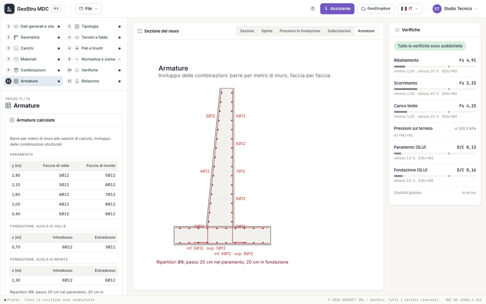
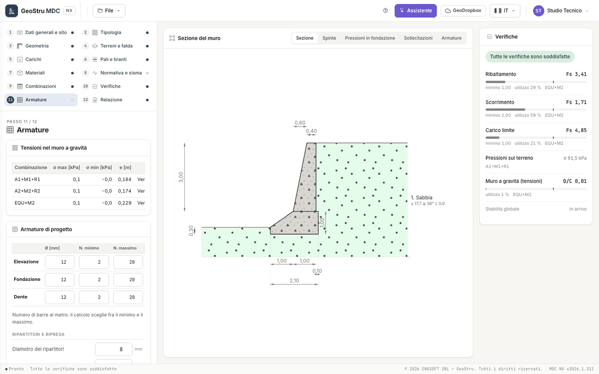

# Sezioni, armature e distinta

## Le sezioni di verifica

Il paramento è diviso in sezioni lungo l'altezza; le suole di valle e di monte, il dente e la mensola di valle hanno le loro. Per ogni
sezione e ogni combinazione il programma calcola sforzo normale N, taglio T e momento M (vista **Sollecitazioni**) e li verifica con il
solutore delle sezioni in c.a. di GeoStru:

| Verifica | Norma | Combinazioni |
|---|---|---|
| SLU a presso-flessione | NTC 2018 §4.1.2.3.4, legame parabola-rettangolo | STR e GEO+STR |
| Taglio senza armatura trasversale | NTC 2018 §4.1.2.3.5 | STR e GEO+STR |
| Tensioni in esercizio e apertura delle fessure | NTC 2018 §4.1.2.2.4-5 | SLE |
| Tensioni ammissibili | D.M. 1996 | con **Verifica delle sezioni: Tensioni ammissibili** |

Il rapporto domanda/capacità di ogni parte (il più gravoso fra flessione, taglio, fessure e tensioni) compare nel pannello come
**Paramento (SLU)**, **Fondazione (SLU)** e **Dente (SLU)**, e per sezione nel riepilogo del passo Verifiche e nella relazione. Le formule
sono in [Sezioni in c.a., pali e tiranti](teoria-strutture.md).

!!! note "Nota"
    Le sezioni del muro non hanno staffe: il taglio si verifica come elemento senza armatura trasversale, come nel programma desktop. Se il
    taglio non passa si aumenta lo spessore o l'armatura longitudinale tesa.

## Armature calcolate

Il passo 11 · **Armature** mostra in alto le armature che il programma ha progettato sull'**inviluppo delle combinazioni strutturali**,
entro i limiti del riquadro «Armature di progetto», in barre per metro di muro:

- **paramento**: per ogni sezione (quota y) le barre sulla faccia di valle e su quella di monte;
- **suole di valle e di monte** (e dente): per ogni sezione (ascissa x) le barre all'intradosso e all'estradosso;
- **ripartitori**: diametro e passo nel paramento e in fondazione;
- **armatura dei pali** (barre e staffe) e **verifica dei tiranti**, se ci sono.

Al centro, la vista **Armature** disegna i ferri in sezione con «n Ø d» e i ripartitori.

La modifica manuale dei ferri e la tavola dei ferri sagomati sono **in arrivo**. Le armature assegnate a mano in un progetto del desktop
restano nel file («Il file porta armature assegnate o modificate nel desktop: sono conservate»), ma il calcolo le progetta sempre di
nuovo.

## La distinta dei ferri

Sotto le armature, la **Distinta dei ferri**: per ogni posizione (P paramento, F fondazione, R ripartitori) descrizione, diametro Ø [mm],
numero n, lunghezza L [m] e peso [kg], con il totale e il peso per diametro. Il peso unitario è 0,006165·Ø² kg/m (Ø in mm); i pesi sono
per metro di muro. Le sagome sono quelle tipiche del muro a mensola. La distinta finisce nella relazione.

## Armature di progetto

| Campo | Unità | Note |
|---|---|---|
| Elevazione, Fondazione, Dente: Ø, N. minimo, N. massimo | mm, barre al metro | il calcolo sceglie il numero di barre fra il minimo e il massimo |
| Diametro dei ripartitori | mm | |
| Passo minimo dei ripartitori | m | |
| Percentuale di ripartizione | % | armatura secondaria rispetto alla principale |
| Ferri di ripresa | | |
| Percentuali geometriche (sezioni rettangolari): Minima, Massima | | rapporto fra area d'acciaio e area di calcestruzzo (es. 0,003 e 0,06) |

## Muro a gravità

Non ci sono armature da progettare: il passo mostra la tabella **Tensioni nel muro a gravità** con, per ogni combinazione, σ max, σ min,
eccentricità e ed esito. Se l'eccentricità sta nel nocciolo d'inerzia la sezione è tutta compressa; fuori dal nocciolo la sezione si
parzializza e la compressione massima cresce. Le tensioni si confrontano con le resistenze del passo [Materiali](materiali.md#muro-a-gravita)
e il rapporto compare nel pannello come **Muro a gravità (tensioni)**.

---

*Hai trovato un errore in questa pagina? [Segnalacelo](mailto:info@geostru.ai?subject=Help%20MDC%20NX) o apri una [Pull Request](https://github.com/EngSoft-Geostru/geostru-help-nx/edit/main/mdc/docs/it/armature.md).*
