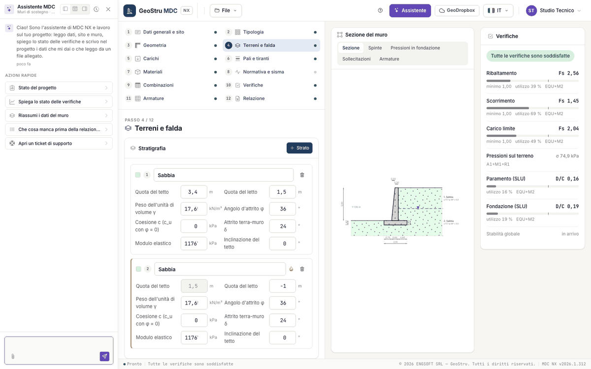

# Assistente AI

Il pulsante **Assistente** nella barra in alto apre la chat in un pannello laterale, che si può agganciare a sinistra, a destra o in basso.
L'assistente è un sistema di intelligenza artificiale che lavora sul progetto aperto: legge dati generali, sito e muro, calcola, spiega lo
stato delle verifiche e scrive nel progetto i dati che gli dai o che legge da un file allegato (graffetta accanto al campo del messaggio).

Le **azioni rapide** sono: Stato del progetto, Spiega lo stato delle verifiche, Riassumi i dati del muro, Che cosa manca prima della
relazione?, Apri un ticket di supporto. Altri esempi:

- «Perché la combinazione sismica non verifica a scorrimento?»
- «Porta la suola di monte a 1,40 m.»
- «Metti la falda a 1,5 m dal piano di posa.»
- «Quanto pesa l'armatura per metro di muro?»

Mentre lavora, sotto il messaggio compaiono le operazioni in corso (lettura del progetto, scrittura nel progetto, calcolo del muro,
spiegazione di una verifica…). Può anche creare un muro con la procedura guidata o caricare un esempio.

Regole:

- I numeri li calcola il motore: l'assistente li legge con i suoi strumenti e li cita, non li stima. Per spiegare una verifica riporta i
  numeri della combinazione e le leve del progetto.
- I dati già presenti si sostituiscono solo se lo chiedi esplicitamente. Prima di riscrivere la stratigrafia, creare un muro nuovo al posto
  di quello esistente o caricare un esempio chiede conferma. Nessuno strumento cancella dati: righe, strati e carichi si tolgono dalla
  pagina.
- I parametri sismici dal servizio si calcolano con il pulsante del passo [Normativa e sisma](sisma.md); l'assistente li scrive solo se
  glieli dai o se li legge da un file.
- Non genera la relazione né il DXF (sono a crediti: li scarichi tu dal passo Relazione).
- Mentre l'assistente scrive, la pagina non accetta modifiche; dopo una sua modifica si aggiorna da sola.

Ogni messaggio consuma crediti NX; un messaggio che finisce in errore non si paga. Dalla chat puoi anche aprire un ticket di supporto.

---

*Hai trovato un errore in questa pagina? [Segnalacelo](mailto:info@geostru.ai?subject=Help%20MDC%20NX) o apri una [Pull Request](https://github.com/EngSoft-Geostru/geostru-help-nx/edit/main/mdc/docs/it/assistente.md).*
