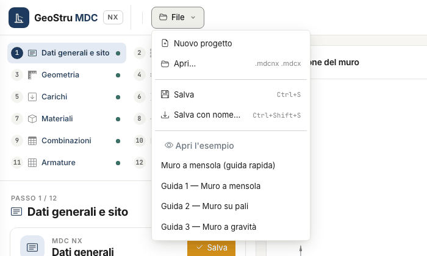

# File, progetti del desktop e GeoDropbox

Il menu **File** in alto a sinistra raccoglie apertura, salvataggio ed esempi.

| Voce | Che cosa fa |
|---|---|
| Nuovo progetto | svuota il progetto; il muro si crea poi con la procedura guidata del passo Tipologia |
| Apri… | apre un file `.mdcnx` di MDC NX o un `.mdcx` del programma desktop |
| Salva (Ctrl+S) | riscrive il file aperto; se non c'è, chiede dove salvare |
| Salva con nome… (Ctrl+Maiusc+S) | salva il progetto in un nuovo file `.mdcnx` |
| Apri l'esempio | Muro a mensola (guida rapida), Guida 1 — Muro a mensola, Guida 2 — Muro su pali, Guida 3 — Muro a gravità |

Nuovo progetto, Apri ed esempio sostituiscono il progetto aperto: se ci sono modifiche non salvate, una striscia sotto la barra chiede
**Salva prima**, **Continua senza salvare** o **Annulla**. Accanto al menu compare il nome del file su cui scrive «Salva», quando il
browser sa riscriverlo.

## Il file `.mdcnx`

Il progetto vive sul server mentre lavori e scade dopo un periodo di inattività: salvalo. Il file `.mdcnx` è JSON in unità SI e contiene
solo i dati d'ingresso: i risultati si ricalcolano all'apertura.

## Progetti del programma desktop

**File → Apri…** accetta anche i progetti `.mdcx` di MDC desktop. L'app legge tipologia, geometria, profilo, strati, falda, carichi,
materiali, combinazioni, parametri sismici, pali e tiranti, converte le unità del desktop (cm, t/m², kg/cm²) in SI e **ricalcola** tutto.

Dopo l'apertura il passo attivo mostra una striscia: «Progetto del programma desktop aperto: controlla i dati prima di calcolare», con le
**Note dell'import** da aprire. Che cosa aspettarsi:

- **la normativa del file resta**: se è una norma che la prima consegna non calcola (D.M. 1996, OPCM 3274, norme straniere) l'app mostra un
  avviso nel passo Normativa e sisma;
- **le combinazioni del file restano** e risultano personalizzate; **Torna alla normativa** le sostituisce con quelle generate;
- **gabbioni, pietrame e contrafforti** si conservano ma non si calcolano: arrivano con la seconda consegna;
- **armature assegnate a mano** nel desktop: si conservano nel file, ma il calcolo progetta sempre le armature;
- **risultati salvati nel file**: non si usano, perché possono essere di una versione precedente o di dati diversi.

I risultati possono differire da quelli del desktop dove MDC NX corregge un difetto del programma: l'elenco è in
[Validazione e limiti](validazione.md).

## GeoDropbox

Il pulsante **GeoDropbox** nella barra in alto salva il progetto (`.mdcnx`) in un progetto GeoDropbox, anche nuovo, o apre un `.mdcnx` o un
`.mdcx` salvato lì. Il progetto in cloud è disponibile da qualunque postazione e condivisibile con il tuo studio.

## Esempi

Gli esempi caricano un muro già completo, utile per vedere tutte le viste senza scrivere dati: la **Guida 1** è un muro a mensola di 3 m su
sabbia, la **Guida 2** un muro su due file di pali, la **Guida 3** un muro a gravità. I loro numeri sono quelli dei casi di prova della
[validazione](validazione.md).

---

*Hai trovato un errore in questa pagina? [Segnalacelo](mailto:info@geostru.ai?subject=Help%20MDC%20NX) o apri una [Pull Request](https://github.com/EngSoft-Geostru/geostru-help-nx/edit/main/mdc/docs/it/file.md).*
