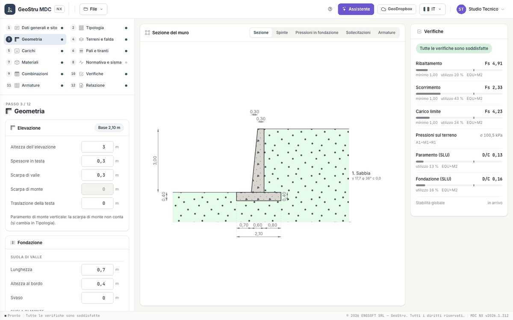

# Geometria

Il passo 3 descrive la sezione del muro per elementi. Tutte le misure sono in **metri**, le inclinazioni in **gradi**. Ogni campo si salva
quando lo lasci: la sezione al centro si ridisegna e le verifiche si aggiornano. Le quote della sezione si modificano anche con un clic sul
loro valore nel disegno.

## Riferimento

Il calcolo è per **un metro di muro**. Valle è a sinistra, monte (il terrapieno) a destra. Le coordinate del muro hanno x = 0 al bordo di
valle della fondazione e y = 0 sul piano di posa; il polo dei momenti per il ribaltamento è lo spigolo di valle della base. In testa al
riquadro dell'elevazione l'app riporta la larghezza della base che risulta dalle misure.

## Elevazione

| Campo | Unità | Note |
|---|---|---|
| Altezza dell'elevazione | m | dalla fondazione alla testa |
| Spessore in testa | m | |
| Scarpa di valle | m | sporgenza del piede del paramento di valle rispetto alla testa |
| Scarpa di monte | m | conta solo con il paramento di monte inclinato (si sceglie in Tipologia) |
| Traslazione della testa | m | |

Con il paramento di monte **a gradoni** compare l'elenco dei gradoni (**Alzata** e **Pedata**, dall'alto): la somma delle alzate è l'altezza
del muro e l'ultima pedata vale 0.

## Fondazione

| Gruppo | Campi | Note |
|---|---|---|
| Suola di valle | Lunghezza, Altezza al bordo, Svaso | lo svaso è l'aumento di altezza dal bordo allo spiccato del paramento |
| Suola di monte | Lunghezza, Altezza al bordo, Svaso | il terreno sopra la suola entra nelle verifiche come peso stabilizzante |
| Inclinazioni e lunghezza | Inclinazione del piano di posa (°), Inclinazione della faccia di monte della fondazione (°), Lunghezza del muro (m) | il piano di posa si inclina solo con la fondazione diretta o con dente; la lunghezza del muro serve solo al computo |

## Dente di fondazione

Il riquadro si apre quando nel passo Tipologia la fondazione è **Con dente**. Campi: **Base**, **Altezza** e **Distanza dal bordo di
monte** (m). Il dente aumenta la resistenza allo scorrimento: il piano di scorrimento passa per il suo fondo.

## Mensole e magrone

Ogni parte ha un interruttore, lo stesso del passo Tipologia.

| Parte | Campi |
|---|---|
| Mensola di monte | Base, Altezza, Distanza dalla testa (m) |
| Mensola di valle | Distanza dalla testa, Sbalzo, Altezza all'attacco, Altezza all'estremo (m); Numero di ferri; Diametro dei ferri (mm) |
| Magrone | Sporgenza, Spessore (m) |

Le azioni portate dalla mensola di valle si scrivono come forze concentrate nel passo [Carichi](carichi.md): senza, la mensola si progetta
con l'armatura minima.

## Controlli

Una misura negativa, una fondazione più stretta dello spessore in testa, un dente che esce dalla fondazione o un piano di posa inclinato
oltre 45° sono **errori**: compaiono accanto al campo e nel riquadro «Da controllare nel progetto», e il muro non va al calcolo finché non
li correggi. Gli **avvisi** (per esempio una normativa che la prima consegna non calcola) non fermano il calcolo.

---

*Hai trovato un errore in questa pagina? [Segnalacelo](mailto:info@geostru.ai?subject=Help%20MDC%20NX) o apri una [Pull Request](https://github.com/EngSoft-Geostru/geostru-help-nx/edit/main/mdc/docs/it/geometria.md).*
