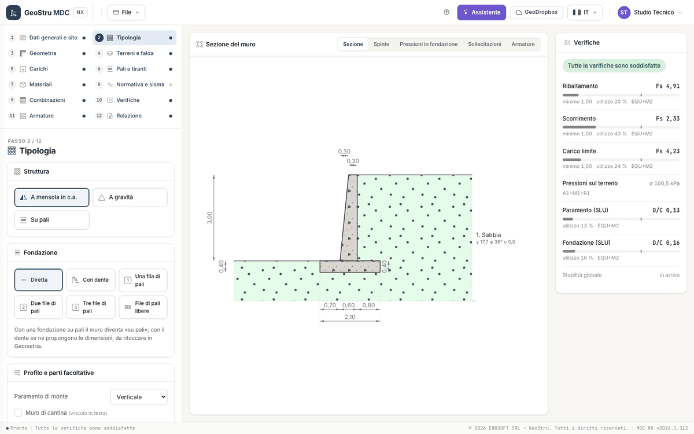

# MDC NX

**MDC NX** è l'app web GeoStru per il progetto e la verifica dei **muri di sostegno** secondo le **NTC 2018** e gli **Eurocodici**. È il
porting del programma desktop MDC: stesse fasi di calcolo, stessi risultati dove il desktop è corretto, correzioni dichiarate dove non lo è
(vedi [Validazione e limiti](validazione.md)).

Descrivi la sezione del muro, il terreno, la falda e i carichi; l'app genera le combinazioni della norma, calcola le spinte, esegue le
verifiche globali e strutturali, progetta le armature e prepara la relazione. Il calcolo avviene sul server e riparte a ogni modifica; nel
browser vedi la sezione, i diagrammi e le verifiche.

[**Apri l'app**](https://nx.geostru.ai/mdc/){ .md-button .md-button--primary }

## Che cosa fa

1. **Spinte** del terreno sul paramento e sul piano virtuale: attiva (Coulomb/Müller-Breslau o Rankine) o a riposo, sismica
   (Mononobe-Okabe), su terreno stratificato con falda, profilo a tratti, sovraccarichi distribuiti e forze concentrate.
2. **Verifiche globali** per ogni combinazione: scorrimento sul piano di posa, ribaltamento, carico limite (Vesic o Brinch Hansen),
   pressioni sul terreno di fondazione.
3. **Sisma** pseudostatico NTC 2018: parametri del sito dalle coordinate, k~h~ e k~v~ per le opere di sostegno, forze d'inerzia.
4. **Sezioni in c.a.** di paramento, suole e dente: SLU a presso-flessione e taglio, SLE di tensione e fessurazione (o tensioni
   ammissibili).
5. **Armature** progettate sull'inviluppo delle combinazioni, con **distinta dei ferri** e pesi.
6. **Pali** (una, due, tre file o file libere) e **tiranti**, con la ripartizione delle azioni e le verifiche di ogni fila e di ogni
   tirante.
7. **Relazione Word** con il blocco «Codice di calcolo» e un codice verificabile online, **sezione in DXF**, progetto `.mdcnx`.

## Le tipologie

| Tipologia | Che cosa cambia |
|---|---|
| Muro a mensola in c.a. | il caso base: paramento, suola di valle e di monte; dente, mensola di monte, mensola di valle e magrone facoltativi |
| Muro a gravità | niente armature; si verificano le tensioni nel corpo del muro |
| Muro su pali | le azioni in fondazione vanno ai pali sotto un plinto rigido; verifica di ogni fila |
| Muro con tiranti | uno o più tiranti sul paramento, con la verifica di ciascuno |

Muri a contrafforti e a gabbioni, spostamenti sismici, capacità sismica e stabilità globale sono **in arrivo** con la seconda consegna. Un
progetto del desktop che li contiene si apre e li conserva, ma non li calcola.

## La pagina

Tutto sta in una pagina: a sinistra i **12 passi** del progetto e, sotto, il passo attivo; al centro la **sezione del muro** dal vivo, con
le viste Sezione, Spinte, Pressioni in fondazione, Sollecitazioni e Armature; a destra il pannello delle **Verifiche**. Non ci sono finestre a
comparsa: conferme e messaggi sono strisce nella pagina, gli errori dei dati compaiono accanto al campo.

Il pallino accanto a ogni passo dice se è compilato o se manca qualcosa.

| Passo | Che cosa fai |
|---|---|
| 1 · [Dati generali e sito](progetto.md) | descrizione, committente, cantiere, posizione del sito, studio tecnico |
| 2 · [Tipologia](progetto.md#tipologia) | struttura, fondazione, profilo del paramento, parti facoltative, procedura guidata |
| 3 · [Geometria](geometria.md) | elevazione, suole, inclinazioni, dente, mensole, magrone |
| 4 · [Terreni e falda](terreno.md) | strati, falda, profilo del terreno, riempimenti |
| 5 · [Carichi](carichi.md) | carichi distribuiti sul terrapieno e forze concentrate |
| 6 · [Pali e tiranti](pali-tiranti.md) | pali (solo con fondazione su pali) e tiranti |
| 7 · [Materiali](materiali.md) | calcestruzzo, acciaio, coefficienti, copriferri, muro a gravità |
| 8 · [Normativa e sisma](sisma.md) | normativa, opzioni di spinta e di carico limite, parametri sismici, k~h~ e k~v~ |
| 9 · [Combinazioni](verifiche.md#le-combinazioni) | combinazioni generate dalla normativa o personalizzate |
| 10 · [Verifiche](verifiche.md) | fattori di sicurezza per combinazione, coefficienti, riepilogo verifica × combinazione |
| 11 · [Armature](armature.md) | armature calcolate, distinta dei ferri, dati di progetto delle armature |
| 12 · [Relazione](relazione.md) | anteprima gratuita, Word e DXF a crediti |

Inizia dalla [Guida rapida](quickstart.md). Prima di usare i risultati in un progetto leggi [Validazione e limiti](validazione.md).

---

*Hai trovato un errore in questa pagina? [Segnalacelo](mailto:info@geostru.ai?subject=Help%20MDC%20NX) o apri una [Pull Request](https://github.com/EngSoft-Geostru/geostru-help-nx/edit/main/mdc/docs/it/index.md).*
