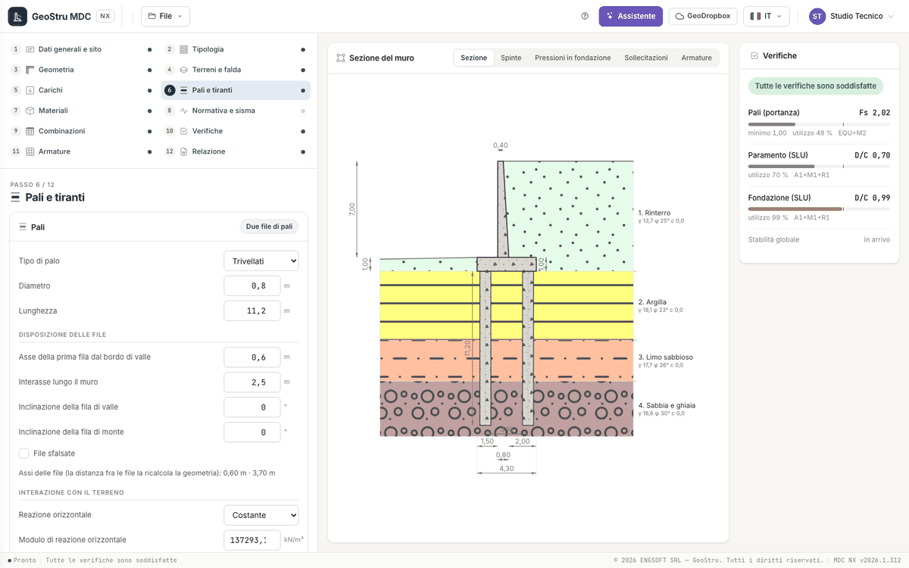

# Pali e tiranti

Il passo 6 ha due riquadri: **Pali** e **Tiranti**.

## Pali

Il riquadro si compila solo con una fondazione su pali, che si sceglie nel passo [Tipologia](progetto.md#tipologia) (una, due, tre file o
file di pali libere): altrimenti un collegamento porta a quel passo. Le azioni che il muro trasmette alla fondazione (forza orizzontale,
forza verticale e momento) passano ai pali attraverso un **plinto rigido**.

### Palo

| Campo | Unità | Scelte e note |
|---|---|---|
| Tipo di palo | | Trivellati, Infissi, Micropali |
| Diametro | m | |
| Lunghezza | m | l'ultimo strato del terreno deve arrivare sotto la punta |

### Disposizione delle file

Con una, due o tre file:

| Campo | Unità | Note |
|---|---|---|
| Asse della prima fila dal bordo di valle | m | |
| Interasse lungo il muro | m | lo stesso per tutte le file |
| Inclinazione della fila di valle, di monte, centrale | ° | quelle che servono al numero di file |
| File sfalsate | | da due file in su |

Sotto, l'app riporta gli assi delle file che ne risultano: la distanza fra le file la ricalcola la geometria della fondazione. Con **File di
pali libere** c'è invece una tabella (**+ Fila**) con, per ogni fila, ascissa x [m], inclinazione [°], interasse [m] e sfalsamento [m], fino
a otto file.

L'app controlla la disposizione: inclinazione oltre 30°, asse fuori dalla fondazione o interasse minore del diametro sono errori; un
interasse minore di tre diametri è un avviso.

### Interazione con il terreno e azioni sui pali

| Campo | Unità | Scelte e note |
|---|---|---|
| Reazione orizzontale | | Costante, Crescente con la profondità |
| Modulo di reazione orizzontale | kN/m³ | |
| Coefficiente di Poisson | | |
| Pali incastrati in testa | | casella; altrimenti cerniera |
| Efficienza di gruppo (Converse-Labarre) | | casella |
| Azioni sui pali | | Momento ribaltante, Momento risultante |
| Quota del carico ai pali | % | il resto va al terreno sotto il plinto |
| Verticali indagate | | per i fattori di correlazione ξ delle NTC 2018 |

### Armatura dei pali

| Campo | Unità | Note |
|---|---|---|
| Armatura | | Barre, Tubolare |
| Diametro delle barre, Numero minimo di barre | mm, — | con le barre |
| Diametro esterno e interno del tubolare | mm | con il tubolare |
| Diametro delle staffe | mm | |
| Passo massimo delle staffe | m | |

Il programma ripartisce le azioni fra le file, poi verifica **ogni fila**: azione assiale, taglio e momento in testa al singolo palo,
portanza e fattore di sicurezza. La portanza della palificata è quella della **fila critica**, con il fattore minimo; l'armatura è
sull'inviluppo delle combinazioni strutturali e si legge nel passo [Armature](armature.md). Le formule sono in
[Sezioni in c.a., pali e tiranti](teoria-strutture.md).

!!! note "Nota"
    Per il **muro su pali** scorrimento, ribaltamento e carico limite della fondazione diretta non compaiono: li sostituisce la verifica
    **Pali (portanza)**. La vista **Pressioni in fondazione** mostra le azioni in testa a ogni fila.

## Tiranti

I tiranti si aggiungono con **+ Tirante** (fino a dieci). Ciascuno è una forza applicata al paramento, il tiro di esercizio diviso
l'interasse, che entra nell'equilibrio del muro in tutte le combinazioni con il coefficiente TIR della combinazione (1 in quelle generate).

| Campo | Unità | Note |
|---|---|---|
| Distanza dalla testa del muro | m | la testa del tirante deve stare sul paramento |
| Inclinazione verso il basso | ° | da 0 a 60 |
| Lunghezza libera, Lunghezza del bulbo | m | |
| Diametro del bulbo, Diametro del foro | m | |
| Tiro di esercizio | kN | |
| Interasse | m | la forza per metro di muro è il tiro diviso l'interasse |
| Adesione al bulbo | kPa | |
| Attrito al bulbo | ° | |
| Numero di trefoli | | |
| Resistenza dell'acciaio | MPa | |

Con almeno un tirante compaiono i **parametri comuni**: Fattore di sicurezza, Cadute di tensione (%), Aderenza malta-acciaio (kPa),
Diametro dei trefoli (mm) e Fattore ξ.

La resistenza dell'ancoraggio è la minore fra quella del **bulbo** nel terreno, dell'**aderenza** malta-trefoli e dell'**acciaio**; la
verifica confronta il tiro di progetto con questa resistenza e compare nel pannello come **Tiranti**.

!!! note "Nota"
    Il tratto libero non è verificato rispetto a una superficie di scorrimento: quella verifica appartiene alla stabilità globale, che è in
    arrivo.

---

*Hai trovato un errore in questa pagina? [Segnalacelo](mailto:info@geostru.ai?subject=Help%20MDC%20NX) o apri una [Pull Request](https://github.com/EngSoft-Geostru/geostru-help-nx/edit/main/mdc/docs/it/pali-tiranti.md).*
