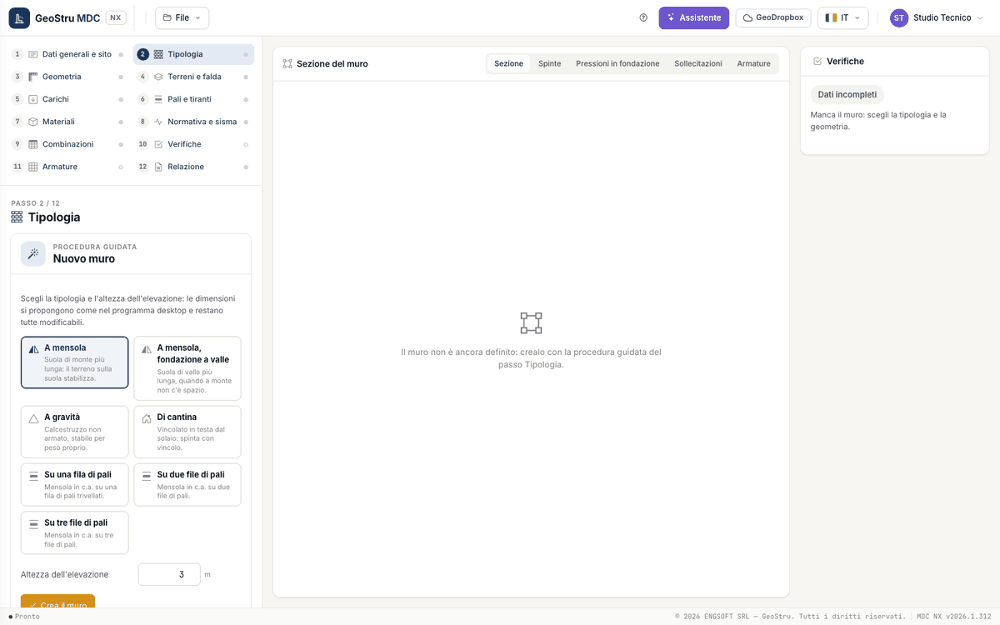

# Dati generali e tipologia

I primi due passi raccolgono ciò che vale per tutto il progetto: chi, dove e che tipo di muro. La normativa e le opzioni di calcolo stanno
nel passo [Normativa e sisma](sisma.md).

## Dati generali e sito

Il passo 1 ha tre riquadri. I dati si scrivono nel form e si registrano con **Salva**.

| Riquadro | Campi |
|---|---|
| Dati generali | Descrizione, Committente, Cantiere, Progettista, Data |
| Posizione del sito | Indirizzo o località (con **Cerca**), Latitudine, Longitudine, Altitudine [m], carta |
| Studio tecnico | Intestazione, Via, Comune, Provincia, CAP, Telefono, E-mail, Partita IVA |

Descrizione, cantiere, progettista e studio tecnico finiscono nella relazione. Per il sito fai clic sulla carta o trascina il segnaposto:
latitudine e longitudine (WGS84) si aggiornano. **Cerca** trova la località scritta nel campo dell'indirizzo. Le coordinate servono al passo
[Normativa e sisma](sisma.md) per ricavare i parametri di pericolosità del sito.

## Tipologia

### Procedura guidata

In un progetto senza muro il passo 2 mostra la **procedura guidata** (la stessa del desktop): scegli la tipologia, scrivi l'**Altezza
dell'elevazione** (da 0,5 a 20 m) e premi **Crea il muro**. Le sette scelte:

| Scelta | Muro creato |
|---|---|
| A mensola | mensola in c.a., suola di monte più lunga |
| A mensola, fondazione a valle | mensola in c.a., suola di valle più lunga (quando a monte non c'è spazio) |
| A gravità | calcestruzzo non armato |
| Di cantina | mensola in c.a. con vincolo in testa (solaio) |
| Su una, due o tre file di pali | mensola in c.a. su pali trivellati |

Le dimensioni proposte seguono le regole del programma desktop:

- **mensola e pali**: base 0,7·H, spessore in testa e scarpa di valle 0,30 m, altezza delle suole H/10 (0,40 m se il risultato è
  minore di 0,35 m), suola di valle un terzo della base (o suola di monte, con la fondazione a valle);
- **gravità**: spessore in testa 0,40 m, scarpa di valle 0,2·H, suola di valle H/3;
- **pali**: diametro 0,40 m, lunghezza 12 m, asse della prima fila a 0,60 m dal bordo di valle, interasse 1 m.

La procedura mette anche uno strato di sabbia (γ = 17,65 kN/m³, φ = 36°, δ = 24°) e i materiali C25/30 e B450C. È un punto di partenza:
le verifiche dicono se va bene. Con un muro già definito la procedura si riapre in fondo al passo, alla voce **Ricomincia con la procedura
guidata**: sostituisce il muro (dati generali e sito restano) dopo una conferma in striscia.

### Struttura, fondazione e parti facoltative

Con il muro definito il passo mostra tre riquadri.

| Riquadro | Scelte |
|---|---|
| Struttura | A mensola in c.a., A gravità, Su pali |
| Fondazione | Diretta, Con dente, Una fila di pali, Due file di pali, Tre file di pali, File di pali libere |
| Profilo e parti facoltative | Paramento di monte (Verticale, Inclinato, Inclinato all'indietro, A gradoni); Muro di cantina (vincolo in testa); Mensola di monte; Mensola di valle; Magrone |

Con una fondazione su pali il muro diventa «su pali»; con il dente l'app ne propone le dimensioni, da ritoccare in
[Geometria](geometria.md). La fondazione su pali vale solo per il muro a mensola: con il muro a gravità l'app segnala l'errore e non
calcola. Le misure delle parti facoltative si scrivono nel passo Geometria.

!!! note "Nota"
    I muri in **gabbioni o blocchi** e **in pietrame** e i **contrafforti** di un progetto del desktop si aprono e restano nel file, ma il
    loro calcolo arriva con la seconda consegna: l'app lo dice nel passo.

---

*Hai trovato un errore in questa pagina? [Segnalacelo](mailto:info@geostru.ai?subject=Help%20MDC%20NX) o apri una [Pull Request](https://github.com/EngSoft-Geostru/geostru-help-nx/edit/main/mdc/docs/it/progetto.md).*
