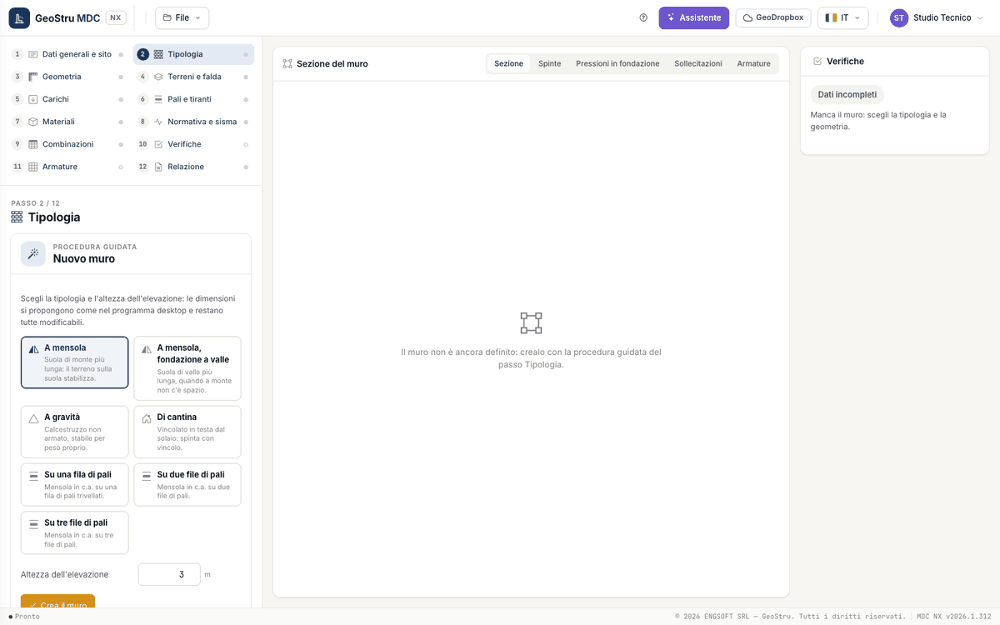
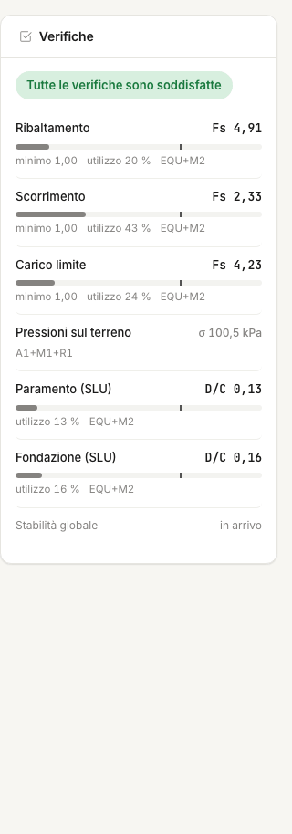

# Guida rapida (5 minuti)

Un muro a mensola alto 4 m, un solo strato di terreno, verifiche NTC 2018 con il sisma del sito. Nessun credito speso fino alla relazione.

## 1. Apri l'app

Vai su [nx.geostru.ai/mdc](https://nx.geostru.ai/mdc/) e accedi con il tuo account GeoStru. Se vuoi solo guardare, **File → Apri
l'esempio** carica un muro già completo (Guida 1, 2 o 3): puoi saltare al punto 5.

## 2. Crea il muro

Apri il passo **2 · Tipologia**. In un progetto nuovo c'è la **procedura guidata**: scegli **A mensola**, scrivi l'**Altezza
dell'elevazione** (4 m) e premi **Crea il muro**. L'app propone le dimensioni come il programma desktop (base 0,7·H, suola di valle a un
terzo della base, suole alte H/10 e almeno 40 cm), mette uno strato di sabbia e ti porta al passo **Geometria**, dove le dimensioni restano
tutte modificabili.

## 3. Terreno

Nel passo **4 · Terreni e falda** controlla lo strato proposto («Sabbia», γ = 17,65 kN/m³, φ = 36°, δ = 24°) e scrivi i parametri del tuo
terreno. Lascia la falda assente. La sezione al centro si ridisegna a ogni modifica.

## 4. Sito e sisma

1. Nel passo **1 · Dati generali e sito** fai clic sulla carta nel punto del cantiere (o scrivi latitudine e longitudine) e premi **Salva**.
2. Nel passo **8 · Normativa e sisma** lascia la normativa **NTC 2018**, scegli vita nominale, classe d'uso, categoria di sottosuolo e
   topografica, poi premi **Calcola dal sito**: la tabella si riempie con T~R~, a~g~, F~0~ e T~c~* dei quattro stati limite.
3. Premi **k_h e k_v dai parametri del sito (SLV)**: i due coefficienti del muro passano nelle combinazioni sismiche.

## 5. Leggi le verifiche

Il pannello **Verifiche** a destra riporta ribaltamento, scorrimento e carico limite con il fattore di sicurezza della combinazione che
governa, il minimo richiesto e una barra di utilizzo; sotto, le pressioni sul terreno e il rapporto domanda/capacità delle sezioni in c.a.
Il rosso compare solo su ciò che non verifica. Un clic su una voce apre la vista della sezione che la spiega.

Se lo scorrimento non passa, allunga la suola o scegli la fondazione **Con dente** nel passo Tipologia e guarda il numero cambiare.

## 6. Armature, relazione e salvataggio

Nel passo **11 · Armature** trovi le barre calcolate e la distinta dei ferri. Nel passo **12 · Relazione** l'anteprima è gratuita;
**Genera Word** e **Scarica la sezione (DXF)** consumano crediti. Salva il progetto con **File → Salva** (`.mdcnx`) o in **GeoDropbox**.

Il resto del manuale spiega ogni passo: comincia dal [Flusso di lavoro](workflow.md).

---

*Hai trovato un errore in questa pagina? [Segnalacelo](mailto:info@geostru.ai?subject=Help%20MDC%20NX) o apri una [Pull Request](https://github.com/EngSoft-Geostru/geostru-help-nx/edit/main/mdc/docs/it/quickstart.md).*
