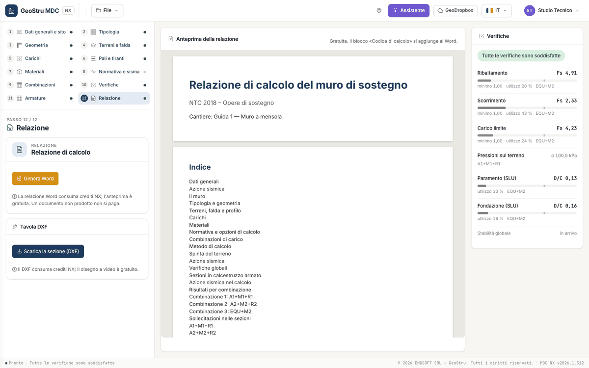

# Relazione, DXF e crediti

Il passo 12 · **Relazione** ha due riquadri, **Relazione di calcolo** e **Tavola DXF**; al centro, al posto della sezione, c'è l'anteprima
della relazione.

## Anteprima

L'anteprima è composta dal server con lo stesso codice del documento ed è **gratuita**. Riporta tutto il contenuto della relazione tranne il
blocco «Codice di calcolo», che si aggiunge solo al Word. Se il calcolo non è completo il passo lo dice, con il collegamento **Completa i
dati**, e il pulsante del Word resta spento.

## Il documento Word

**Genera Word** produce il documento nella lingua dell'interfaccia (italiano o inglese):

1. dati generali e azione sismica (vita nominale, classe d'uso, V~R~, categorie, parametri del sito);
2. il muro: tipologia e geometria con la figura della sezione, terreni, falda e profilo, carichi, materiali, normativa e opzioni di calcolo,
   combinazioni con i coefficienti;
3. metodo di calcolo con le formule (Müller-Breslau, Rankine/Jaky, Mononobe-Okabe, scorrimento, ribaltamento, carico limite, pressioni,
   sezioni in c.a., pali) e la bibliografia;
4. azione sismica nel calcolo (k~h~, k~v~ delle combinazioni sismiche);
5. per ogni combinazione: coefficienti, spinte per striscia sul paramento e sul piano virtuale, risultanti delle forze, verifiche globali
   con i dettagli e i fattori del carico limite, pressioni sul terreno o azioni sulle file di pali, figure delle spinte e delle pressioni;
6. sollecitazioni nelle sezioni per combinazione e inviluppo, con la figura;
7. verifiche delle sezioni, armature con la figura e distinta dei ferri; pali e tiranti, se ci sono; avvisi del calcolo;
8. riepilogo delle verifiche e riepilogo verifica × combinazione;
9. blocco **«Codice di calcolo»** (NTC 2018 §10.2): titolo, produttore, versione dell'app e del motore, licenza, codice del documento,
   documento di validazione, impronta dei dati.

La relazione dichiara che la stabilità globale non è calcolata da questa versione e va verificata a parte. Il **codice del documento**
stampato nel blocco è registrato su geostru.ai: chiunque può verificarlo su `geostru.ai/verify/<codice>`. La verifica dice che il documento
è stato emesso da MDC NX con quei dati, non che il progetto è corretto: la responsabilità delle scelte resta del progettista.

## La sezione in DXF

**Scarica la sezione (DXF)** produce il disegno della **sezione del muro** com'è a video, con i **ferri**: muro e fondazione, terreno e
falda, carichi, pali e tiranti, quote e testi su livelli separati (`muro`, `fondazione`, `terreno`, `falda`, `carichi`, `ferri`, `pali`,
`tiranti`, `quote`, `testi`…). I testi sono nella lingua dell'interfaccia. Il file porta la firma di provenienza di GeoStru NX in un
commento, che i programmi CAD ignorano. La distinta dei ferri è nella relazione; la tavola esecutiva dei ferri sagomati è in arrivo.

## Crediti

| Azione | Costo |
|---|---|
| Modellazione, calcolo, verifiche, disegni e diagrammi a video, anteprima | gratuiti |
| Relazione Word | crediti NX |
| Sezione in DXF | crediti NX |
| Messaggio all'assistente | crediti NX |

Un'operazione fallita non si paga, e rigenerare lo stesso documento con gli stessi dati e la stessa lingua non si ripaga. I crediti scadono
12 mesi dopo l'acquisto: la scadenza del pacchetto più vecchio è indicata sul saldo in alto.

---

*Hai trovato un errore in questa pagina? [Segnalacelo](mailto:info@geostru.ai?subject=Help%20MDC%20NX) o apri una [Pull Request](https://github.com/EngSoft-Geostru/geostru-help-nx/edit/main/mdc/docs/it/relazione.md).*
