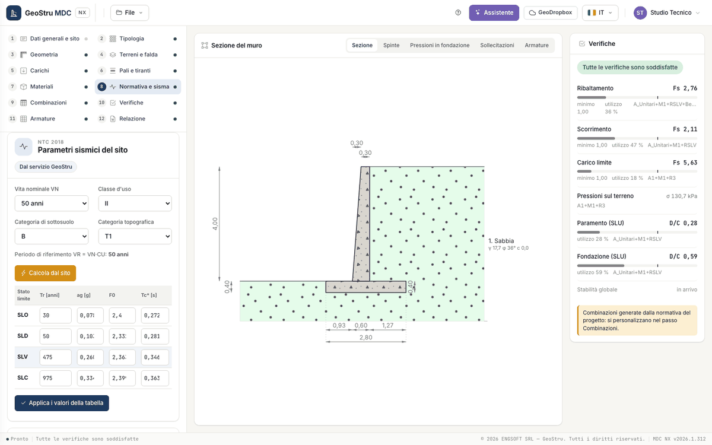

# Normativa e sisma

Il passo 8 ha tre riquadri: **Normativa e opzioni di calcolo**, **Parametri sismici del sito** e **Coefficienti sismici del muro**.

## Normativa e opzioni di calcolo

| Campo | Scelte |
|---|---|
| Normativa geotecnica | D.M. 1996 tensioni ammissibili, D.M. 1996 stati limite, OPCM 3274, NTC 2008, Eurocodici, STAS 3300, BS 8004, SR EN 1997-1, NTC 2018 |
| Normativa strutturale | D.M. 1996 tensioni ammissibili, D.M. 1996 stati limite, OPCM 3274, NTC 2008, Eurocodice 2, STAS 10107, BS 8110, SR EN 1992-1-1, NTC 2018 |
| Verifica delle sezioni | Stati limite, Tensioni ammissibili |

La normativa geotecnica decide le combinazioni e i coefficienti parziali (vedi [Combinazioni e verifiche](verifiche.md)). L'elenco è quello
del desktop, perché i progetti importati conservano la loro norma; la prima consegna calcola con **NTC 2018**, **NTC 2008** ed
**Eurocodici**. Con le altre norme l'app mostra un avviso; il calcolo con le normative storiche è in arrivo.

Sotto la normativa, le opzioni di calcolo:

| Gruppo | Campo | Scelte e unità |
|---|---|---|
| Spinta del terreno | Regime | A riposo, Attiva |
| | Metodo | Rankine, Coulomb / Mononobe-Okabe |
| | Punto d'applicazione dell'incremento sismico | a 2/3 dell'altezza dalla base, a 1/3, a metà altezza |
| | Partecipazione della spinta passiva | % (0 per trascurarla) |
| | δ terra-muro anche sul piano virtuale (invece di δ = φ) | casella |
| Carico limite | Metodo | Vesic, Hansen |
| | Escludi i fattori di forma, d'inclinazione, di profondità | caselle |
| | Attrito terreno-fondazione | ° (0 = dallo strato di posa) |
| | Adesione terreno-fondazione | kPa (0 = dallo strato di posa) |

Con il D.M. 1996 alle tensioni ammissibili compare anche il gruppo **Coefficienti di sicurezza richiesti** (ribaltamento, scorrimento,
carico limite); con le norme agli stati limite il minimo è 1. Le formule sono in [Spinte e sisma](teoria-spinte.md) e
[Verifiche globali](teoria-verifiche.md).

!!! note "Nota"
    Attrito e adesione di base scritti a mano vengono ridotti con i coefficienti γ~φ~ e γ~c~ della combinazione, come i parametri dello
    strato. Il programma desktop li usava senza riduzione.

## Parametri sismici del sito

| Campo | Scelte |
|---|---|
| Vita nominale V~N~ | 10, 50, 100 anni |
| Classe d'uso | I, II, III, IV |
| Categoria di sottosuolo | A, B, C, D, E |
| Categoria topografica | T1, T2, T3, T4 |

Il passo riporta il periodo di riferimento V~R~ = V~N~·C~U~, da cui dipendono i tempi di ritorno. **Calcola dal sito** interroga il servizio
GeoStru Parametri Sismici con le coordinate del passo [Dati generali e sito](progetto.md) e compila la tabella dei quattro stati limite
(SLO, SLD, SLV, SLC) con T~R~ [anni], a~g~ [g], F~0~ e T~c~* [s]. Senza coordinate il pulsante è spento e un collegamento porta al passo 1.

I valori si possono anche scrivere o correggere a mano nella tabella e registrare con **Applica i valori della tabella**. L'etichetta in alto
dice da dove vengono: «Dal servizio GeoStru», «Inseriti a mano», «Dal file» o «Nessun parametro». Se cambi vita nominale o classe d'uso, i
parametri presi dal servizio valevano per altri tempi di ritorno: l'app li toglie e chiede di ricalcolarli.

## Coefficienti sismici del muro

| Campo | Note |
|---|---|
| Coefficiente orizzontale k~h~ | |
| Coefficiente verticale k~v~ | |
| Muro che non ammette spostamenti | β~m~ = 1 |

**k_h e k_v dai parametri del sito (SLV)** calcola i due coefficienti dallo stato limite SLV e li scrive nei campi; si possono anche
scrivere a mano. Sotto, una tabella per stato limite riporta S~S~, S~T~, a~max~, β~m~, k~h~ e k~v~:

$$a_{max} = S_S\,S_T\,a_g \qquad k_h = \beta_m\,\frac{a_{max}}{g} \qquad k_v = 0{,}5\,k_h$$

| Grandezza | Valore |
|---|---|
| S~S~ (amplificazione stratigrafica) | A 1; B 1,40 − 0,40·F~0~·a~g~/g fra 1 e 1,2; C 1,70 − 0,60·F~0~·a~g~/g fra 1 e 1,5; D 2,40 − 1,50·F~0~·a~g~/g fra 0,9 e 1,8; E 2,00 − 1,10·F~0~·a~g~/g fra 1 e 1,6 |
| S~T~ (amplificazione topografica) | T1 1,0; T2 1,2; T3 1,2; T4 1,4 |
| β~m~ (NTC 2018 §7.11.6.2.1) | 0,38 allo SLV, 0,47 allo SLD; 1 se il muro non ammette spostamenti |

## Nelle combinazioni

Con le combinazioni generate dalla normativa, k~h~ e k~v~ del muro vanno da soli nelle combinazioni sismiche: non serve copiarli. Nella
combinazione sismica per il ribaltamento (EQU) delle NTC 2018 il programma li aumenta del 50 % (al più 1), come chiede la norma.

Il sisma verticale agisce in un solo verso: la forza d'inerzia k~v~·W è diretta verso l'alto sulle masse, che è il verso sfavorevole per
le verifiche globali.

!!! warning "Attenzione"
    Nel programma desktop le combinazioni sismiche NTC 2018 nascevano con k~h~ = 0 se non si ripeteva il calcolo dell'azione sismica: il
    calcolo era statico senza che l'utente lo sapesse. In MDC NX le combinazioni sismiche prendono sempre i coefficienti del muro. Controlla
    nel passo Combinazioni che k~h~ non sia zero.

## In arrivo

Spostamenti permanenti del muro (Newmark, Richards-Elms) e capacità sismica (PGA limite) arrivano con la seconda consegna.

---

*Hai trovato un errore in questa pagina? [Segnalacelo](mailto:info@geostru.ai?subject=Help%20MDC%20NX) o apri una [Pull Request](https://github.com/EngSoft-Geostru/geostru-help-nx/edit/main/mdc/docs/it/sisma.md).*
