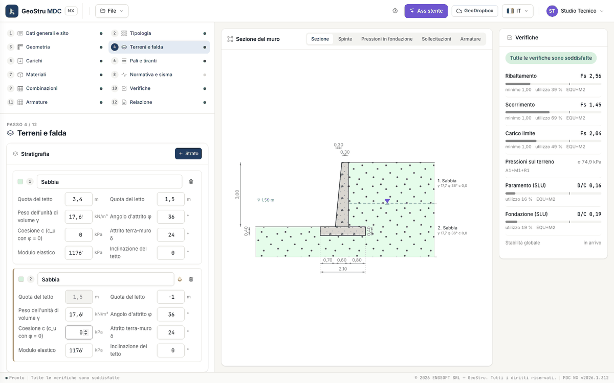

# Terreni e falda

Il passo 4 ha tre riquadri: **Stratigrafia**, **Profilo del terreno** e **Riempimenti**. Le quote sono nel sistema del muro (y = 0 sul piano
di posa, positive verso l'alto), in metri.

## Stratigrafia

Gli strati si leggono dall'alto verso il basso e sono contigui: il tetto di uno strato è il letto di quello sopra, e si cambia da lì (il
campo del tetto è in sola lettura dal secondo strato in giù). **+ Strato** aggiunge uno strato di 3 m sotto l'ultimo, con gli stessi
parametri; il cestino lo toglie. Si arriva fino a **dieci strati**. Per ogni strato, oltre alla descrizione:

| Campo | Unità | Note |
|---|---|---|
| Quota del tetto | m | |
| Quota del letto | m | |
| Peso dell'unità di volume γ | kN/m³ | sotto falda il programma usa γ − γ~w~ |
| Angolo d'attrito φ | ° | |
| Coesione c (c~u~ con φ = 0) | kPa | con φ = 0 lo strato è in condizioni non drenate |
| Attrito terra-muro δ | ° | di solito 2/3 di φ; δ = 0 equivale a una parete liscia |
| Modulo elastico | kPa | serve ai pali |
| Inclinazione del tetto | ° | |

Uno strato deve avere un angolo d'attrito o una coesione maggiori di zero.

## Falda

La falda si dà come **Quota del pelo libero (dal piano di posa)**, in metri, con **Imposta la falda**; **Togli la falda** la elimina. Gli
strati sotto la quota sono in falda (icona a goccia) e lo strato tagliato dalla quota si divide in due. Nella sezione la falda è una linea
blu tratteggiata con la sua quota.

Sotto la falda il terreno spinge con il peso alleggerito, l'acqua aggiunge la sua pressione idrostatica sul paramento e la base del muro
riceve la **sottospinta** (a valle la falda è considerata al più al piano campagna).

!!! note "Nota"
    Il programma desktop non applicava la sottospinta sulla base. MDC NX la applica: con la falda alta scorrimento, ribaltamento e carico
    limite possono risultare meno favorevoli che nel desktop. Vedi [Validazione e limiti](validazione.md).

## Profilo del terreno

Una tabella con **tre tratti a monte**, misurati dalla testa del muro, e **un tratto a valle**, dal bordo della fondazione: per ciascuno
**Lunghezza** (m) e **Pendenza** (°). Sotto la tabella:

| Campo | Unità | Note |
|---|---|---|
| Rilevato sopra la testa | m | negativo: piano campagna abbassato |
| Peso del rilevato | kN/m³ | |
| Approfondimento del piano di posa a valle | m | il terreno di valle sopra il piano di posa |

Per la spinta il programma usa, come il desktop, una **pendenza di calcolo** del terrapieno: la retta che va dalla testa del muro al punto
in cui il cuneo di rottura, uscito dal piede di monte della fondazione, incontra il profilo. Se il cuneo non incontra il profilo vale la
pendenza del primo tratto a monte. La pendenza a valle entra nel carico limite (fattori di pendio).

## Riempimenti

Due interruttori: **Riempimento dietro il muro** e **Riempimento sulla suola di valle**. Ciascuno ha Spessore (m), Peso dell'unità di
volume γ (kN/m³), Angolo d'attrito φ (°), Coesione c (kPa), Attrito terra-muro δ (°) e Altezza del filtro (m).

---

*Hai trovato un errore in questa pagina? [Segnalacelo](mailto:info@geostru.ai?subject=Help%20MDC%20NX) o apri una [Pull Request](https://github.com/EngSoft-Geostru/geostru-help-nx/edit/main/mdc/docs/it/terreno.md).*
