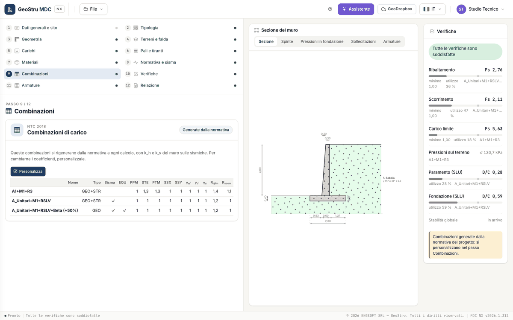
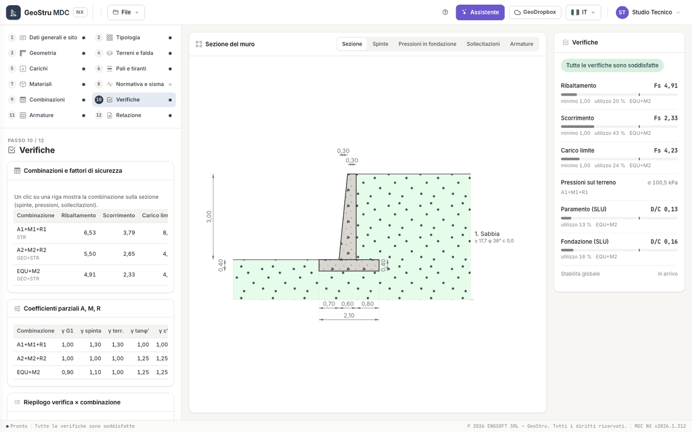
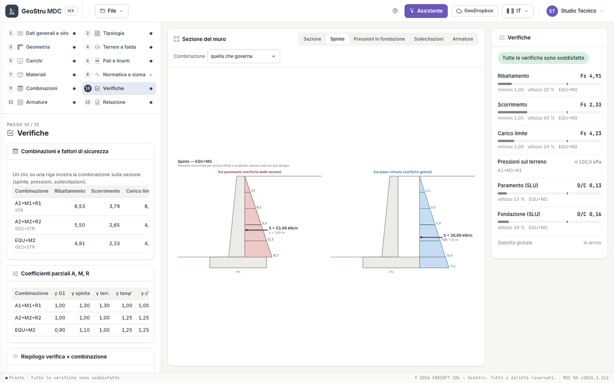
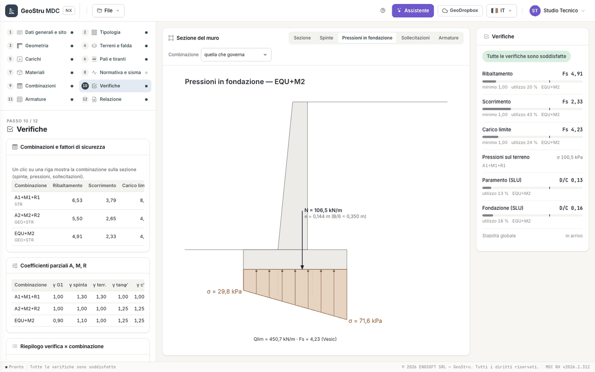
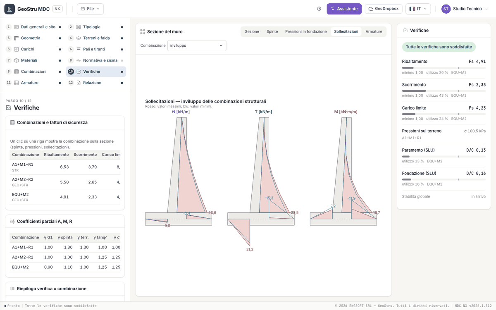
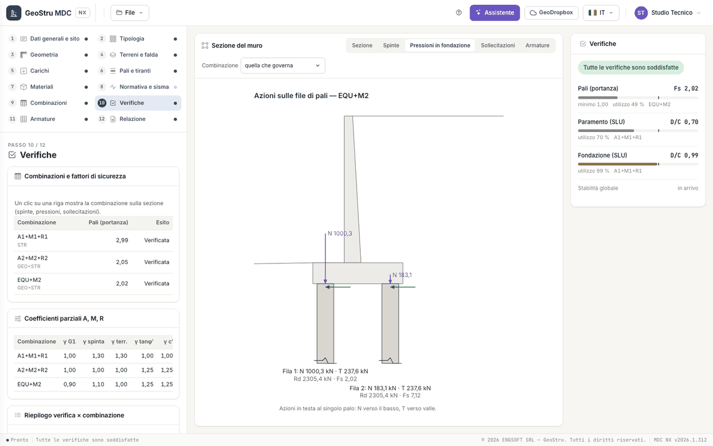

# Combinazioni e verifiche

## Le combinazioni

Il passo 9 · **Combinazioni** mostra le combinazioni di carico del progetto. L'etichetta in alto dice se sono **Generate dalla normativa**
o **Personalizzate**.

- **Generate dalla normativa** (progetto nuovo): si rigenerano a ogni calcolo dalla normativa geotecnica del passo
  [Normativa e sisma](sisma.md), con k~h~ e k~v~ del muro sulle sismiche. La tabella è in sola lettura.
- **Personalizza** le copia nel progetto: da quel momento nome, tipo, caselle e coefficienti si modificano nella tabella.
  **Torna alla normativa** le rigenera, dopo una conferma (le personalizzazioni si perdono).

Un progetto aperto dal desktop porta le sue combinazioni, che sono quindi personalizzate.

| Colonna | Significato |
|---|---|
| Nome, Tipo | Tipo GEO, STR, GEO+STR o SLE: decide quali verifiche usano la combinazione (globali, strutturali, di esercizio) |
| Sisma, EQU | combinazione sismica; combinazione di equilibrio (ribaltamento) |
| PPM, STE, PTM | coefficienti su peso proprio del muro, spinta del terreno, peso del terreno sulla mensola |
| SSX, SSY | coefficienti sull'incremento sismico orizzontale e verticale |
| TIR | coefficiente sul tiro dei tiranti (solo con tiranti) |
| γ~φ'~, γ~c'~, γ~γ~ | coefficienti parziali su tan φ′, c′ e peso del terreno |
| R~qlim~, R~scorr~, R~rib~ | coefficienti R di carico limite, scorrimento e ribaltamento |
| k~h~, k~v~ | coefficienti sismici della combinazione |

I coefficienti dei singoli carichi distribuiti e concentrati sono nel progetto, uno per carico; l'assistente li legge e li scrive.

### NTC 2018

| Combinazione | Tipo | Azioni | M | R (carico limite / scorrimento / ribaltamento / terreno a valle) |
|---|---|---|---|---|
| A1+M1+R3 | GEO+STR | PPM 1; STE 1,3; PTM 1,3; carichi 1,5 | 1 | 1,4 / 1,1 / 1,15 / 1,4 |
| A_Unitari+M1+RSLV | GEO+STR, sismica | tutte 1 | 1 | 1,2 / 1,0 / 1,0 / 1,2 |
| A_Unitari+M1+RSLV+Beta (+50%) | GEO, sismica, EQU | tutte 1 | 1 | 1,2 / 1,0 / 1,0 / 1,2; k~h~ e k~v~ × 1,5 |

### NTC 2008 ed Eurocodici

| Combinazione | Tipo | Azioni | M |
|---|---|---|---|
| A1+M1+R1 | STR | PPM 1; STE 1,3; PTM 1,3; carichi 1,5 | 1 |
| A2+M2+R2 | GEO+STR | tutte 1; carichi 1,3 | NTC 2008: γ~φ'~ = γ~c'~ = 1,25; Eurocodici: 1,1 e 1,2 come il desktop |
| EQU+M2 | GEO+STR | PPM 0,9; STE 1,1; PTM 1; carichi 1 | come A2+M2+R2 |

In queste norme i coefficienti R valgono 1. Le combinazioni generate non comprendono combinazioni di esercizio: per le verifiche di
tensione e fessurazione personalizza le combinazioni e dai tipo **SLE** a quelle che ti servono. Con NTC 2008 ed Eurocodici non nascono
combinazioni sismiche: con il sisma, personalizza e attiva la casella **Sisma**, scrivendo k~h~ e k~v~ nella riga.

I coefficienti M riducono i parametri del terreno (tan φ′/γ~φ'~, c′/γ~c'~); quelli A amplificano le azioni; quelli R dividono le resistenze.

## Il passo Verifiche

Il passo 10 · **Verifiche** ha tre tabelle, più i coefficienti sismici del sito e gli avvisi del calcolo.

| Tabella | Che cosa leggi |
|---|---|
| Combinazioni e fattori di sicurezza | per ogni combinazione: ribaltamento, scorrimento, carico limite, σ max [kPa] ed esito; per il muro su pali la portanza dei pali. «--» dove la verifica non riguarda la combinazione |
| Coefficienti parziali A, M, R | γ G1, γ spinta, γ terr., γ tanφ′, γ c′, γR qlim, γR scorr., γR rib. |
| Riepilogo verifica × combinazione | domanda, capacità, rapporto D/C ed esito di ogni verifica globale e di ogni parte in c.a. |

Un clic su una riga della prima tabella mostra quella combinazione nella sezione al centro.

## Il pannello Verifiche

A destra, sempre visibile, il pannello riassume il progetto con il valore della **combinazione che governa**: fattore di sicurezza F~s~
contro il minimo, oppure rapporto domanda/capacità D/C, con una barra di utilizzo.

| Voce | Che cosa riporta |
|---|---|
| Ribaltamento | F~s~ = momento stabilizzante / momento ribaltante attorno allo spigolo di valle |
| Scorrimento | F~s~ = resistenza / azione lungo il piano di posa |
| Carico limite | F~s~ = carico limite di progetto / carico verticale |
| Pressioni sul terreno | σ massima sotto la base (informativa) |
| Paramento, Fondazione, Dente (SLU) | D/C delle sezioni in c.a. |
| Pali (portanza) | F~s~ della fila critica |
| Muro a gravità (tensioni) | D/C delle tensioni nel corpo del muro |
| Tiranti | D/C fra tiro di progetto e resistenza |
| Stabilità globale | in arrivo |

In cima la sintesi: «Tutte le verifiche sono soddisfatte», «Alcune verifiche non sono soddisfatte», «Verifiche non calcolate» o «Dati
incompleti». Il **rosso** compare solo su ciò che non verifica; l'**ambra** segnala un margine inferiore al 10 %. Un clic su una voce apre la
vista che la spiega. Sotto, gli avvisi del calcolo: i primi due in chiaro, gli altri in **Altri avvisi del calcolo**.

## Le viste della sezione

Sopra la sezione cinque linguette: **Sezione**, **Spinte**, **Pressioni in fondazione**, **Sollecitazioni**, **Armature**. Nelle viste dei
risultati la tendina **Combinazione** sceglie «quella che governa», una combinazione o l'«inviluppo».

| Vista | Contenuto |
|---|---|
| Sezione | il muro quotato con strati, falda, carichi, pali e tiranti |
| Spinte | diagrammi delle pressioni sul paramento e sul piano virtuale, con la stessa scala, e le risultanti |
| Pressioni in fondazione | diagramma trapezio o triangolare sotto la base con nocciolo, eccentricità e carico limite; per il muro su pali le azioni in testa a ogni fila |
| Sollecitazioni | N, T e M disegnati su paramento e fondazione, per combinazione o inviluppo |
| Armature | i ferri in sezione con «n Ø d» e i ripartitori |

Nel muro su pali la vista Pressioni in fondazione mostra le azioni N e T in testa al singolo palo di ogni fila, con portanza e F~s~.

## Quando un muro non verifica

| Verifica | Leve |
|---|---|
| Scorrimento | base più larga, fondazione con dente, piano di posa inclinato, spinta passiva a valle (se il terreno davanti al muro è affidabile) |
| Ribaltamento | suola di monte più lunga, paramento spostato verso monte |
| Carico limite | base più larga, eccentricità più piccola, piano di posa più profondo |
| Sezioni | spessori maggiori, più ferri o diametro maggiore, classe di calcestruzzo superiore |

Le formule delle verifiche sono in [Verifiche globali](teoria-verifiche.md).

---

*Hai trovato un errore in questa pagina? [Segnalacelo](mailto:info@geostru.ai?subject=Help%20MDC%20NX) o apri una [Pull Request](https://github.com/EngSoft-Geostru/geostru-help-nx/edit/main/mdc/docs/it/verifiche.md).*
