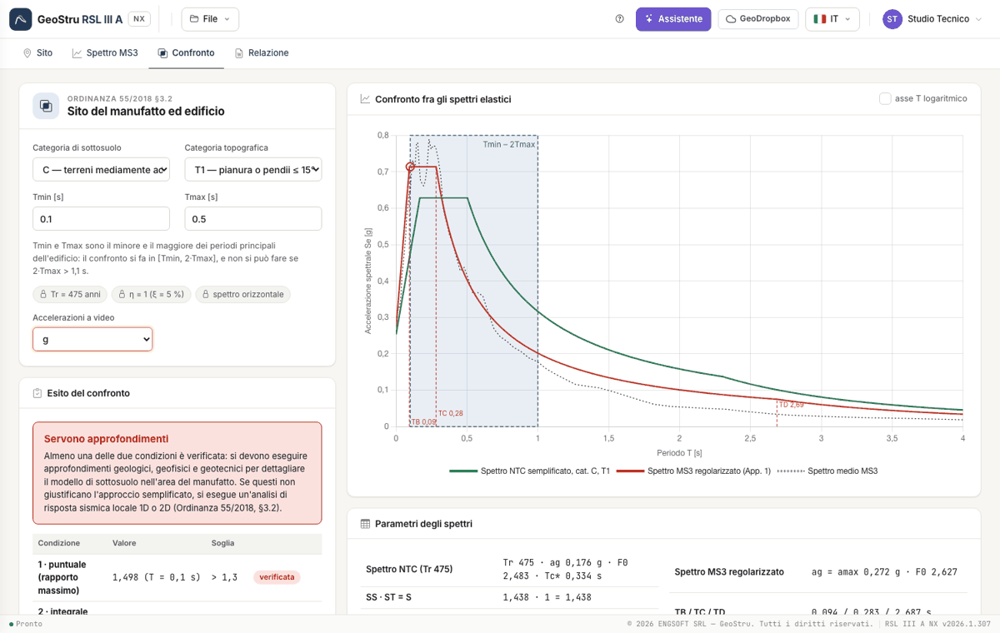

# Comparison

## The choices

- **Subsoil category** (A–E) and **topographic category** (T1–T4) of the building site: they give S~S~, C~C~ and S~T~ of the NTC spectrum.
- **T~min~** and **T~max~**: the smallest and the largest of the main vibration periods of the building, from the structural analysis. The
  comparison interval is **[T~min~, 2·T~max~]**: the factor 2 accounts for the lengthening of the period during the earthquake.
- **Accelerations on screen**: g or m/s². It changes only the display.

The following are set by the Ordinance and shown as such: **T~R~ = 475 years**, **η = 1** (5 % damping), **horizontal spectrum**.

## The chart

Simplified NTC spectrum (green), regularised MS3 spectrum (red), MS3 spectrum of the study (dotted), [T~min~, 2·T~max~] band and verticals T~B~,
T~C~, T~D~ of the regularised spectrum. The circle marks the period of the maximum ratio. The T axis can be logarithmic.

## The two conditions

| Condition | What is measured | Threshold |
|---|---|---|
| 1 · pointwise (maximum ratio) | the maximum of the ratio Se,MS3/Se,NTC over the interval | > 1.30 |
| 2 · integral (area ratio) | (A~MS3~ − A~NTC~)/A~NTC~, with A the area under the spectrum over the interval | > 20 % |

A value exactly equal to the threshold does not exceed it.

## The outcome

- **Simplified approach can be used**: neither of the two conditions is met.
- **Further investigations required**: at least one is met. Geological, geophysical and geotechnical investigations are carried out; if they
  do not justify the simplified approach, a 1D or 2D local seismic response analysis is performed.
- **Comparison not applicable**: 2·T~max~ exceeds 1.1 s (note 1 of the Ordinance). The conditions remain visible for information.

Below the conditions you find, for information, the share of points at a 0.01 s step where the MS3 spectrum exceeds the code spectrum: it is
the reading made by the desktop program, **not** condition 1 of the Ordinance. The coloured dot on the **Comparison** tab sums up the outcome
from any tab.

---

*Found an error on this page? [Let us know](mailto:info@geostru.ai?subject=Help%20RSL%20III%20A%20NX) or open a [Pull Request](https://github.com/EngSoft-Geostru/geostru-help-nx/edit/main/rsl3a/docs/en/confronto.md).*
