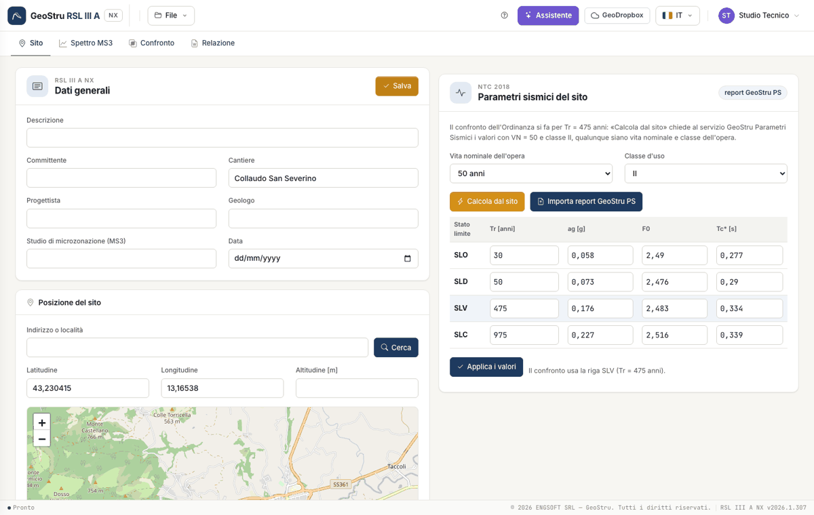
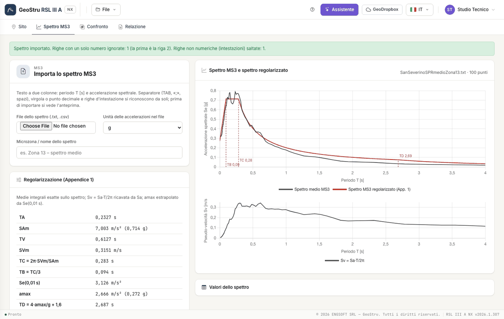
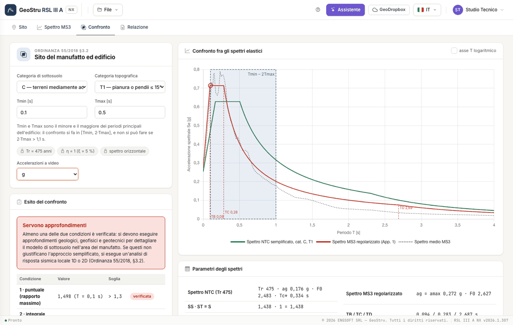

# Quick start (5 minutes)

You reach the outcome with the example of the manual: San Severino Marche, microzone 13. If you already have your own files, follow the same
steps with them. To see the result straight away, open **File → Example**.

## 1. The site

Open [nx.geostru.ai/rsl3a](https://nx.geostru.ai/rsl3a/). In the **Site** tab, enter the construction site and place the site: click on the map,
or type latitude and longitude in the fields. Press **Save**. Then press **Compute from site**: a~g~, F~0~ and T~c~* come from the GeoStru Seismic
Parameters service, with the **SLV at 475 years** row used by the comparison. As an alternative, import a GeoStru PS report with **Import GeoStru
PS report**.

## 2. The MS3 spectrum

In the **MS3 spectrum** tab, choose the file of the study (two-column text: period and acceleration). The preview shows the first lines of the
file, the first values read and the warnings: in the San Severino file the line «0.04», with a single number, is discarded. Press **Import**:
the regularisation is computed at once.

## 3. The comparison

In the **Comparison** tab, choose the **subsoil category** (C in the example) and the **topographic** category (T1), then enter **T~min~ = 0.1 s**
and **T~max~ = 0.5 s**. The chart shows the NTC spectrum (green), the regularised MS3 spectrum (red) and the [T~min~, 2·T~max~] band. The outcome
box says: maximum ratio 1.498 → condition 1 met; difference between the areas −17.2 % → condition 2 not met; **further investigations
required**.

## 4. The report

In the **Report** tab, check the **preview** and press **Generate Word**. The report uses NX credits; preview and CSV are free.

## Next steps

The [Workflow](workflow.md) explains all the options. The formulas are in [Theory](teoria.md).

---

*Found an error on this page? [Let us know](mailto:info@geostru.ai?subject=Help%20RSL%20III%20A%20NX) or open a [Pull Request](https://github.com/EngSoft-Geostru/geostru-help-nx/edit/main/rsl3a/docs/en/quickstart.md).*
