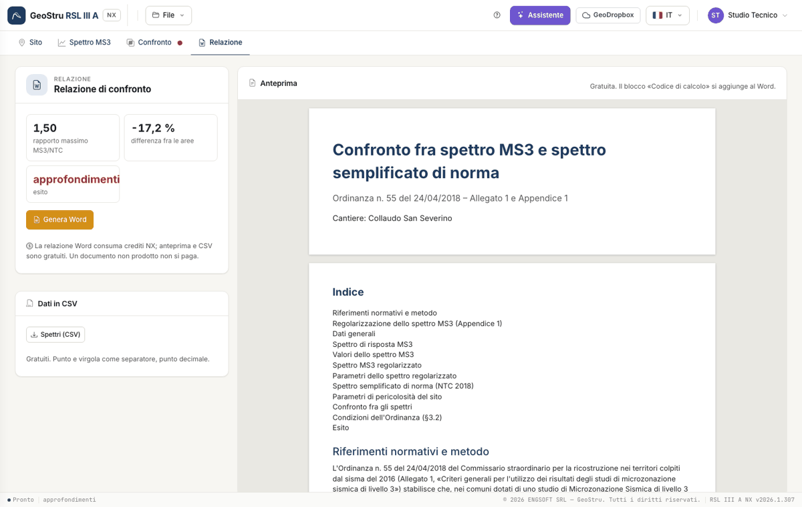

# Report and credits

## Preview

The **Report** tab shows the preview composed by the server with the same code as the document: it is free. If something is missing
(spectrum, parameters, periods) it tells you, with the link to the tab to complete.

## The Word document

**Generate Word** produces the document in the language of the interface:

1. cover with engineering firm, client, construction site, place and date;
2. regulatory references and method (Ordinance no. 55 of 24/04/2018, §3.2) and regularisation (Appendix 1, steps a–h);
3. general data, coordinates, nominal life and use class;
4. MS3 spectrum: file, microzone, points, maximum, chart, pseudo-velocity and table of values;
5. regularised spectrum with its parameters;
6. simplified code spectrum: source, T~R~, a~g~, F~0~, T~c~*, categories, S~S~, C~C~, S~T~, T~B~, T~C~, T~D~, and the parameters of the four limit states;
7. comparison: T~min~, T~max~, interval, chart, table of the two conditions with value and threshold, outcome;
8. **«Calculation code»** block (NTC §10.2) with the document code, which can be verified on geostru.ai.

## Credits

| Action | Cost |
|---|---|
| Import, parameters, regularisation, comparison, preview, CSV | free |
| Word report | NX credits |
| Message to the assistant | NX credits |

A failed operation is not charged, and generating the same document again with the same data is not charged twice. With a subscription to the
app, no credits are used.

## CSV

**Spectra (CSV)**, also from the File menu: period, MS3 Se, regularised Se, NTC Se at the periods of the spectrum, «;» separator and decimal
point.

---

*Found an error on this page? [Let us know](mailto:info@geostru.ai?subject=Help%20RSL%20III%20A%20NX) or open a [Pull Request](https://github.com/EngSoft-Geostru/geostru-help-nx/edit/main/rsl3a/docs/en/relazione.md).*
